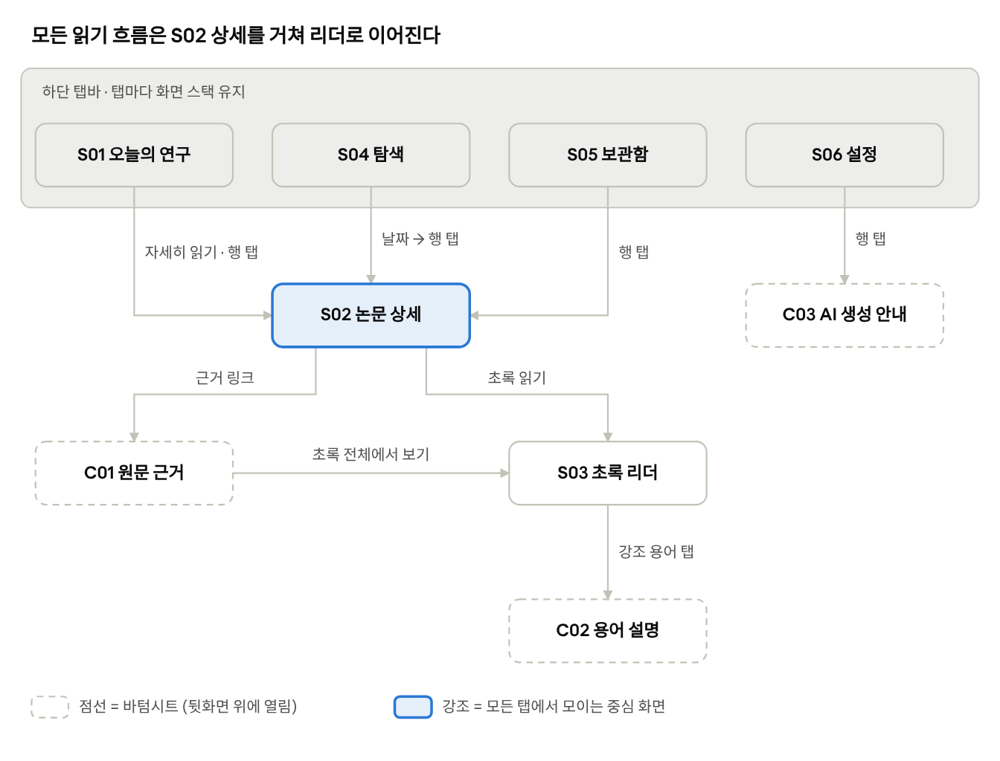
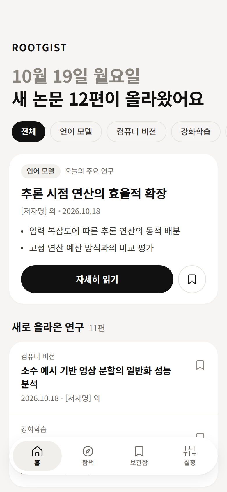
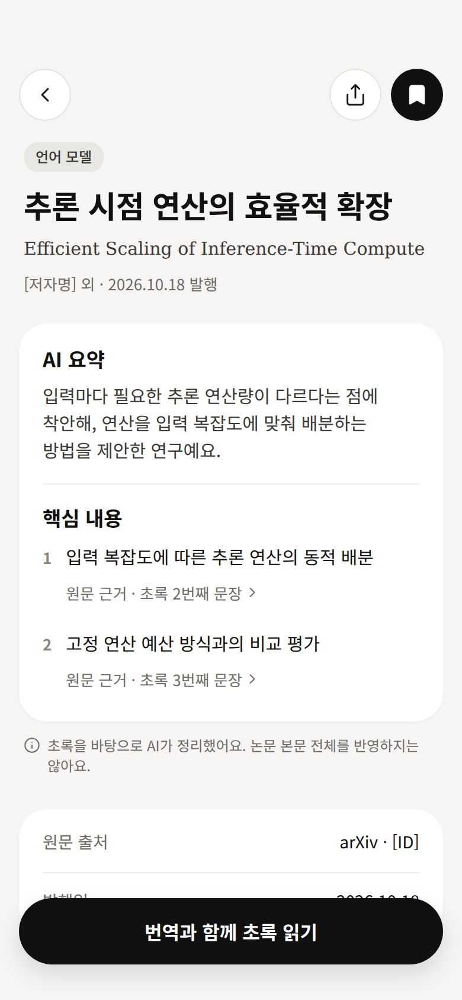
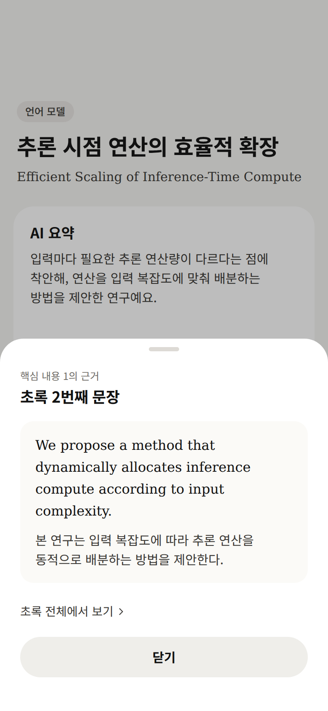
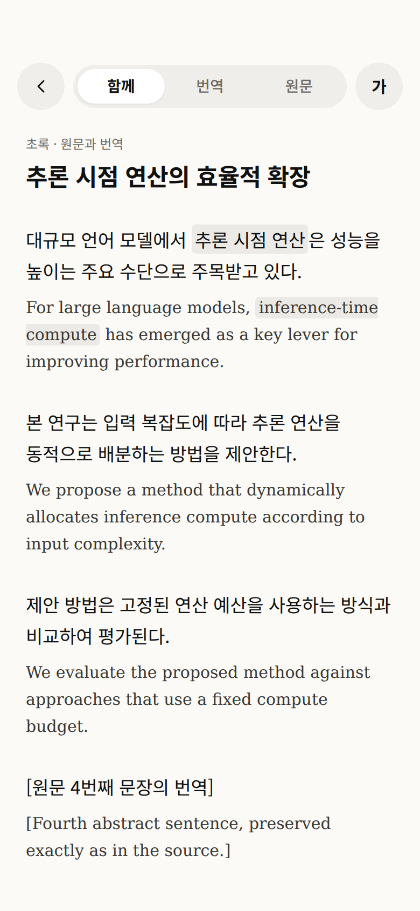
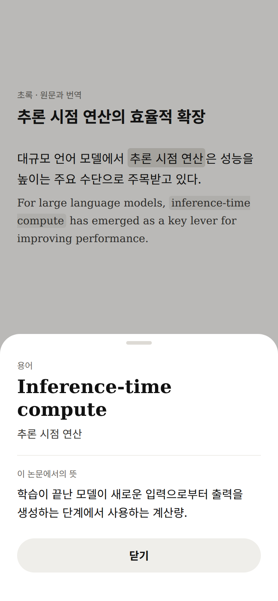
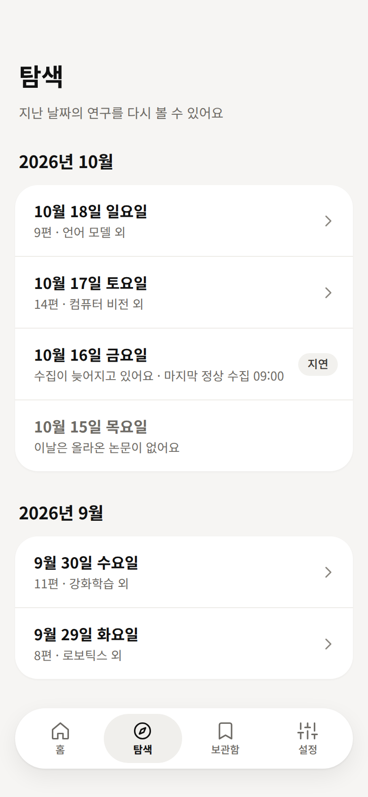
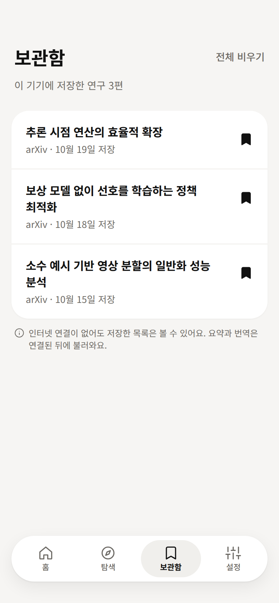
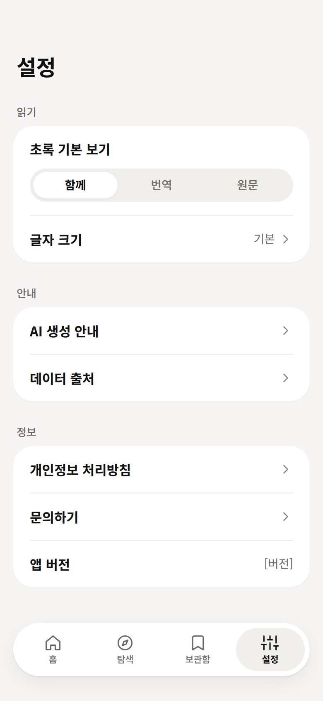

# ROOTGIST 앱 구현 인수인계서 v1 (Flutter MVP)

| 항목 | 내용 |
|---|---|
| 작성일 | 2026-10-21 |
| 목적 | 다른 PC나 새 Claude Code 세션에서 **이 문서 하나만 읽고** 앱 구현을 바로 시작한다 |
| 상위 기준 | UI: `docs/spec/ROOTGIST_UI_Spec_v2.1_Flutter.pdf`(2026-10-19). 데이터: `docs/contract/`(운영 설정 v1, 출력 스키마 `p2-output-v0.2`, 프롬프트 v0.5.2), P1 결재 A1~A7 |
| 디자인 시안 | `docs/design/ui_v2.1/` — PNG 9장(390×844pt @2x, PDF에서 추출), 캔버스 시안 HTML 원본, 화면별 정적 HTML(`source/`), 아이콘 SVG(`icons/`). 7.0절 표 참조 |
| 개발용 데이터 | `fixtures/` — 4.3절 모양의 **가상** 데이터 6일치·12편. 11장 참조 |
| 레포 공개 여부 | **공개 레포.** 0.1절 규칙을 지킨다 |
| 출처 | 비공개 연구 레포(ROOTGIST-research)의 검증 결과를 옮긴 것이다. `(연구 레포)`로 표시한 경로는 이 레포에 없다 |
| 표기 | **[확정]** 사용자 결정 완료 · **[명세]** UI 명세서 v2.1 그대로 · **[제안]** 이 문서의 권장안(승인 전) · **[결정 필요]** 10장 목록 |

충돌 시 우선순위 [명세]: 기능 범위는 MVP 명세, 스타일은 v6 규칙, **수치는 UI 명세서 v2.1**. 이 문서와 PDF가 다르면 PDF가 맞다.

---

## 0. 새 세션에서 시작하는 법

1. 이 레포 구성

   ```
   docs/
     HANDOFF.md                 이 문서 (출발점)
     spec/                      UI 구현 명세서 v2.1 PDF (수치 최종 기준)
     design/ui_v2.1/            시안 PNG, 원본 HTML, source/(화면별 정적 HTML), icons/(SVG)
     contract/                  출력 스키마, 프롬프트 v0.5.2, 운영 설정 v1
     reference/                 운영 제공처 비교, 배치 워커 구현 노트
   fixtures/                    가상 개발 데이터 (digests.json, digests/, papers/)
   ```
2. Flutter 프로젝트는 이 레포 루트에 만든다(`flutter create .`). `fixtures/`는 M0에서 `assets/fixtures/`로 옮기거나 pubspec에 등록한다.
3. 새 세션 첫 지시 예시:
   > `docs/HANDOFF.md`를 읽고 11장 마일스톤 M0부터 진행해줘. 디자인 수치는 5~7장과 `docs/design/ui_v2.1/source/`를 기준으로 해.
4. 준비물: Flutter stable(3.x), Xcode(iOS), Android Studio. 백엔드 단계(M4)부터 Supabase 프로젝트와 NVIDIA API 키(개발용)가 필요하다.

### 0.1 공개 레포 규칙

- **실제 논문 초록·번역·LLM 출력을 커밋하지 않는다.** 초록 재게시·번역 권리(A8)가 미결이다. fixture·테스트·스크린샷은 가상 텍스트만 쓴다.
- fixture의 `paper_id`는 실존할 수 없는 `0000.0000N` 형식(월 00)이다. 실제 ID 형식과 섞지 않는다.
- API 키, Supabase service key, `.env`를 커밋하지 않는다(`.gitignore`에 `.env` 추가). 앱에는 Supabase **anon key만** 넣고 RLS로 읽기 전용을 보장한다.
- 배치 워커가 받은 원본 응답·생성 결과는 DB나 비공개 저장소에 두고 레포에 넣지 않는다.

---

## 1. 제품 한 줄 요약과 범위

HF Daily Papers에서 **매일 상위 10편**을 골라, 초록만 근거로 한 **한국어 요약·핵심 내용(근거 문장 연결)·문장별 번역·용어 해설**을 보여 주는 읽기 앱.

| 포함 (MVP) | 제외 (MVP) [명세] |
|---|---|
| 화면 8개(S01~S06) + 시트 3개(C01~C03) | 검색, 계정·로그인, 동기화, 알림 벨, AI 채팅 |
| 북마크 **기기 로컬 저장** | 논문 이미지, AI 썸네일, 장식 일러스트 |
| 초록 보기 모드(함께/번역/원문), 글자 크기 4단계 | 설명 수준 선택(standard 고정) |
| 로딩·빈·오류·오프라인·지연 상태 | 유채색, 분야별 색, 그라디언트, 강한 그림자 |

불변 원칙 [명세]
- 무채색만 쓴다. 검정 채움은 주 버튼, 선택된 필터, 저장된 북마크에만.
- 면의 층: 오프화이트 배경 → 흰 카드 → 떠 있는 요소.
- S03 리더에는 본문을 덮는 플로팅 요소를 두지 않는다.
- 근거 없는 핵심 내용, 검증되지 않은 기관 정보는 출력하지 않는다.

---

## 2. 이미 확정된 결정 (앱에 영향 있는 것만)

| 결정 | 내용 | 출처 |
|---|---|---|
| 하루 편수 | 상위 **10편**만 해설 생성. 0편이면 빈 날 | A1 [확정] |
| 선별·동점 | upvote 내림차순 → `paper.publishedAt` 최신순 → `paper_id` 오름차순. upvote는 배치 시각 값으로 고정 저장 | A2·A4 [확정] |
| 원문 링크 | `https://huggingface.co/papers/{id}` 기본, `https://arxiv.org/abs/{id}` 보조 | A3 [확정] |
| 기관 표기 | HF `paper.organization`은 저자 소속이 아니라 **게시 조직**. 그렇게 표기하고 없으면 미표시 | A5 [확정] |
| LaTeX | 앱 후처리로 표시 문자 변환(`\%`→`%` 등, 8.3절) | A6 [확정] |
| 배치 | 매일 **KST 05:00**, 전날(UTC D) 목록 처리. 다음 날 재조회로 늦게 추가된 논문은 보관 목록에만 추가, 노출한 10편은 바꾸지 않음 | A7 [확정] |
| 모델 | 기본 `deepseek-v4.1-flash`, 예비 `glm-5.3-flash`, temperature 0, max_tokens 32,000, 실패 시 1회 재시도 후 예비 | ops config v1 [확정] |
| 프롬프트/스키마 | `p2-prompt-v0.5.2` / `p2-output-v0.2` | [확정] |
| 제공처 | **개발·내부 테스트는 NVIDIA 무료 등급, 외부 공개(지인 베타 포함) 전에 DeepSeek 공식 API(예비 Z.ai)로 전환** | [확정] |
| 권리 | A8(HF 약관·초록 재게시·번역 권리) **미결** → 권리 확인 전 외부 공개 보류 | [확정] |
| 문장 ID | 초록 문장 `A01~`(화면 ID S01~와 구분). 화면에는 노출하지 않음 | MVP v1.2 D7, [명세] |

---

## 3. 전체 구조 [제안]

```
[KST 05:00 배치 워커 (Python)]
  HF daily_papers?date=D 수집 → 상위 10편 선별 → 문장 분할(A01~)
  → LLM 호출(auto_select) → 검증(스키마·문장ID·근거ID) → 후처리 → DB 저장
                │
                ▼
[Supabase Postgres]  ← 배치만 쓰기(service key), 앱은 읽기 전용(anon + RLS)
                │  읽기 API 3개 (4.3절)
                ▼
[Flutter 앱]  Repository 인터페이스 → (M0~M3: 로컬 fixture JSON / M5: Supabase)
             로컬: 북마크·설정·응답 캐시(Hive)
```

- **앱은 Repository 인터페이스에만 의존**한다. 백엔드가 늦어도 fixture JSON으로 화면 전체를 먼저 완성한다(M0~M3).
- 배치 실행 위치 [제안]: GitHub Actions 예약 실행(`cron: "0 20 * * *"` = KST 05:00). 1회 최대 약 1시간(예비 모델 전환 시) 걸리므로, 요청 시간 제한이 짧은 서버리스 함수는 맞지 않을 수 있다. GitHub 예약 실행은 몇 분~수십 분 늦게 시작될 수 있음을 감안한다.
- 배치 워커는 `docs/reference/batch_worker_notes.md`를 기준으로 새로 작성한다. 연구 레포에서 검증한 수집 규칙, 문장 분할기(`d691502`) 핵심 코드, 호출 설정, 출력 검사 1~5가 들어 있다.

---

## 4. 데이터 계약

### 4.1 수집원 필드 (P1 검증 결과)

`GET https://huggingface.co/api/daily_papers?date=YYYY-MM-DD&limit=..&p=..`

| 앱 필드 | API 경로 | 제공률 | 비고 |
|---|---|---|---|
| `paper_id` (= arXiv ID) | `paper.id` | 100% | 링크는 ID로 만든다(URL 필드 0%) |
| `title_en` | `paper.title` | 100% | |
| `abstract_en` | `paper.summary` | 100% | 538~1,919자. **원문 문자열을 바꾸지 않고 저장** |
| `authors` | `paper.authors[].name` | 100% | 저자 소속 정보 없음 |
| `org_name` | `paper.organization.fullname` | 72.9% | **게시 조직**. 저자 소속으로 쓰지 않음 |
| `published_at` | `paper.publishedAt` | 100% | 최상위 `publishedAt`(4시간 이름) 말고 이것 |
| `upvotes` | `paper.upvotes` | 100% | 배치 시각 값 고정 |
| — | `withdrawnAt` 있음 | — | 철회 논문은 제외 |
| — | `ai_summary`, `ai_keywords` | — | HF 생성값, **사용 금지** |

### 4.2 LLM 출력 (`p2-output-v0.2`)

원본: `docs/contract/p2_output_schema_v0.2.json`

| 필드 | 형태 | 화면 사용처 |
|---|---|---|
| `title_ko` | 문자열 ≤300 | S01 카드·행 제목, S02 제목, S03 제목, S05 행 |
| `summary_ko` | 2~4문장 (실측 396~669자) | S02 「AI 요약」 |
| `key_points[]` | 0~3개 `{claim_ko, evidence_sentence_ids[1..4]}` | S01 추천 카드 불릿(최대 2), S02 「핵심 내용」, C01 |
| `sentence_translations[]` | `{sentence_id, translation_ko}`, `kind=text` 문장 전부 1:1 | S03 문장 쌍, C01 번역 줄 |
| `glossary[]` | 0~8개 `{term, definition_ko, context_ko, sentence_ids, term_id, term_difficulty, explanation_level}` | S03 하이라이트, C02 |
| `topic_tags[]` | 1~2개, 첫 항목이 대표. `llm`·`agent`·`multimodal`·`optimization`·`other` | 배지, 필터 칩, S04 「대표 분야」 |
| `limitations[]` | 문자열 배열 | MVP 화면 미사용(저장만) |

운영 모드 [제안]: **`auto_select` 1회 호출만**(용어 DB가 아직 없으므로 `fixed_terms` 불가. 비용 월 약 $1.2).

### 4.3 앱이 읽는 JSON (Repository 계약) [제안]

백엔드가 무엇이든 앱은 아래 세 모양만 받는다. M0의 fixture도 같은 모양으로 만든다.

**① 날짜 목록** `listDigests(beforeDate?, limit)` — S04, 홈 상태

```json
{
  "digests": [
    {"digest_date": "2026-10-19", "source_date": "2026-10-18", "status": "published",
     "paper_count": 10, "primary_topic": "llm", "last_success_at": "2026-10-18T20:12:00Z"},
    {"digest_date": "2026-10-16", "source_date": "2026-10-15", "status": "delayed",
     "paper_count": 0, "primary_topic": null, "last_success_at": "2026-10-16T00:00:00Z"},
    {"digest_date": "2026-10-15", "source_date": "2026-10-14", "status": "empty",
     "paper_count": 0, "primary_topic": null, "last_success_at": "2026-10-14T20:05:00Z"}
  ],
  "next_cursor": "2026-09-30"
}
```

`status`: `published` | `empty`(0편) | `delayed`(배치 미완료·실패, 재시도 대기). `digest_date`는 KST 날짜(배치일), `source_date`는 HF에 넘긴 UTC 날짜 D.

**② 하루 다이제스트** `getDigest(digestDate)` — S01

```json
{
  "digest_date": "2026-10-19", "status": "published", "last_success_at": "2026-10-18T20:12:00Z",
  "featured_paper_id": "0000.00001",
  "papers": [
    {"paper_id": "0000.00001", "rank": 1, "title_en": "…", "title_ko": "…", "first_author": "…", "author_count": 6,
     "published_at": "2026-10-18", "topic_primary": "llm", "topic_secondary": null,
     "key_points_preview": ["…", "…"], "ai_status": "ready"}
  ]
}
```

**③ 논문 상세** `getPaper(paperId)` — S02, C01, S03, C02

```json
{
  "paper_id": "0000.00001", "title_en": "…", "title_ko": "…",
  "authors": ["…"], "org_name": null, "published_at": "2026-10-18",
  "hf_url": "https://huggingface.co/papers/0000.00001", "arxiv_url": "https://arxiv.org/abs/0000.00001",
  "topic_primary": "llm", "topic_secondary": "optimization",
  "ai_status": "ready",
  "summary_ko": "…",
  "key_points": [{"claim_ko": "…", "evidence_sentence_ids": ["A02"]}],
  "sentences": [{"sentence_id": "A01", "kind": "text", "text": "…(원문 그대로)", "translation_ko": "…"}],
  "glossary": [{"term": "inference-time compute", "definition_ko": "…", "context_ko": "…",
                "sentence_ids": ["A01"], "highlight": true}]
}
```

- `ai_status`: `ready` | `pending`(해설 준비 중, 다음 배치 재시도) | `failed`. `ready`가 아니면 S02는 제목 블록 + 13장 오류/준비 중 카드.
- `sentences`에는 `kind=link|meta`도 들어 있다. S03은 **`kind=text`만** 쌍으로 보여 준다.
- `glossary[].highlight`는 서버 검증 결과(8.4절). `false`면 앱은 강조하지 않는다.

### 4.4 DB 테이블 [제안]

| 테이블 | 주요 칸 |
|---|---|
| `digests` | `digest_date` PK, `source_date`, `status`, `paper_count`, `last_success_at`, `late_added_count` |
| `papers` | `paper_id` PK, `title_en`, `abstract_en`, `abstract_sha256`, `authors` text[], `org_name`, `published_at`, `withdrawn` |
| `digest_papers` | (`digest_date`, `paper_id`) PK, `rank`, `upvotes_at_batch`, `is_featured`, `is_exposed`(상위 10편 여부) |
| `paper_sentences` | (`paper_id`, `sentence_id`) PK, `start`, `end`, `kind`, `splitter_version` |
| `paper_ai` | `paper_id` PK, `abstract_sha256`, `status`, `title_ko`, `summary_ko`, `topic_primary`, `topic_secondary`, `model_id`, `prompt_version`, `schema_version`, `generated_at`, `raw_response` jsonb |
| `paper_key_points`, `paper_translations`, `paper_glossary` | `paper_ai` 하위. 출력 필드 그대로 + `highlight` |

상세 JSON(③)은 이 테이블을 묶는 읽기 전용 함수(RPC) 또는 뷰로 만든다. 운영 용어 DB(`terms`, `term_senses` 등)는 `docs/term_matching_plan_v0.1.md`(연구 레포) 소관이며 MVP 1차 구현 범위 밖이다.

---

## 5. 디자인 토큰 [명세]

화면 코드에 HEX·숫자를 직접 쓰지 않는다. 모든 수치 단위는 pt = Flutter 논리 픽셀. 기준 기기 iPhone 14(390×844).

### 5.1 컬러

| 토큰 | HEX | 쓰는 곳 |
|---|---|---|
| `bgApp` | `#F6F5F3` | S01·S02·S04·S05·S06 배경 |
| `bgReading` | `#FBFAF7` | S03 배경, C01 근거 박스 |
| `surfaceCard` | `#FFFFFF` | 카드, 시트, 탭바, 원형 버튼, 세그먼트 선택 알약 |
| `textPrimary` | `#111111` | 제목, 본문, 선택 탭 라벨 |
| `textBody` | `#3A3835` | 요약 불릿, 영문 원문, 미선택 필터 글자 |
| `textSecondary` | `#6E6B66` | 메타, 캡션, 미선택 탭·세그먼트 라벨 |
| `textTertiary` | `#8A867F` | 홈 헤드라인 날짜 줄, 번호, 미저장 북마크, 셰브론 |
| `fillBadgeOnCard` | `#F2F1EE` | 흰 카드 안 배지 |
| `fillBadgeOnBg` | `#E9E7E3` | 앱 배경 위 배지 |
| `fillNeutral` | `#EFEEEA` | 리더 원형 버튼, 세그먼트 트랙, 시트 닫기 버튼, 스켈레톤 |
| `fillSelected` | `#F0EFEC` | 하단 탭 선택 알약 |
| `borderDefault` | `#E6E3DE` | 미선택 필터, 외곽선 원형 버튼 |
| `dividerCard` | `#EEECE8` | 카드 안 행 구분선(1pt) |
| `dividerReading` | `#ECE9E4` | 리더 내 최소 구분 |
| `highlight` | `#ECEAE6` | 용어 하이라이트 기본 |
| `highlightActive` | `#DEDBD5` | 용어 누름·시트 열림 |
| `actionPrimary` | `#111111` | 주 버튼, 선택 필터, 저장됨 버튼(위 글자·아이콘 `#FFFFFF`) |
| `overlayDim` | `rgba(17,17,17,0.28)` | 바텀시트 뒷배경 |
| `grabber` | `#DDDAD5` | 시트 손잡이 |

### 5.2 타이포그래피

한글 UI·번역: **Pretendard** → Apple SD Gothic Neo → Noto Sans KR. 영문 원문·용어 원어: **Source Serif 4** → Georgia. Flutter `height = 행간 / 크기`.

| 토큰 | 크기/행간 | Weight | 자간 | 쓰는 곳 |
|---|---|---|---|---|
| `displayHome` | 30/39 | 700 | -0.4 | S01 두 줄 헤드라인 |
| `titleDetail` | 26/35 | 700 | -0.3 | S02 제목, S04~S06 화면 제목 |
| `titleReader` | 22/31 | 700 | -0.2 | S03 논문 제목 |
| `titleFeatured` | 21/29 | 700 | -0.3 | 추천 카드 제목 |
| `titleSection` | 18/25 | 700 | -0.2 | 섹션 제목, 시트 제목 |
| `titleCard` | 17/24 | 700 | 0 | 카드 내부 제목(AI 요약, 핵심 내용) |
| `titleList` | 16/23 | 600 | -0.2 | 목록 행 제목, 설정 행 라벨 |
| `bodyReaderKo` | 17/29 | 400 | -0.1 | 리더 한국어 번역 |
| `bodyDefinition` | 16/26 | 400 | 0 | 용어 정의 |
| `bodySummary` | 15/23 | 400 | 0 | 요약, 핵심 내용, 불릿 |
| `bodySmall` | 14/21 | 400 (필터 500/600) | 0 | 보조 본문, 필터 라벨 |
| `meta` | 13/18 | 400 | 0 | 저자·날짜, 근거 링크 |
| `caption` | 12/16~17 | 400~500 | 0 | 배지, 캡션, 카테고리 |
| `tabLabel` | 11/14 | 500 (선택 600) | 0 | 하단 탭 라벨 |
| `serifTogether` | 14/22 serif | 400 | 0 | 함께 보기 영문(iOS QA에서 15/25 → 14/22) |
| `serifOnly` | 18/30 serif | 400 | 0 | 원문만 보기 영문 |
| `serifTerm` | 26/32 serif | 600 | 0 | C02 용어 원어 |
| `serifSubtitle` | 15/22 serif | 400 | 0 | S02 영문 원제 |

11~13pt는 보조 정보에만 쓴다.

### 5.3 간격·모서리·그림자·아이콘

| 구분 | 값 |
|---|---|
| 간격 스케일 | 2·4·6·8·10·12·14·16·18·20·24·28·32·40 |
| 화면 좌우 여백 | 카드 16, 카드 밖 텍스트 20, 리더 본문 24 |
| 카드 내부 여백 | 위아래 18, 좌우 20 (목록 행은 오른쪽 8 + 44 버튼) |
| 섹션 간격 | 28 (탐색 월 그룹 사이 32) |
| 모서리 | 카드 24, 시트 상단 28, 근거 박스 16, 용어 하이라이트 4, 버튼·칩·탭바 완전 알약(999) |
| 그림자: 카드 | `0 1 2 rgba(0,0,0,.04)` |
| 그림자: 탭바 | `0 1 2 rgba(0,0,0,.06)` + `0 8 24 rgba(0,0,0,.07)` |
| 그림자: 하단 주 버튼 | `0 8 20 rgba(0,0,0,.12)` |
| 그림자: 세그먼트 선택 | `0 1 2 rgba(0,0,0,.06)` |
| 아이콘 | Lucide, 24 그리드, 선 굵기 1.75, 둥근 끝. 탭바 22, 버튼 안 20, 행 셰브론 18~20, 글자 옆 14 |

| 용도 | Lucide 이름 |
|---|---|
| 홈 / 탐색 / 보관함 / 설정 탭 | `house` / `compass` / `bookmark` / `sliders-vertical` |
| 북마크 | `bookmark` (저장됨은 채움) |
| 뒤로 / 공유 / 행 이동·근거 링크 / AI 안내 | `chevron-left` / `share` / `chevron-right` / `info` |

**아이콘은 `docs/design/ui_v2.1/icons/*.svg`를 그대로 쓴다.** 캔버스 시안에서 뽑은 경로로, Lucide 계열이지만 Lucide 원본과 경로가 다르다(예: house, compass, sliders-vertical은 단순화됨). 모두 viewBox 24, `stroke="currentColor"`, 선 굵기 1.75, 둥근 끝이다. `flutter_svg`로 넣고 `colorFilter`로 색을 입힌다. 저장된 북마크는 `bookmark-filled.svg`.

### 5.4 토큰 코드 (`lib/design/tokens.dart`, `typography.dart`)

PDF 14.2의 코드를 정리한 것이다. `RgSpace`는 PDF에 이름만 있어 5.3 스케일로 채웠다.

```dart
import 'package:flutter/material.dart';

abstract class RgColors {
  static const bgApp = Color(0xFFF6F5F3);
  static const bgReading = Color(0xFFFBFAF7);
  static const surfaceCard = Color(0xFFFFFFFF);
  static const textPrimary = Color(0xFF111111);
  static const textBody = Color(0xFF3A3835);
  static const textSecondary = Color(0xFF6E6B66);
  static const textTertiary = Color(0xFF8A867F);
  static const fillBadgeOnCard = Color(0xFFF2F1EE);
  static const fillBadgeOnBg = Color(0xFFE9E7E3);
  static const fillNeutral = Color(0xFFEFEEEA);
  static const fillSelected = Color(0xFFF0EFEC);
  static const borderDefault = Color(0xFFE6E3DE);
  static const dividerCard = Color(0xFFEEECE8);
  static const dividerReading = Color(0xFFECE9E4);
  static const highlight = Color(0xFFECEAE6);
  static const highlightActive = Color(0xFFDEDBD5);
  static const actionPrimary = Color(0xFF111111);
  static const onAction = Color(0xFFFFFFFF);
  static const overlayDim = Color(0x47111111); // 0.28
  static const grabber = Color(0xFFDDDAD5);
}

abstract class RgSpace {
  static const s2 = 2.0, s4 = 4.0, s6 = 6.0, s8 = 8.0, s10 = 10.0, s12 = 12.0, s14 = 14.0,
      s16 = 16.0, s18 = 18.0, s20 = 20.0, s24 = 24.0, s28 = 28.0, s32 = 32.0, s40 = 40.0;
  static const gutterCard = 16.0, gutterText = 20.0, gutterReader = 24.0;
  static const topBar = 52.0, bottomScrollInset = 136.0, minTouch = 44.0;
}

abstract class RgRadius {
  static const card = 24.0, sheet = 28.0, box = 16.0, term = 4.0, pill = 999.0;
}

abstract class RgShadow {
  static const card = [BoxShadow(color: Color(0x0A000000), offset: Offset(0, 1), blurRadius: 2)];
  static const tabBar = [
    BoxShadow(color: Color(0x0F000000), offset: Offset(0, 1), blurRadius: 2),
    BoxShadow(color: Color(0x12000000), offset: Offset(0, 8), blurRadius: 24),
  ];
  static const primaryFloating = [BoxShadow(color: Color(0x1F000000), offset: Offset(0, 8), blurRadius: 20)];
  static const segment = [BoxShadow(color: Color(0x0F000000), offset: Offset(0, 1), blurRadius: 2)];
}

abstract class RgText {
  static const _sans = 'Pretendard';
  static const _sansFallback = ['Apple SD Gothic Neo', 'Noto Sans KR'];
  static const _serif = 'SourceSerif4';

  static TextStyle _s(double size, double lh, FontWeight w, double ls, {bool serif = false}) => TextStyle(
        fontFamily: serif ? _serif : _sans,
        fontFamilyFallback: serif ? const ['Georgia'] : _sansFallback,
        fontSize: size,
        height: lh / size,
        fontWeight: w,
        letterSpacing: ls,
        color: RgColors.textPrimary,
      );

  static final displayHome = _s(30, 39, FontWeight.w700, -0.4);
  static final titleDetail = _s(26, 35, FontWeight.w700, -0.3);
  static final titleReader = _s(22, 31, FontWeight.w700, -0.2);
  static final titleFeatured = _s(21, 29, FontWeight.w700, -0.3);
  static final titleSection = _s(18, 25, FontWeight.w700, -0.2);
  static final titleCard = _s(17, 24, FontWeight.w700, 0);
  static final titleList = _s(16, 23, FontWeight.w600, -0.2);
  static final bodyReaderKo = _s(17, 29, FontWeight.w400, -0.1);
  static final bodyDefinition = _s(16, 26, FontWeight.w400, 0);
  static final bodySummary = _s(15, 23, FontWeight.w400, 0);
  static final bodySmall = _s(14, 21, FontWeight.w400, 0);
  static final meta = _s(13, 18, FontWeight.w400, 0);
  static final caption = _s(12, 16, FontWeight.w400, 0);
  static final tabLabel = _s(11, 14, FontWeight.w500, 0);
  static final serifTogether = _s(14, 22, FontWeight.w400, 0, serif: true);
  static final serifOnly = _s(18, 30, FontWeight.w400, 0, serif: true);
  static final serifTerm = _s(26, 32, FontWeight.w600, 0, serif: true);
  static final serifSubtitle = _s(15, 22, FontWeight.w400, 0, serif: true);
}
```

폰트: Pretendard(OFL) 400/500/600/700, Source Serif 4(OFL) 400/600만 `assets/fonts`에 번들한다. 워드마크 「ROOTGIST」는 17/700, 자간 +1.2.

---

## 6. 공통 위젯 9개 [명세]

화면은 이 위젯만 조합한다. 크기는 「시각 크기 / 터치 영역」.

| 위젯 | 크기 | 스타일 | 상태 |
|---|---|---|---|
| `RgBottomTabBar` | 좌우 16 띄움, 높이 64, 하단 30 위(SafeArea 하단과 비교해 큰 값) | surfaceCard 알약, 내부 여백 6, 4칸 균등(간격 4), 탭바 그림자. 아이콘 22 위 + 라벨 11/14 아래, 간격 2 | 선택: fillSelected 알약 + textPrimary 600 / 미선택: 배경 없음 + textSecondary 500 |
| `RgFilterChip` | 높이 36 / 터치 44, 좌우 여백 16 | 알약, 14pt | 선택: actionPrimary 채움 + 흰 글자 600 / 미선택: borderDefault 1pt + textBody 500 |
| `RgPrimaryButton` | 카드 안 48, 하단 고정 56 | actionPrimary 알약, 흰 글자 15~16/600. 하단 고정형은 주 버튼 그림자 | 눌림: 불투명도 0.85 |
| `RgCircleButton` | 44×44 (추천 카드 북마크 48) | 아이콘 20. 변형: `outline`(surfaceCard + borderDefault 1pt), `neutral`(fillNeutral), `filled`(actionPrimary + 흰 아이콘) | 북마크는 저장 시 filled |
| `RgCard` | 폭 = 화면 − 32 | surfaceCard, 모서리 24, 카드 그림자, clip | — |
| `RgListRow` | 최소 높이 56 | 여백 위18 / 오른8 / 아래18 / 왼20. 텍스트 열 + 오른쪽 44×44 북마크. 마지막 행 제외 dividerCard 1pt | 행 전체 탭 → 상세, 북마크는 따로 동작 |
| `RgBadge` | 높이 24, 여백 4/10 | 알약, 12/16 500 textBody. 카드 위 fillBadgeOnCard, 배경 위 fillBadgeOnBg | — |
| `RgSegmented` | 높이 40, 내부 여백 4, 간격 2 | 트랙 fillNeutral 알약, 3등분. 선택: surfaceCard 알약 + 세그먼트 그림자 + 14/600 textPrimary / 미선택: 14/500 textSecondary | 흰 알약 이동 AnimatedAlign 200ms easeOut |
| `RgBottomSheet` | 폭 전체, 높이 내용만큼(최대 85%) | surfaceCard, 상단 모서리 28, 여백 위10/좌우24/아래40, 손잡이 36×5 grabber 모서리 3, 뒷배경 overlayDim | 바깥 탭·뒤로가기·아래 스와이프로 닫힘. 닫으면 이전 스크롤·포커스 복원 |

공통 규칙
- 모든 아이콘 버튼에 `Semantics(label: …)`. 북마크는 「북마크에 저장」 / 「저장됨, 북마크 해제」.
- 하단에 떠 있는 요소(탭바 또는 주 버튼)가 있는 화면은 스크롤 끝에 **136** 여백.
- 상태바는 그리지 않는다. 시안 상단 54는 iPhone 14 상태바 자리이며 구현은 SafeArea 실제 값. **상단 바 높이 52 고정.**
- 눌림 피드백은 ripple 대신 불투명도 변화(0.85). 모든 터치 영역 44×44 이상.

---

## 7. 화면별 명세

### 7.0 이동 흐름



| ID | 화면 | 종류 | 배경 | 하단 요소 |
|---|---|---|---|---|
| S01 | 오늘의 연구 | 탭(홈) | bgApp | 탭바 |
| S02 | 논문 상세 | 푸시 | bgApp | 주 버튼 56 |
| C01 | 원문 근거 | 시트 | surfaceCard | — |
| S03 | 초록 원문·번역 | 푸시 | bgReading | 없음 |
| C02 | 용어 설명 | 시트 | surfaceCard | — |
| S04 | 탐색 | 탭 | bgApp | 탭바 |
| S05 | 보관함 | 탭 | bgApp | 탭바 |
| S06 | 설정 | 탭 | bgApp | 탭바 |
| C03 | AI 생성 안내 | 시트 | surfaceCard | — |

S02·S03은 탭 위에 푸시되어 **탭바를 숨긴다**. S02의 AI 안내 캡션과 S06 「AI 생성 안내」가 C03을 연다.

> 시안 속 논문 제목·문장·편수·날짜·분야명은 레이아웃 확인용 **예시**다. `[저자명]`, `[ID]`, `[버전]`은 실제 데이터 자리.

**디자인 파일** (`docs/design/ui_v2.1/`)

| 파일 | 내용 | 쓰는 법 |
|---|---|---|
| `*.png` | 화면 9장(흐름도 포함), 780×1688 = 390×844 @2x | 눈으로 비교할 때 |
| `ROOTGIST 모바일 화면 시안.html` | 캔버스 시안 원본. 8개 화면이 압축 번들로 들어 있다 | 브라우저로 열어 보기만(JavaScript 필요, 수정하지 않음) |
| `source/<화면>.html` | 위 번들에서 풀어 낸 화면별 정적 HTML. 모든 수치가 인라인 CSS로 있고, 화면 사이 링크가 연결됨 | **정확한 px 값을 확인할 때 가장 먼저 본다**(grep 가능) |
| `icons/*.svg` | 시안에 쓰인 아이콘 9종 | 앱 에셋으로 그대로 사용 |

- 정적 HTML의 수치는 PDF 명세와 대조해 일치함을 확인했다(S01·S02·S03). PDF에 없는 세부(예: 추천 카드 불릿 점과 글자 간격 10, 점 위치 위 10)는 `source/`를 따른다.
- 시안 HTML은 Pretendard를 불러오지 않는다(Google Fonts의 Noto Sans KR로 대체되어 보임). 앱은 5.2절대로 Pretendard를 번들한다.

### 7.1 S01 오늘의 연구 (홈)



| # | 요소 | 명세 | 위 간격 |
|---|---|---|---|
| 1 | 상단 바 | 높이 52, 좌우 20. 워드마크 「ROOTGIST」 17/700 자간 +1.2. 오른쪽 비움 | SafeArea |
| 2 | 헤드라인 | displayHome 2줄. 1줄 날짜·요일 textTertiary(예: 10월 19일 월요일), 2줄 「새 논문 N편이 올라왔어요」 textPrimary | 4 |
| 3 | 필터 행 | RgFilterChip 가로 스크롤, 칩 간격 8, 좌우 여백 20. 첫 칩 「전체」, 이후 분야명 | 20 |
| 4 | 추천 카드 | RgCard. ① 배지(분야) + 「오늘의 주요 연구」 caption textSecondary, 간격 8 ② 제목 titleFeatured(위 12) ③ 「저자 외 · YYYY.MM.DD」 meta(위 6) ④ 불릿 0~2개 bodySummary textBody, 점 4×4, 항목 간격 6(위 14) ⑤ 「자세히 읽기」 RgPrimaryButton 48(남은 폭) + 북마크 RgCircleButton outline 48, 간격 8(위 18) | 20 |
| 5 | 섹션 헤더 | 「새로 올라온 연구」 titleSection + 편수 14pt textSecondary, 간격 8, 기준선 정렬. 좌우 20, 아래 12 | 28 |
| 6 | 논문 목록 | RgCard 한 장 안에 RgListRow 반복. 행: 카테고리 caption(「전체」 필터일 때만) → 제목 titleList(위 4) → 「날짜 · 저자 외」 meta(위 4) | 0 |
| 7 | 하단 여백 | 136 | — |
| 8 | 탭바 | Stack으로 화면 위 고정 | — |

동작
- 필터 선택 → 추천 카드와 목록을 해당 분야로 거른다. **헤드라인 편수는 전체 기준 유지.**
- 추천 논문은 아래 목록에 다시 넣지 않는다. 섹션 편수 = 전체 − 1.
- 추천 카드 불릿은 근거 있는 `key_points`의 `claim_ko` 최대 2개. 0개면 불릿 영역을 통째로 뺀다.
- 「자세히 읽기」·행 탭 → S02. 북마크 탭 → 로컬 저장 토글(이동 없음).
- 당일 데이터 없음 → 헤드라인 2줄 「아직 올라온 논문이 없어요」, 추천 카드 숨김. 지연 → 13장.
- 당일이 `empty`(0편)이거나 아직 없으면 가장 최근 `published` 다이제스트를 대신 보여 준다(iOS QA P4. 다이제스트는 HF 전날분이라 일·월요일은 늘 0편). 헤드라인은 오늘 날짜 그대로 「오늘은 새 논문이 없어요」(아직 없음이면 기존 문구), 바로 아래 RgCard 안내 bodySmall textSecondary 「[일·월요일이면 「주말에는 새 논문이 발표되지 않아요.」] 가장 최근인 M월 D일 요일 연구를 보여 드려요.」(위 20). 추천 카드 caption은 「M월 D일 주요 연구」, 섹션 헤더는 「그날 올라온 연구」. 최근 다이제스트를 못 불러오면 기존 빈 상태. 지연은 대체하지 않는다.

### 7.2 S02 논문 상세



| # | 요소 | 명세 | 위 간격 |
|---|---|---|---|
| 1 | 상단 바 | 높이 52, 좌우 16. 왼쪽 뒤로 RgCircleButton outline. 오른쪽 글자 크기(outline 「가」 15/600, AI 카드가 있을 때만 → S03과 같은 4단계 시트) + 공유(outline) + 북마크(저장 시 filled), 간격 8. 우측 버튼 최대 3개(iOS QA에서 글자 크기 추가) | SafeArea |
| 2 | 제목 블록 | 좌우 20. ① RgBadge(onBg) 분야 ② 한국어 제목 titleDetail(위 14) ③ 영문 원제 serifSubtitle textBody(위 8) ④ 「저자 외 · YYYY.MM.DD 발행」 meta(위 10) | 12 |
| 3 | AI 카드 | RgCard. ① 「AI 요약」 titleCard ② 요약 bodySummary textBody(위 8) ③ dividerCard(위아래 16) ④ 「핵심 내용」 titleCard ⑤ 항목 0~3개, 항목 간격 14(위 10) | 24 |
| 3-1 | 핵심 내용 항목 | 번호 13/600 textTertiary + 간격 12 + [내용 bodySummary, 근거 링크]. 링크 「원문 근거 · 초록 N번째 문장」 meta textSecondary + chevron-right 14, 최소 높이 36 | — |
| 4 | AI 안내 캡션 | 카드 바깥, 좌우 20. info 14 + caption 12/17 textSecondary, 간격 6. 「초록을 바탕으로 AI가 정리했어요. 논문 본문 전체를 반영하지는 않아요.」 탭 → C03 | 12 |
| 5 | 원문 정보 카드 | RgCard, 좌우 여백 20, 위아래 4. 행 높이 14+21+14, 라벨 textSecondary · 값 textPrimary bodySmall 양끝 정렬. 행: 원문 출처(arXiv · ID, 탭 → 외부 브라우저 `arxiv_url`), 발행일 | 28 |
| 6 | 하단 여백 | 136 | — |
| 7 | 하단 주 버튼 | 「번역과 함께 초록 읽기」 RgPrimaryButton 56, 좌우 16, 하단 30 위 고정 → S03 | — |

데이터 규칙
- `evidence_sentence_ids`가 비어 있는 핵심 내용은 출력하지 않는다. 0개면 「핵심 내용」 헤더와 구분선까지 숨긴다.
- 링크 문구는 문장 ID를 사용자 문구로: `A02` → 「초록 2번째 문장」(첫 근거 ID 기준). 탭 → C01에 해당 ID 전달.
- HF organization을 저자 소속으로 표시하지 않는다. 발행일과 수집일을 같은 행에 섞지 않는다.
- 공유 → OS 공유 시트(한국어 제목 + `hf_url`).

### 7.3 C01 원문 근거 시트



| # | 요소 | 명세 | 위 간격 |
|---|---|---|---|
| 1 | 손잡이 | 36×5 grabber, 가운데 | 10(시트 여백) |
| 2 | 상위 라벨 | 「핵심 내용 N의 근거」 caption textSecondary | 22 |
| 3 | 제목 | 「초록 N번째 문장」 titleSection | 4 |
| 4 | 근거 박스 | bgReading, 모서리 16, 여백 16/18. 원문 serif 16/26 textPrimary → 번역 bodySummary textBody(위 10) | 16 |
| 5 | 초록 전체에서 보기 | 텍스트 링크 14 textBody + chevron-right 14, 높이 44 → S03을 열고 해당 문장으로 스크롤 | 12 |
| 6 | 닫기 | 폭 전체 48, fillNeutral 알약, 15/600 | 8 |

원문 문장은 저장된 텍스트 그대로. 번역이 없으면 번역 줄을 뺀다. 문장 ID는 노출하지 않는다. 닫으면 S02 스크롤 위치와 접근성 포커스를 누른 링크로 되돌린다.

### 7.4 S03 초록 원문·번역 리더



| # | 요소 | 명세 | 위 간격 |
|---|---|---|---|
| 1 | 상단 바 | 높이 52, 좌우 16, 간격 8. 뒤로 RgCircleButton neutral → RgSegmented(함께/번역/원문, 남은 폭) → 글자 크기 RgCircleButton neutral(「가」 15/600). 스크롤 시 상단 고정, 배경 bgReading | SafeArea |
| 2 | 상위 라벨 | 「초록 · 원문과 번역」 caption textSecondary, 좌우 24 | 20 |
| 3 | 논문 제목 | titleReader | 6 |
| 4 | 문장 쌍 목록 | 쌍 사이 dividerCard 1(위아래 12). 쌍 왼쪽에 문장 번호 meta 600 textTertiary(폭 20, 첫 줄 행간에 세로 가운데, 상세 「초록 N번째 문장」과 같은 번호, 화면 읽기 제외). 쌍 안: 한국어 bodyReaderKo textPrimary → 영문 serifTogether textBody, 간격 8. 「함께」에서 한국어 아래 영문은 왼쪽 세로선 borderDefault 2 + 들여쓰기 12(iOS QA 디자인 A+B) | 28 |
| 5 | 하단 여백 | 40 + SafeArea 하단 | — |

| 모드 | 한국어 | 영문 |
|---|---|---|
| 함께(기본) | bodyReaderKo 17/29 | serifTogether 14/22 textBody |
| 번역 | bodyReaderKo 17/29 | 숨김 |
| 원문 | 숨김 | serifOnly 18/30 textPrimary |

- 기본 모드는 S06 설정값. 모드를 바꿔도 읽던 문장 쌍이 화면 위쪽에 유지되게 스크롤 보정.
- 용어 하이라이트: 배경 highlight, 모서리 4, 좌우 여백 3, 위아래 1. 누름·시트 열림 동안 highlightActive. 용어당 **문장 쌍에서 최초 1회만** 표시. 탭 → C02. `highlight=false` 용어는 강조하지 않는다. (한국어 쪽 하이라이트는 10장 G2 참조)
- 각 쌍은 `sentence_id`를 key로 든다. C01에서 들어오면 해당 쌍으로 스크롤.
- 글자 크기 버튼 → 바텀시트 4단계: 작게 0.9 / 기본 1.0 / 크게 1.15 / 아주 크게 1.3. 리더 본문과 S02 AI 카드(AI 요약·핵심 내용)에 곱하고 시스템 textScaler와 함께 적용(iOS QA에서 S02까지 넓힘).

### 7.5 C02 용어 설명 시트



| # | 요소 | 명세 | 위 간격 |
|---|---|---|---|
| 1 | 손잡이 | 36×5 grabber | 10 |
| 2 | 라벨 | 「용어」 caption textSecondary | 22 |
| 3 | 원어 | serifTerm 26/32 600 | 6 |
| 4 | 한국어 대응어 | bodySummary textBody (데이터 없으면 행 생략, 10장 G1) | 6 |
| 5 | 구분선 | dividerCard 1pt | 18(아래 18) |
| 6 | 라벨 | 「이 논문에서의 뜻」 caption textSecondary | 0 |
| 7 | 문맥 정의 | bodyDefinition 16/26, 사전식 명사형 문장 (10장 G3) | 6 |
| 8 | 닫기 | 폭 전체 48, fillNeutral 알약 | 24 |

닫기: 버튼, 뒷배경 탭, 아래 스와이프, 뒤로가기. 닫아도 S03 스크롤 위치 그대로. 정의가 없거나 보류된 용어는 애초에 강조하지 않으므로 빈 시트는 열리지 않는다.

### 7.6 S04 탐색



| # | 요소 | 명세 | 위 간격 |
|---|---|---|---|
| 1 | 상단 바 | 높이 52, 좌우 20. 「탐색」 titleDetail | SafeArea |
| 2 | 설명 | 「지난 날짜의 연구를 다시 볼 수 있어요」 bodySmall textSecondary | 4 |
| 3 | 월 헤더 | 「YYYY년 M월」 titleSection, 아래 12 | 28(다음 월부터 32) |
| 4 | 날짜 목록 | RgCard 안에 날짜 행 반복. 행 여백 16/16/16/20, 날짜·요일 titleList + 보조 줄 meta textSecondary(위 2), 오른쪽 상태 요소 | 0 |
| 5 | 하단 여백 + 탭바 | 136, RgBottomTabBar | — |

| 상태(`status`) | 보조 줄 | 오른쪽 | 탭 |
|---|---|---|---|
| 정상(`published`) | 「N편 · 대표 분야 외」 | chevron-right 20 textTertiary | 해당 날짜의 S01 레이아웃(헤드라인 날짜만 바뀜, 뒤로 버튼 추가) |
| 수집 지연(`delayed`) | 「수집이 늦어지고 있어요 · 마지막 정상 수집 HH:MM」 | RgBadge(onCard) 「지연」 | 없음 |
| 논문 없음(`empty`) | 「이날은 올라온 논문이 없어요」 | 없음, 날짜도 textSecondary | 없음 |

날짜는 최신순, **오늘은 제외**(홈에서 보임). 월 그룹은 무한 스크롤로 이전 달을 불러온다.

### 7.7 S05 보관함



| # | 요소 | 명세 | 위 간격 |
|---|---|---|---|
| 1 | 상단 바 | 높이 52, 좌 20 / 우 12. 「보관함」 titleDetail + 오른쪽 「전체 비우기」 텍스트 버튼 14/500 textSecondary, 높이 44 | SafeArea |
| 2 | 개수 | 「이 기기에 저장한 연구 N편」 bodySmall textSecondary | 4 |
| 3 | 북마크 목록 | RgCard + RgListRow. 행: 제목 titleList → 「출처 · M월 D일 저장」 meta. 오른쪽 북마크 채움(textPrimary) | 24 |
| 4 | 오프라인 안내 | info 14 + caption, 「인터넷 연결이 없어도 저장한 목록은 볼 수 있어요. 요약과 번역은 연결된 뒤에 불러와요.」 | 12 |
| 5 | 하단 여백 + 탭바 | 136, RgBottomTabBar | — |

- 저장 단위 `{paper_id, title_ko, source, saved_at}`를 로컬에 둔다. 목록은 이 값만으로 그린다. 정렬: 저장일 최신순.
- 해제: 행을 즉시 지우고 스낵바 「보관함에서 뺐어요 · 되돌리기」 4초.
- 전체 비우기: 확인 대화상자 「저장한 연구 N편을 모두 뺄까요?」 → 「취소」/「모두 빼기」. 목록이 비면 버튼 숨김.
- 오프라인에서 행 탭: S02를 열되 제목 블록만 보여 주고 AI 카드 자리에 오류 상태.

### 7.8 S06 설정 + C03 AI 생성 안내



| # | 요소 | 명세 | 위 간격 |
|---|---|---|---|
| 1 | 상단 바 | 높이 52, 좌우 20. 「설정」 titleDetail | SafeArea |
| 2 | 그룹 라벨 | meta 13/500 textSecondary, 좌우 20, 아래 8. 「읽기」「안내」「정보」 | 20(두 번째부터 28) |
| 3 | 설정 카드 | RgCard, 좌우 여백 20. 행 최소 높이 56, 라벨 titleList, 행 사이 dividerCard | 0 |
| 4 | 하단 여백 + 탭바 | 136, RgBottomTabBar | — |

| 그룹 | 행 | 오른쪽 / 동작 |
|---|---|---|
| 읽기 | 초록 기본 보기 | 라벨 아래(위 12) RgSegmented 함께/번역/원문. 행 여백 위아래 16. 바꾸면 즉시 저장 |
| 읽기 | 글자 크기 | 현재 단계(「기본」) bodySmall textSecondary + chevron-right 18 → S03과 같은 4단계 시트 |
| 안내 | AI 생성 안내 | chevron → C03 시트 |
| 안내 | 데이터 출처 | chevron → 출처 설명 화면(시안 없음, 10장 G7) |
| 정보 | 개인정보 처리방침 | chevron → 인앱 웹뷰(URL 미정) |
| 정보 | 문의하기 | chevron → 메일 앱(주소 미정) |
| 정보 | 앱 버전 | 버전 문자열 bodySmall textSecondary, 탭 없음 |

C03(RgBottomSheet): bodySummary 문단 3개 — ① 초록만 기반으로 생성 ② 핵심 내용은 원문 문장 근거가 있는 것만 표시 ③ 번역·요약에 오류가 있을 수 있음. **논문 본문 전체를 읽었다는 표현은 쓰지 않는다.** 설명 수준 선택은 MVP에서 노출하지 않는다.

---

## 8. 예외 상태와 데이터 처리 규칙

### 8.1 예외 상태 [명세] (시안 없음, 같은 카드·토큰 사용, 일러스트 없음)

| 상태 | 화면 | 표현 |
|---|---|---|
| 로딩 | S01, S02, S03, S04 | 실제 카드·행 모양 스켈레톤. 막대 fillNeutral, 모서리 6, 높이는 해당 글자 행간. 불투명도 1.0↔0.6, 1.2초 반복 |
| 빈 목록 | S01(당일 없음), S05 | 카드 없이 좌우 20에 제목 titleCard + 설명 bodySmall textSecondary(위 6) + 필요하면 행동 1개. S05: 「아직 저장한 연구가 없어요」 / 「관심 있는 논문의 북마크를 누르면 여기에 모여요」 / 「오늘의 연구 보기」 아웃라인 버튼 44 |
| 오류 | 모든 데이터 화면 | RgCard 안에 「불러오지 못했어요」 titleCard + 「마지막 정상 수집 M월 D일 HH:MM」 meta + 재시도 가능 시 「다시 시도」 버튼 48 |
| 오프라인 | 전체 | S05는 그대로 동작. 다른 화면은 캐시가 있으면 보여 주고, 없으면 오류 카드에 「인터넷 연결을 확인해 주세요」 |
| 당일 지연 | S01 | 헤드라인 2줄 「오늘 논문을 아직 모으는 중이에요」, 추천 카드 자리에 마지막 수집 시각 안내 |

### 8.2 날짜 [확정 + 제안]

- `digest_date`(KST) = 배치가 돈 날. 처리 대상은 `source_date` = UTC D(전날). 홈 헤드라인은 `digest_date`, 카드 날짜는 `published_at`.
- 시각 표시(「마지막 정상 수집 HH:MM」)는 KST로 변환해 보인다.

### 8.3 LaTeX 표시 변환 (A6) [확정]

`\%`→`%`, `\_`→`_`, `\&`→`&`, `\#`→`#`, `\$`→`$`, 숫자 옆 `times`→`×`, `~`·`\,`→공백. **저장된 원문은 바꾸지 않고 표시할 때만** 변환한다(10장 G5). 하이라이트 위치는 변환된 문자열에서 다시 찾는다.

### 8.4 용어 하이라이트 대상 판정 [제안]

`highlight=true` 조건(배치에서 계산):
1. `term`이 `sentence_ids`의 `kind=text` 영문 문장에 **원문 표기 그대로**(대소문자 포함) 존재한다.
2. `definition_ko`가 비어 있지 않고, 한자·가나가 없다.
3. 같은 논문에서 같은 표기가 중복 선정되지 않았다.

### 8.5 기타 후처리 [확정: ops config 3장]

- 분류 코드가 허용 목록 밖이면 버리고 `other`.
- 한자·가나가 나오면 경고 기록, 재시도 대상.
- 요약 길이는 저장값을 고치지 않는다(표시 상한은 10장 G4).

---

## 9. Flutter 구현 가이드

### 9.1 패키지 [제안, PDF 14장 권장안 기반]

| 용도 | 패키지 |
|---|---|
| 라우팅 | `go_router` (`StatefulShellRoute.indexedStack`) |
| 상태 | `flutter_riverpod` (북마크 `NotifierProvider<Set<String>>`, 설정, Repository) |
| 로컬 저장 | `hive`/`hive_flutter` (북마크, 응답 캐시) 또는 `shared_preferences`(설정) |
| 백엔드 | `supabase_flutter` (M5부터) |
| 아이콘 | `flutter_svg` + `docs/design/ui_v2.1/icons/*.svg`(앱의 `assets/icons/`로 복사) |
| 특정 문장 스크롤 | `scrollable_positioned_list` 또는 `GlobalKey` + `Scrollable.ensureVisible` |
| 외부 링크·공유·메일 | `url_launcher`, `share_plus` |
| 웹뷰 | `webview_flutter` (개인정보 처리방침) |
| 연결 상태 | `connectivity_plus` |

### 9.2 폴더 구조 [명세]

```
lib/
  design/
    tokens.dart        // RgColors, RgSpace, RgRadius, RgShadow
    typography.dart    // RgText
    theme.dart         // ThemeData + ThemeExtension (splashFactory: NoSplash)
    widgets/           // 6장 Rg* 공통 위젯 9개
  data/                // [제안] models(Digest, PaperListItem, PaperDetail), repository(인터페이스 + fixture + supabase)
  features/
    home/      (S01)
    paper/     (S02, C01)
    reader/    (S03, C02)
    explore/   (S04)
    library/   (S05)
    settings/  (S06, C03)
  app_shell.dart       // 탭 4개 + StatefulShellRoute
assets/
  fonts/               // Pretendard 400/500/600/700, SourceSerif4 400/600
  fixtures/            // [제안] 4.3절 모양의 개발용 JSON
```

### 9.3 위젯 매핑 [명세]

| 규칙 | Flutter 구현 |
|---|---|
| 탭 4개 + 탭별 스택 유지 | `StatefulShellRoute.indexedStack`. 쉘은 `Stack`으로 본문 위에 탭바를 `Positioned(left:16, right:16, bottom:30)` |
| 목록 화면 | `CustomScrollView` + `SliverToBoxAdapter`(헤드라인·추천) + `SliverList`(행), 끝에 `SliverPadding(bottom: 136)` |
| 필터 행 | `SizedBox(height: 44)` 안 가로 `ListView.separated`, `padding: EdgeInsets.symmetric(horizontal: 20)` |
| 카드 | `DecoratedBox` + `ClipRRect(24)`, 행 구분 `Divider(height:1, thickness:1, color: dividerCard)` |
| 눌림 피드백 | `InkWell` 대신 `GestureDetector` + `AnimatedOpacity(0.85)`, 테마 `splashFactory: NoSplash.splashFactory` |
| S03 문장 쌍 | `ListView.builder`, 각 쌍 `Key(sentenceId)` |
| 용어 하이라이트 | `Text.rich` + `WidgetSpan`(배경·모서리 4) 또는 `TextSpan(recognizer: TapGestureRecognizer)`. `Semantics(button: true, label: '용어 설명: …')` |
| 원문 선택 | `SelectionArea`로 감싸되 용어 탭과 충돌하는지 실기기 확인 |
| 바텀시트 | `showModalBottomSheet(barrierColor: overlayDim, backgroundColor: surfaceCard, shape: 상단 28, isScrollControlled: true, useSafeArea: true, showDragHandle: false)`, 손잡이 직접 그림 |
| 세그먼트 | Material `SegmentedButton` 대신 직접 구현 |
| 글자 확대 | `MediaQuery.textScalerOf(context)` 존중. 리더는 `TextScaler.linear(system × 단계)`. 200%에서 필터·탭 라벨 줄바꿈 허용. iOS QA에서 상한 추가: 높이 고정 화면 틀(상단 바 52·하단 탭바)은 1.35배(`ChromeTextScale`), 21pt 이상 큰 제목(displayHome·titleDetail·titleReader·titleFeatured·serifTerm)은 2배(`HeadingTextScale`). 본문은 상한 없음 |
| 한글 줄바꿈 | Flutter에 keep-all 없음. 제목·본문은 어절 내부 글자 사이에 `⁠`(word joiner)을 넣는 유틸로 흉내 |
| 상태바 | `SystemUiOverlayStyle.dark`, 배경 투명 |

### 9.4 로컬 저장 키 [제안]

| 키 | 값 |
|---|---|
| `bookmarks` (Hive box) | `paper_id` → `{paper_id, title_ko, source: "arXiv", saved_at}` |
| `settings.readerMode` | `together` \| `translation` \| `original` (기본 together) |
| `settings.readerScale` | `0.9` \| `1.0` \| `1.15` \| `1.3` (기본 1.0) |
| `cache.digest.<date>`, `cache.paper.<id>` | 마지막 성공 응답 JSON + 받은 시각 |

---

## 10. 결정 필요 항목 (UI 명세 ↔ 데이터 계약 차이)

구현은 **권장안으로 먼저 진행**하고, 사용자가 다르게 정하면 바꾼다.

| # | 항목 | 문제 | 권장안 |
|---|---|---|---|
| G1 | C02 한국어 대응어 | 출력 스키마에 한국어 용어 칸이 없다 | MVP는 행 생략. 운영 용어 DB(`canonical_ko`)가 생기면 채움 |
| G2 | S03 한국어 쪽 하이라이트 | 번역문 안 용어 위치 정보가 없다(명세는 한·영 모두 강조) | MVP는 **영문 쪽만** 강조. 한국어 강조는 스키마 확장(예: 용어별 한국어 표기) 또는 용어 DB 후 |
| G3 | C02 「이 논문에서의 뜻」 내용 | 스키마에 `definition_ko`(일반 정의)와 `context_ko`(이 초록 용례) 둘. 시안 문장은 사전식 명사형(=정의 쪽) | `definition_ko`를 본문으로. `context_ko`는 MVP 미표시 |
| G4 | 요약 표시 상한 | 실측 396~669자, ops config는 앱이 상한을 정하라고 함 | S02는 전문 표시(상세 화면이므로). 실기기 확인 후 필요하면 상한 |
| G5 | 원문 LaTeX 표시 | 명세 「원문은 저장된 문자열 그대로」 vs A6 「원문 표시에도 같은 변환」 | 저장은 그대로, **표시만 A6 변환** |
| G6 | 분야 칩 이름 | 시안 칩(언어 모델·컴퓨터 비전·강화학습)은 예시. 실제 코드는 5개 | `llm`=언어 모델, `agent`=에이전트, `multimodal`=멀티모달, `optimization`=모델 최적화, `other`=기타(칩 없음, 「전체」에서만). 그날 있는 대표 분야만 칩으로, 순서 고정 |
| G7 | 데이터 출처 화면 | 시안 없음 | 텍스트 화면: HF Daily Papers 수집, upvote 기준 상위 10편(ROOTGIST 독자 평가가 아님), 원문 링크 HF·arXiv |
| G8 | 게시 조직 표시 | A5는 「게시 조직」 표기 결정, UI v2.1 원문 정보 카드는 출처·발행일 2행 | `org_name` 있을 때만 원문 정보 카드에 「게시 조직」 행 추가. 저자 옆에는 쓰지 않음 |
| G9 | 오늘의 주요 연구 선정 | 규칙 미확정(MVP v1.2 3.2는 제안 상태) | 선별 1위 중 `ai_status=ready`이고 근거 있는 핵심 내용 1개 이상인 첫 논문 |
| G10 | S04 「대표 분야」 | 정의 없음 | 그날 노출 논문의 `topic_primary` 최빈값(동률이면 주요 연구의 분야) |
| G11 | 추천 카드 불릿 2개 고정 vs 3개 | PDF 15장 남은 결정 | 2개로 시작, 실기기 높이 확인 |
| G12 | serif 어울림, 4탭 라벨 200%, 오류·경고 색, 브랜드 강조색 | PDF 15장 남은 결정 | 명세대로 구현 후 실기기에서 판단 |
| G13 | 개인정보 처리방침 URL, 문의 메일 주소 | 미정 | 자리만 만들고 상수로 분리 |
| G14 | 해설 준비 중(`pending`) 논문 표시 | 한국어 제목·분야가 없다 | 목록·상세 제목은 `title_en`으로 대신 보이고 분야 배지·카테고리 줄은 생략. 분야 필터에서는 빠지고 「전체」에만 나옴. 주요 연구로 뽑지 않음 |

---

## 11. 마일스톤 [제안]

| 단계 | 할 일 | 완료 기준 |
|---|---|---|
| **M0** 셋업 | Flutter 프로젝트 생성, 폰트 번들, `tokens.dart`·`typography.dart`·`theme.dart`, go_router 쉘(탭 4개), fixture JSON 2~3일치 작성 | 빈 탭 4개가 토큰 색·폰트로 뜬다 |
| **M1** 공통 위젯 | 6장 위젯 9개 + 디버그용 위젯 갤러리 화면 | 갤러리에서 상태별 모양이 6장과 일치 |
| **M2** 화면 | S01 → S02 → C01 → S03 → C02 → S04 → S05 → S06 → C03 순, fixture로 | 390pt에서 시안 PNG와 나란히 놓고 간격·크기 일치 |
| **M3** 상태·로컬 | 13장 예외 상태 전부, 북마크(Hive), 설정 저장, 글자 크기 시트, 모드 전환 스크롤 보정 | 8장 상태를 fixture 스위치로 모두 재현 |
| **M4** 백엔드 | Supabase 스키마(4.4), 배치 워커(수집·선별·분할·LLM·검증·후처리·저장), 읽기 RPC 3개(4.3), RLS 읽기 전용 | NVIDIA 개발 키로 하루치 배치가 돌아 RPC가 4.3 모양을 돌려준다 |
| **M5** 연동 | Repository를 Supabase 구현으로 교체, 응답 캐시·오프라인 | fixture 없이 실제 데이터로 전 화면 동작 |
| **M6** QA | 12장 체크리스트, iPhone 14 실기기 + Android 1대 | Q01~Q10 통과 |
| 외부 공개 전 | 운영 제공처 전환(DeepSeek 공식 + Z.ai 예비, 짧은 확인 실행), A8 권리 검토, 용어 사람 검토 | — |

**fixture (M0):** `fixtures/`에 4.3절 모양의 가상 데이터가 있다. 모두 가상 텍스트이고 `paper_id`는 `0000.0000N`이다.

| 파일 | 내용 |
|---|---|
| `fixtures/digests.json` | ① 날짜 목록 6일(정상 4, 지연 1, 논문 없음 1). `fixture_today: "2026-10-19"`는 fixture 전용 칸으로, FixtureRepository가 "오늘"로 쓴다 |
| `fixtures/digests/<날짜>.json` | ② 정상인 날 4일치 |
| `fixtures/papers/<paper_id>.json` | ③ 논문 상세 12편 |

일부러 넣은 경우: 1위 논문이 `pending`이라 주요 연구가 2위로 넘어감(G9), upvote 동점(A2), 핵심 내용 0개, 단독 저자, 게시 조직 있음/없음, 번역 없는 문장(Q13), `kind=link` 문장, LaTeX `\%`(8.3), `highlight=false` 용어(대소문자 불일치, 8.4), 분야 5종 전부. 새 경우가 필요하면 같은 모양으로 직접 추가한다.

---

## 12. QA 체크리스트 [명세 + MVP v1.2]

| ID | 확인 |
|---|---|
| Q01 | 390pt에서 시안과 간격·크기가 일치하고 본문 잘림이 없다 |
| Q02 | 폭 320/360/390/430pt, 글자 200%에서 내용·버튼이 잘리지 않는다 |
| Q03 | 모든 조작의 터치 영역이 44×44 이상이고 VoiceOver/TalkBack이 라벨과 저장 상태를 읽는다 |
| Q04 | 5장 토큰 외의 색이 없고, 본문 대비가 4.5:1 이상이다 |
| Q05 | 추천 논문이 홈 목록에 중복되지 않는다 |
| Q06 | 용어 시트가 열리고 닫힌 뒤 리더 스크롤 위치가 그대로다 |
| Q07 | 모든 근거 링크가 정확한 Axx 원문 문장을 연다 |
| Q08 | 기관·수치가 원문에 없으면 표시되지 않는다 |
| Q09 | 검색·계정·AI 채팅·알림 벨·장식 썸네일이 없다 |
| Q10 | 로딩·오류·빈 목록·오프라인 상태가 8.1절대로 동작한다 |
| Q11 | 기관 정보가 없는 카드도 레이아웃이 깨지지 않는다 |
| Q12 | 북마크 저장·해제가 보관함에 반영되고 앱 재시작 후에도 유지된다 |
| Q13 | 번역이 없는 문장은 원문만 보이고 나머지는 정상 표시된다 |

수치를 바꾸면 UI 명세서와 캔버스 시안을 함께 고치고, v6 원본과의 차이를 명세서 v2.0 9장에 남긴다.

---

## 13. 참고 문서

| 문서 | 용도 |
|---|---|
| `docs/spec/ROOTGIST_UI_Spec_v2.1_Flutter.pdf` | UI 원본(수치 최종 기준) |
| `docs/design/ui_v2.1/*.png` | 화면 시안 이미지(780×1688 = 390×844 @2x) |
| `docs/design/ui_v2.1/source/*.html`, `icons/*.svg` | 화면별 정적 HTML(정확한 수치), 아이콘 |
| `docs/design/ui_v2.1/ROOTGIST 모바일 화면 시안.html` | 캔버스 시안 원본 번들 |
| `docs/contract/p2_output_schema_v0.2.json` | LLM 출력 스키마 |
| `docs/contract/p2_prompt_v0.5.2.md` | 운영 프롬프트 확정본 |
| `docs/contract/p2_ops_config_v1.md` | 모델·재시도·후처리·배치 일정 |
| `docs/reference/provider_comparison_v1.md` | 운영 제공처 비교와 비용 |
| `docs/reference/batch_worker_notes.md` | 수집·문장 분할·호출·검증 규칙(배치 워커 구현용) |
| `fixtures/` | 가상 개발 데이터 |

연구 레포(비공개)에만 있는 것: P1 데이터 검증 보고서, P2 평가 보고서, 원본 스크립트, 용어 DB 계획(`docs/term_matching_plan_v0.1.md`, `docs/term_collection_plan_v0.1.md`).
