# ROOTGIST 화면별 명세

작성 2026-10-27 · 기준 코드 `feature/official-news` 브랜치

화면마다 **목적 → 들어오고 나가는 곳 → 위에서부터의 구성(값) → 동작 → 상태 → 데이터**를 적는다. 색·글자·부품 이름(`titleList`, `RgCard`, `ItemActions` 등)은 [DESIGN.md](DESIGN.md)에 정의돼 있다.

- 이미지는 `docs/design/screens/`. iPhone 17(402×874pt) 시뮬레이터에서 **가상 데이터(fixtures/)**로 찍었다. 실제 논문·글 문장은 이 레포에 넣지 않는다(HANDOFF 0.1).
- 2026-10-27 피드백 1차 반영(시트 「닫기」 제거, 원 없는 뒤로 가기, 톱니바퀴 탭, 탭바 새 글 점 제거, 번호 크기, 문장마다 줄바꿈, 읽기 설정 S12)은 글에는 반영했고 **이미지는 반영 전 모습**이다.
- 「여백 위 12」는 바로 앞 요소와의 간격(pt)이다. 「좌우 20」은 화면 가장자리에서의 여백이다.

## 0. 화면 지도

```
하단 탭바(홈 · 탐색 · 보관함 · 설정)
│
├─ 홈 S01 ──────────── 논문 카드·행 ──▶ 논문 상세 S02 ──▶ 리더 S03
│   │                                     │  └─ 근거 시트 C01 ──▶ 리더 S03(그 문장으로)
│   │                                     └─ AI 생성 안내 C03, 글자 크기 C04
│   ├─ 공식 발표·업데이트 행 ──▶ 공식 소식 상세 S07
│   ├─ 모델 행 ──────────────▶ 모델 상세 S08
│   └─ 「… 더 보기」 ────────▶ 탐색의 해당 칸
│
├─ 탐색 S04 [논문 | 공식 소식 | 모델]  (좌우로 밀어 넘김)
│   ├─ 논문: 오늘의 논문 → S02,  지난 논문 날짜 → 지난 날짜 S04-D → S02
│   ├─ 공식 소식: 발표 행 → S07,  업데이트 카드 머리 → 원문(브라우저)
│   └─ 모델: 행 → S08
│
├─ 보관함 S05 ── 행 ──▶ S02 · S07 · S08
│
└─ 설정 S06 ── 공지사항 S09(→ 공지 시트 C05) · AI 생성 안내 C03 · 데이터 출처 S10
               개인정보 처리방침 S11 · 문의하기(메일 앱) · 글자 크기 C04
```

| 주소 | 화면 | 탭바 |
|---|---|---|
| `/home` | S01 홈 | 보임 |
| `/explore` | S04 탐색 | 보임 |
| `/explore/:date` | S04-D 지난 날짜(YYYY-MM-DD) | 보임 |
| `/library` | S05 보관함 | 보임 |
| `/settings` · `/settings/notices` · `/settings/source` · `/settings/privacy` | S06 · S09 · S10 · S11 | 보임 |
| `/paper/:id` | S02 논문 상세 | 없음(탭 위로 띄움) |
| `/paper/:id/reader?s=A03` | S03 리더(`s`가 있으면 그 문장으로 스크롤) | 없음 |
| `/news/:id` | S07 공식 소식 상세(id = 원문 주소 sha1 앞 12자) | 없음 |
| `/model/:id` | S08 모델 상세(id = `author/name`, 주소에는 인코딩) | 없음 |

탭바가 없는 화면은 어디서 열어도 뒤로 가면 연 화면으로 돌아간다. 모든 하위 화면은 왼쪽 가장자리에서 밀어 뒤로 갈 수 있다.

---

## S01 홈

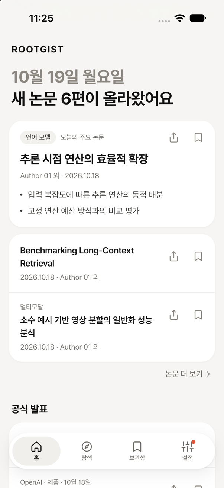 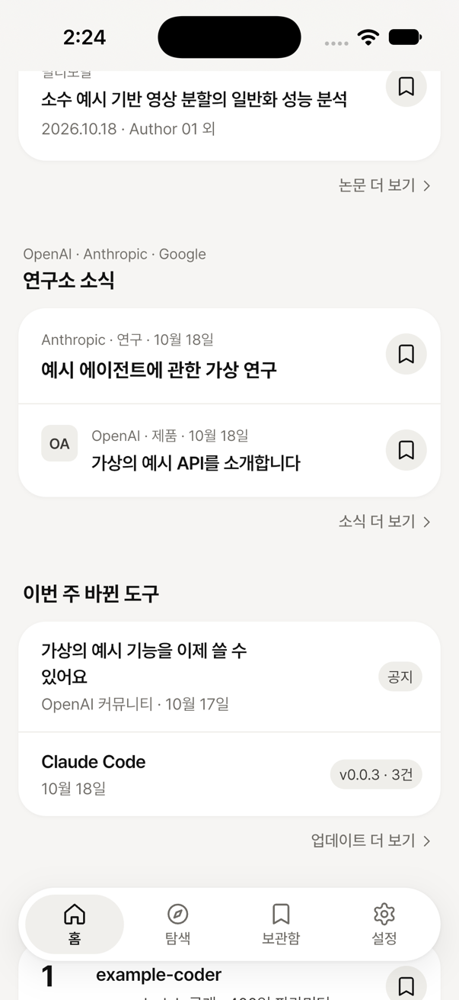 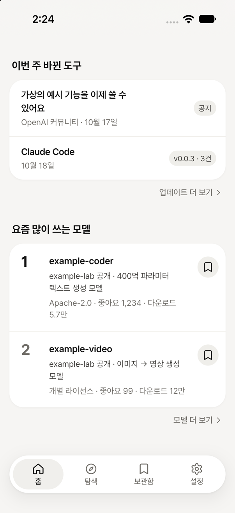

**목적.** 오늘 볼 것을 한 화면에 미리 보여 주는 허브. 논문 3편 → 공식 발표 → 업데이트 → 주목받는 모델 순서이고, 묶음마다 탐색의 전체 목록으로 가는 「더 보기」가 있다.

**구성(위에서부터).**

1. **상단 바** 높이 52, 좌우 20: 워드마크 `ROOTGIST`(`wordmark`).
2. **헤드라인** 여백 위 4, 좌우 20, `displayHome` 2줄. 1줄 날짜 「10월 19일 월요일」(`textTertiary`), 2줄 상태 문구(`textPrimary`).
   - 정상: 「새 논문 N편이 올라왔어요」(N = 그날 노출 편수)
   - 오늘 0편: 「오늘은 새 논문이 없어요」 → 아래 안내 카드 + 가장 최근 날의 논문(상태 X4)
   - 수집 중: 「오늘 논문을 아직 모으는 중이에요」(상태 X5)
   - 그 밖: 「아직 올라온 논문이 없어요」
3. **추천 카드**(여백 위 20) `RgCard`, 안쪽 좌우 20 · 위아래 18. 카드 전체를 누르면 S02.
   - 1줄: 주제 배지(`RgBadge`, 카드 위) + 간격 8 + 「오늘의 주요 논문」(`caption textSecondary`). 오른쪽 위 모서리에 `ItemActions`(공유·북마크).
   - 여백 12, 한국어 제목 `titleFeatured`(큰 제목 상한 2배).
   - 여백 6, 「첫 저자 외 · 2026.10.18」(`meta textSecondary`).
   - 여백 14, 핵심 내용 최대 2개. 점(4pt 원, `textBody`) + 간격 10 + `bodySummary textBody`, **항목당 최대 2줄**(넘치면 …). 항목 간격 6.
4. **논문 행 카드**(여백 위 12) 추천 다음 2편. `RgListRow` 행:
   - 주제(`caption textSecondary`, 있을 때) → 여백 4 → 제목 `titleList` → 여백 4 → 「2026.10.18 · 첫 저자 외」(`meta textSecondary`).
   - 오른쪽 `ItemActions`. 행을 누르면 S02.
5. **「논문 더 보기 ›」**(`MoreLink`) → 탐색 「논문」 칸.
6. **공식 발표**(`SectionTitle`) + 발표 행 최대 2개 + 「공식 발표 더 보기 ›」(→ 탐색 「공식 소식」의 「발표」).
7. **업데이트**(`SectionTitle`) + 업데이트 행 최대 2개 + 「업데이트 더 보기 ›」(→ 「공식 소식」의 「업데이트」).
8. **주목받는 모델**(`SectionTitle`) + 모델 행 1·2위 + 「모델 더 보기 ›」(→ 탐색 「모델」).
9. 맨 아래 여백 136(떠 있는 탭바).

공식 발표·업데이트·모델 행은 S04의 행과 똑같다(S04 참고). 공식 발표·업데이트는 **오늘 기준 7일 안의 것만** 보이고, 없으면 그 묶음(제목·카드·더 보기)이 통째로 빠진다. 모델이나 소식을 못 불러와도 논문은 그대로 보인다.

**상태.** 로딩 X1, 오류 X2, 오프라인 X3, 오늘 0편 X4, 수집 지연 X5.

**데이터.** 오늘(한국 날짜) 다이제스트(`get_digest`), 비었으면 가장 최근 정상 다이제스트. 공식 소식(`list_official_news`), 트렌딩 모델(`list_trending_models`).

---

## S02 논문 상세

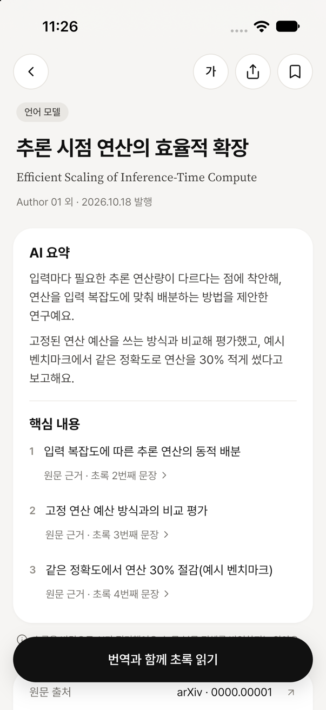 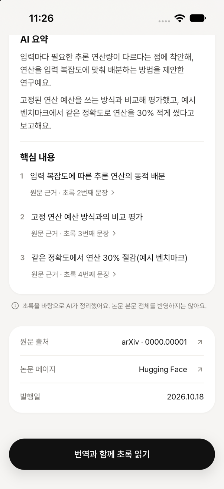

**목적.** 한 논문의 AI 요약과 핵심 내용을 보고, 각 핵심 내용의 근거를 초록에서 확인한다.

**구성.**

1. **상단 바** 52, 좌우 16, 버튼 간격 8: 왼쪽 「뒤로」(원형 outline), 오른쪽 「가」(글자 크기 → C04, 해설이 있을 때만) · 공유 · 북마크(outline, 저장 시 검정 채움).
2. **제목 묶음** 여백 위 12, 좌우 20.
   - 주제 배지(바탕 위 `fillBadgeOnBg`), 여백 14.
   - 한국어 제목 `titleDetail`.
   - 여백 8, 원제 `serifSubtitle textBody`(번역 제목이 있을 때).
   - 여백 10, 「저자 줄 · 2026.10.18 발행」(`meta textSecondary`).
3. **AI 카드**(여백 위 24) 안쪽 20/18. 이 카드 글자에는 글자 크기 4단계가 적용된다.
   - 「AI 요약」(`titleCard`), 여백 8, 요약을 **문장마다 문단으로** 나눠 `bodySummary textBody`, 문단 간격 8.
   - 구분선(위아래 16), 「핵심 내용」(`titleCard`), 여백 10.
   - 핵심 내용 최대 3개, 간격 14. 번호(`bodySummary` 600 `textSecondary`, 본문과 같은 크기) + 간격 8 + 본문 `bodySummary`. 그 밑에 링크 「원문 근거 · 초록 N번째 문장 ›」(`meta textSecondary`, 누르는 높이 36) → C01.
4. **안내**(여백 위 12, ⓘ) 「초록을 바탕으로 AI가 정리했어요. 논문 본문 전체를 반영하지는 않아요.」 누르면 C03.
5. **정보 카드**(여백 위 28) 정보 행:
   - 원문 출처 「arXiv · 0000.00001」 ↗ → arXiv 초록 페이지(브라우저)
   - 논문 페이지 「Hugging Face」 ↗ → HF 논문 페이지
   - 게시 조직(있을 때)
   - 발행일 「2026.10.18」
6. **하단 고정 주 버튼** 「번역과 함께 초록 읽기」(높이 56, 좌우 16, 아래 띄움 max(30, 안전 영역)) → S03. 해설이 있을 때만 보인다.

**상태.**

- 로딩: 제목 묶음·AI 카드 모양 스켈레톤.
- 해설 준비 중·실패: 제목 묶음 + 카드 「해설을 준비하고 있어요」 또는 「해설을 만들지 못했어요」(`titleCard`) / 「다음 수집 때 다시 만들어요. 원문은 아래 링크에서 볼 수 있어요.」. 주 버튼과 「가」는 없다.
- 오류: 보관함에서 들어왔으면 저장해 둔 제목을 보여 주고, 그 밑에 오류 카드(X2).

**데이터.** `get_paper(pid)`: 제목·원제·저자·발행일·주제·요약·핵심 내용(근거 문장 ID)·문장·번역·용어.

---

## C01 원문 근거 시트

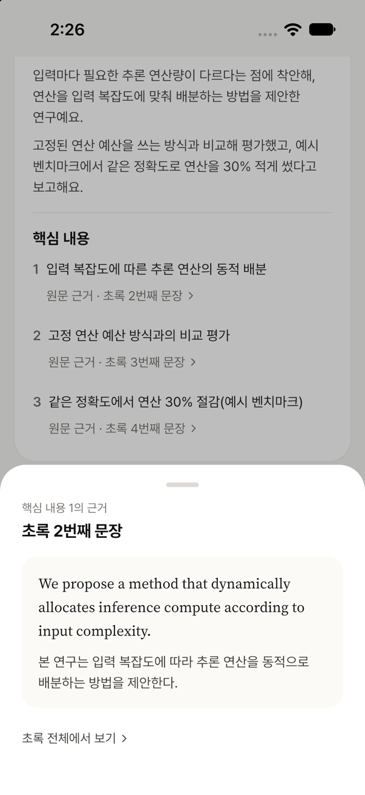

**목적.** 핵심 내용이 초록의 어느 문장에서 나왔는지 원문과 번역으로 보여 준다.

**구성(시트, DESIGN 5.9).**

시트는 「닫기」 버튼 없이 밀어 내리기·바깥 탭으로 닫는다(DESIGN 5.9). 아래 시트 모두 같다.

1. 「핵심 내용 N의 근거」(`caption textSecondary`), 여백 4.
2. 「초록 N번째 문장」(`titleSection`). 문장 ID(A02)는 보이지 않는다.
3. 여백 16, **문장 상자**: `bgReading` 바탕, 모서리 16, 안쪽 좌우 18 · 위아래 16.
   - 원문(Source Serif 4, 16/26).
   - 여백 10, 번역 `bodySummary textBody`.
4. 여백 12, 「초록 전체에서 보기 ›」(`bodySmall textBody`, 높이 44): 시트를 닫고 S03을 열어 그 문장으로 스크롤한다.

---

## S03 초록 원문·번역 리더

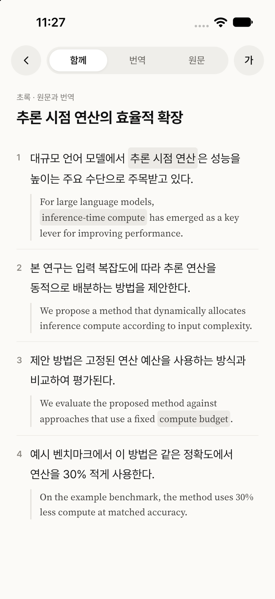 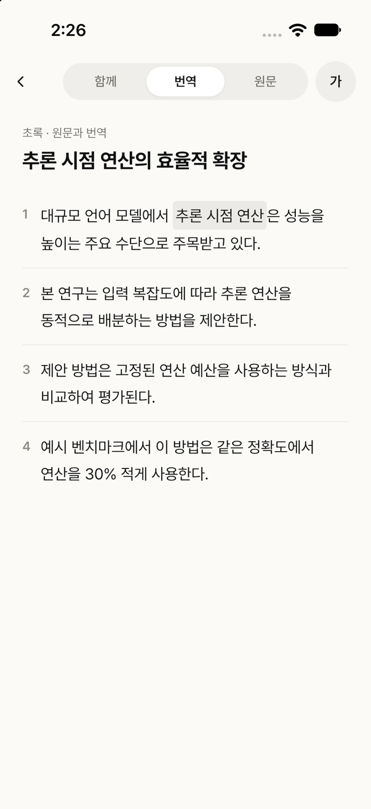 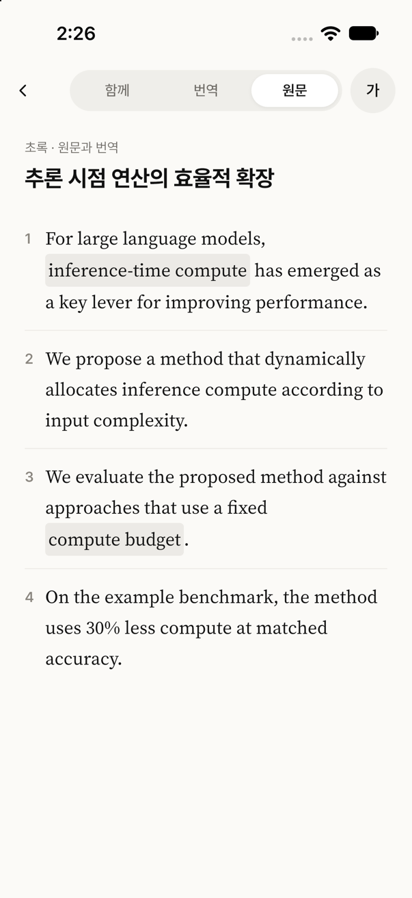

**목적.** 초록 전체를 문장 단위로 원문과 번역을 맞대어 읽는다.

**구성.** 바탕 `bgReading`.

1. **고정 상단 바** 52, 좌우 16, 간격 8. 스크롤해도 움직이지 않는다.
   - 「뒤로」(원형 neutral).
   - 세그먼트 「함께 · 번역 · 원문」(남는 폭). 처음 값은 설정의 「초록 기본 보기」.
   - 「가」(원형 neutral) → C04.
2. **본문** 좌우 24, 위 20.
   - 「초록 · 원문과 번역」(`caption textSecondary`), 여백 6, 논문 제목 `titleReader`, 여백 28.
   - **문장 쌍** 목록. 쌍 사이 구분선(`dividerCard`, 위아래 12). 쌍마다 왼쪽에 문장 번호(폭 20, `meta` 600 `textTertiary`, 첫 줄 가운데).
     - 「함께」: 번역 `bodyReaderKo` → 간격 8 → 원문 `serifTogether textBody`. 원문 왼쪽에 2pt `borderDefault` 세로선 + 들여쓰기 12.
     - 「번역」: 번역만.
     - 「원문」: 원문만 `serifOnly`.
     - 번역이 없는 문장은 어느 모드든 원문만 보인다.
   - 아래 여백 40 + 안전 영역.
3. **용어 강조:** 용어마다 초록 전체에서 처음 나온 곳 한 번만 `highlight` 바탕(모서리 4, 안쪽 3/1). 원문의 영어 용어, 그리고 사전에 대응어가 있으면 번역문의 한국어 표기도 강조한다. 누르면 C02가 열리고, 열려 있는 동안 `highlightActive`. 용어 뒤에 붙은 조사·부호는 용어와 같은 줄에 남긴다.

**동작.**

- 모드나 글자 크기를 바꿔도 **화면 맨 위에 걸친 문장 쌍이 같은 자리에** 남도록 스크롤을 맞춘다.
- C01에서 들어오면 그 문장 쌍이 보이게 스크롤한다.
- 글자 크기 4단계는 본문(문장 쌍)에만 적용한다. 제목·상단 바에는 적용하지 않는다.
- LaTeX 수식 기호는 읽을 수 있는 글자로 바꿔 보여 준다(HANDOFF 8.3).

---

## C02 용어 설명 시트

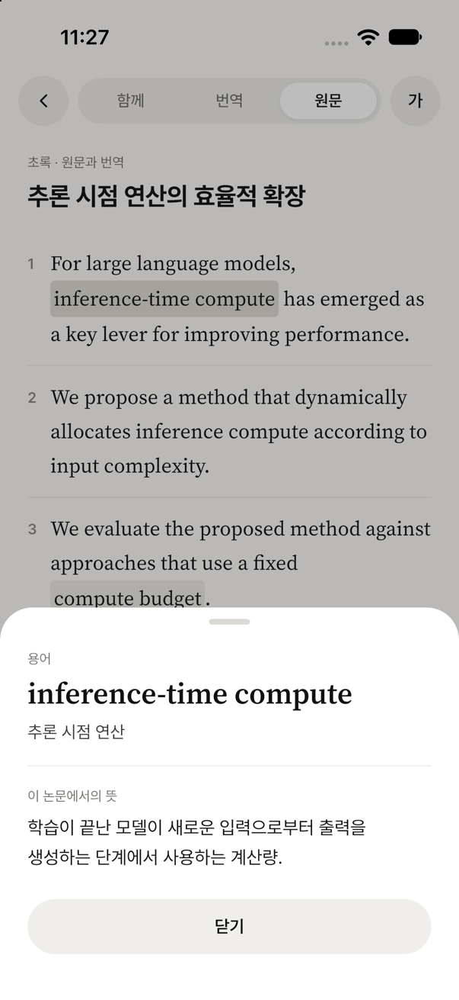

1. 「용어」(`caption textSecondary`), 여백 6.
2. 용어 원어 `serifTerm`(큰 제목 상한 2배).
3. (약어면) 여백 4, 정식 명칭 `serifSubtitle textSecondary`. 예: SLAM → Simultaneous Localization and Mapping.
4. (사전에 대응어가 있고 원어와 다르면) 여백 6, 한국어 대응어 `bodySummary textBody`.
5. 구분선(위아래 18), 「이 논문에서의 뜻」(`caption textSecondary`), 여백 6, 뜻 `bodyDefinition`.

---

## C04 글자 크기 시트

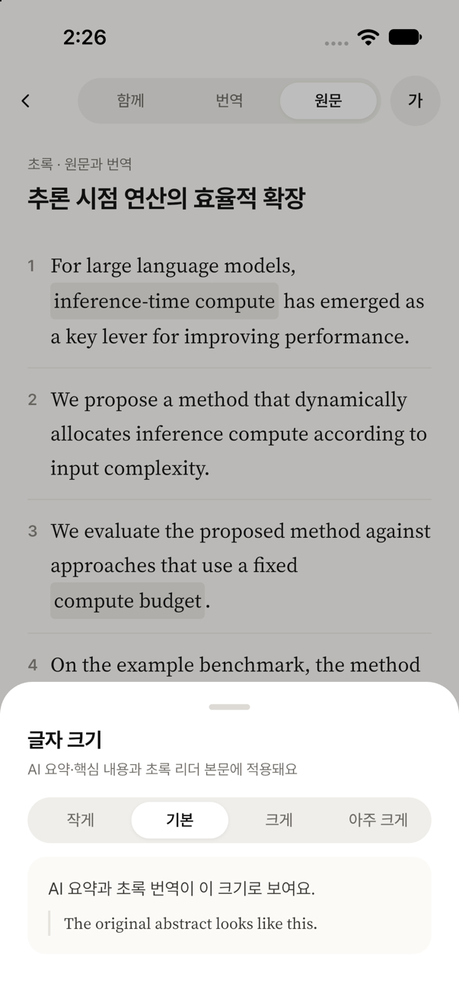

「글자 크기」(`titleSection`) → 여백 4 → 「AI 요약·핵심 내용과 초록 리더 본문에 적용돼요」(`caption textSecondary`) → 여백 16 → 세그먼트 「작게 · 기본 · 크게 · 아주 크게」(0.9 · 1.0 · 1.15 · 1.3배) → 여백 12 → 미리 보기 상자(S12와 같다). 고르는 즉시 반영되고 저장된다. S02 「가」, S03 「가」에서 연다.

---

## C03 AI 생성 안내 시트

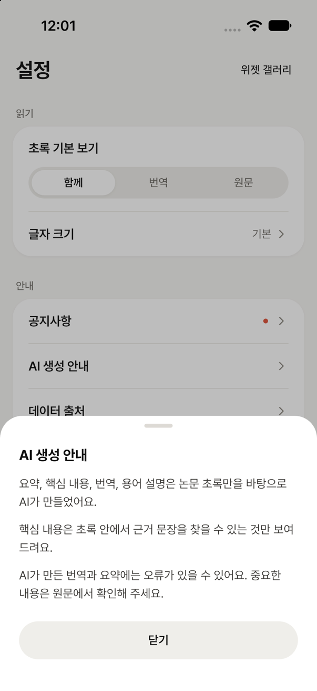

「AI 생성 안내」(`titleSection`) → 여백 12 → 세 문단(`bodySummary textBody`, 간격 12).

1. 요약, 핵심 내용, 번역, 용어 설명은 논문 초록만을 바탕으로 AI가 만들었어요.
2. 핵심 내용은 초록 안에서 근거 문장을 찾을 수 있는 것만 보여 드려요.
3. AI가 만든 번역과 요약에는 오류가 있을 수 있어요. 중요한 내용은 원문에서 확인해 주세요.

「논문 본문 전체를 읽었다」는 표현은 어디에도 쓰지 않는다.

---

## S04 탐색

출처별 허브. 제목 「탐색」(`titleDetail`, 상단 바 52, 좌우 20) 밑에 칸 줄 「논문 | 공식 소식 | 모델」(DESIGN 5.11)이 고정되고, 그 아래 내용만 좌우로 넘어간다. 칸 이름을 누르거나 옆으로 밀어 넘긴다.

### S04 · 논문 칸

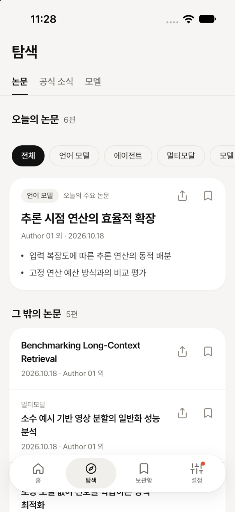 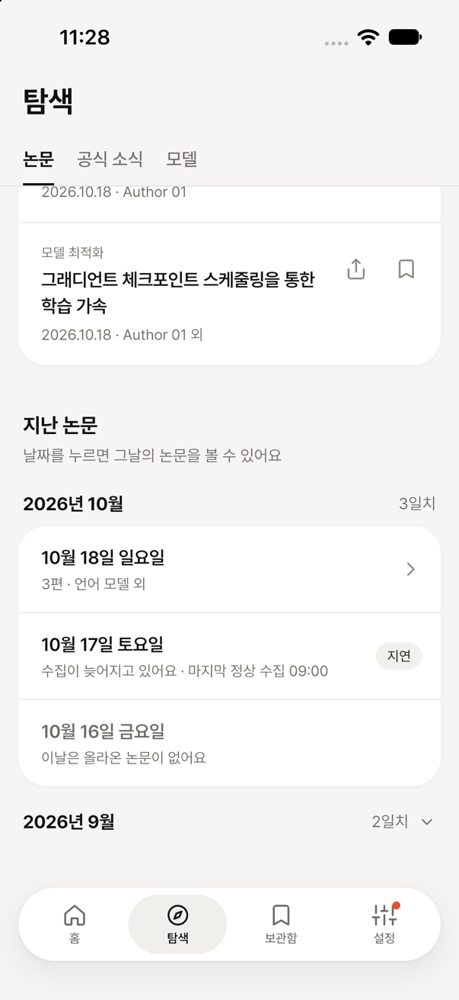

1. **「오늘의 논문 N편」**(`SectionTitle`). 오늘이 비었으면 「10월 18일 논문 N편」(가장 최근 날).
2. **주제 칩**(여백 위 16, 가로 넘김, 좌우 20): 「전체」 + 그날 해설이 있는 주제만. 고르면 아래 목록을 그 주제로 거른다. 거르면 행의 주제 줄은 숨긴다.
3. **추천 카드**(여백 위 16): S01과 같다.
4. **「그 밖의 논문 N편」**(`SectionTitle`) + 나머지 전부의 논문 행(S01 4번과 같은 행).
5. **「지난 논문」**(여백 위 40, `titleSection`) + 「날짜를 누르면 그날의 논문을 볼 수 있어요」(`bodySmall textSecondary`, 여백 4).
6. **달 묶음.** 머리 「2026년 10월」(`titleList` 700) + 오른쪽 「N일치」(`bodySmall textSecondary`). 위 20 · 아래 8, 좌우 20, 높이 44 이상.
   - **이번 달(맨 위)은 늘 펼쳐 있다.** 지난달부터는 접혀 있고, 머리를 누르면 펼친다(셰브론 아래 ▾ / 펼치면 위 ▴).
   - 펼친 달은 날짜 행 카드. 날짜 행(`RgListRow`, 여백 16/16/16/20, 가운데 정렬):
     - 날짜 「10월 18일 일요일」(`titleList`), 여백 2, 설명(`meta textSecondary`).
     - 정상: 「3편 · 언어 모델 외」(주제는 그날의 대표 주제, 1편이면 「외」 없음) + 셰브론 → S04-D.
     - 지연: 「수집이 늦어지고 있어요 · 마지막 정상 수집 09:00」 + 배지 「지연」. 누를 수 없다.
     - 없음: 날짜 `textSecondary` + 「이날은 올라온 논문이 없어요」. 누를 수 없다.
   - 오늘과, 1번에 보여 준 날은 이 목록에서 뺀다.

### S04-D 지난 날짜

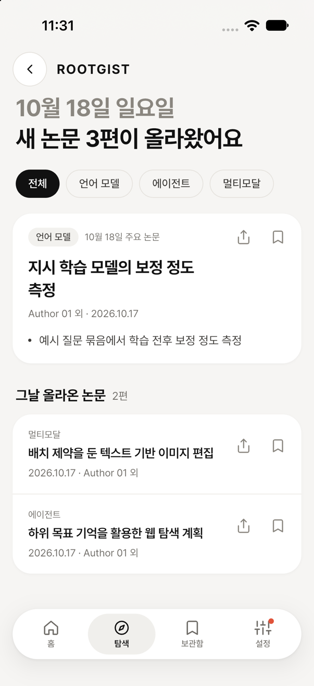

탐색 탭 안에서 열린다(탭바 보임). S01의 레이아웃에서 이렇게 다르다.

- 상단 바: 「뒤로」(원형 outline) + 간격 12 + 워드마크.
- 헤드라인: 그날 날짜 + 「새 논문 N편이 올라왔어요」.
- 주제 칩(여백 위 16)이 있다.
- 추천 카드 라벨이 「10월 18일 주요 논문」.
- 「그날 올라온 논문 N편」 + 그날 논문 전부.
- 공식 발표·업데이트·모델 묶음과 「더 보기」는 없다.

### S04 · 공식 소식 칸

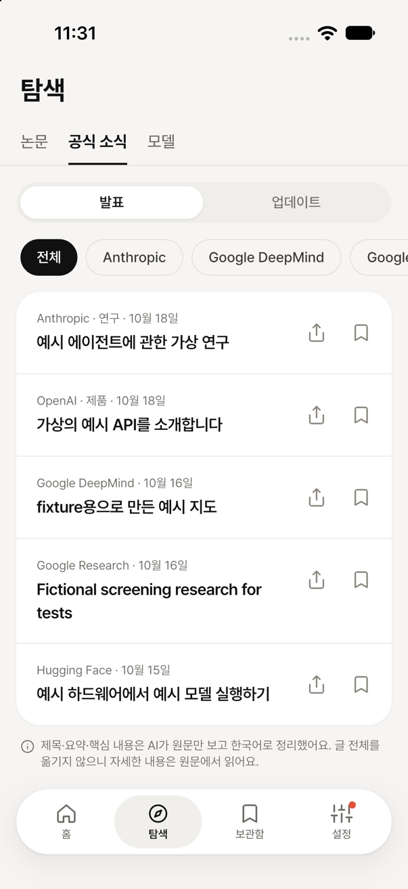 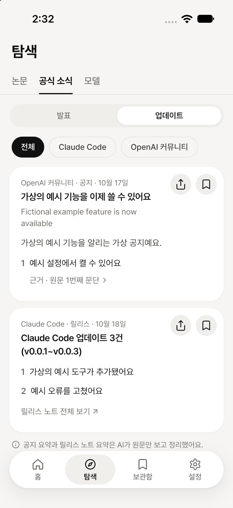

1. 여백 위 16, **세그먼트 「발표 · 업데이트」**(좌우 16). 바꾸면 출처 칩은 「전체」로 돌아간다.
2. 여백 12, **출처 칩**(가로 넘김): 「전체」 + 그 종류에 있는 출처를 **이름순**으로(날마다 자리가 바뀌지 않게).
3. 여백 12, 목록.
   - **발표**: 한 카드 안의 발표 행(`NewsRow`). 출처 줄 「Anthropic · 연구 · 10월 18일」(`caption textSecondary`, 안 연 새 글이면 앞에 새 글 점 + 간격 6) → 여백 4 → 제목 `titleList`(한국어 번역 제목, 없으면 원제) + 오른쪽 `ItemActions`. 행을 누르면 S07.
   - **업데이트**: 항목마다 카드(간격 12), 안쪽 20/18.
     - 머리: 출처 줄 → 제목 `titleList` → (번역 제목이 있는 공지면) 원제 `meta textSecondary`. 머리를 누르면 **원문을 브라우저로** 열고 읽음 처리한다. 오른쪽 위 모서리에 `ItemActions`.
     - 여백 12, 요약 `bodySummary textBody`(있을 때).
     - 여백 12, 핵심 내용(번호 + 본문 + 「근거 · 원문 N번째 문단 ›」).
     - 릴리스: 여백 6, 「릴리스 노트 전체 보기 ↗」(`meta textSecondary`, 높이 36).
4. 여백 12, ⓘ 안내.
   - 발표: 「제목·요약·핵심 내용은 AI가 원문만 보고 한국어로 정리했어요. 글 전체를 옮기지 않으니 자세한 내용은 원문에서 읽어요.」
   - 업데이트: 「공지 요약과 릴리스 노트 요약은 AI가 원문만 보고 정리했어요. 정확한 내용은 원문에서 확인해요.」
5. 비었으면 「아직 모은 소식이 없어요」(`bodySmall textSecondary`).

**분류 이름.** 출처 줄 가운데의 분류: 연구(Research) · 소식(News) · 제품(Product) · 안전(Safety) · 논문(Publication) · 공지(Announcement) · 릴리스(Release). 한국어로 옮기지 않는 분류는 숨긴다(예: 「Google Research · 10월 16일」).

**릴리스 묶기.** 버전 제목은 뜻이 없어 출처마다 기간 안의 릴리스를 한 항목으로 묶는다. 예: 「Claude Code 업데이트 3건 (v0.0.1~v0.0.3)」.

### S04 · 모델 칸

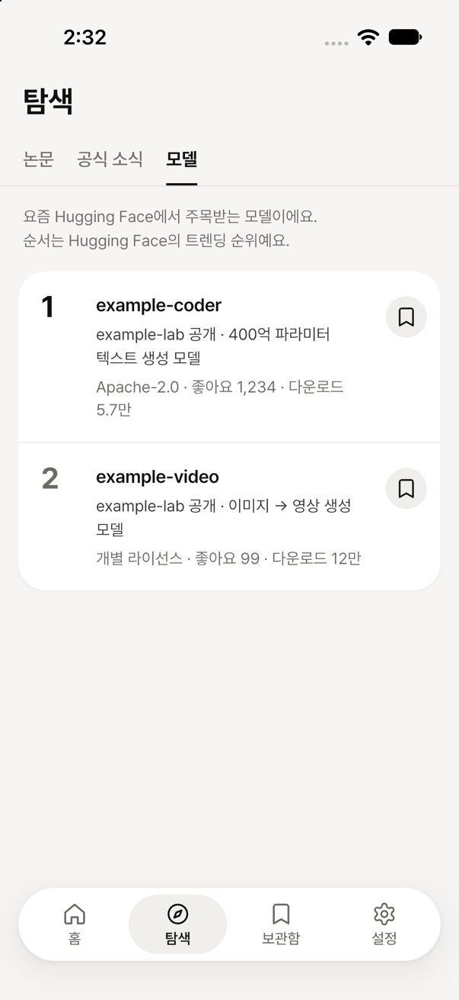

1. 여백 위 16, 좌우 20, 「요즘 Hugging Face에서 주목받는 모델이에요. 순서는 Hugging Face의 트렌딩 순위예요.」(`bodySmall textSecondary`).
2. 여백 16, 한 카드 안의 **모델 행**(`ModelRow`), 최대 10개.
   - 순위(폭 20, `meta` 600 `textSecondary`) + 간격 12 + 글 열 + 오른쪽 `ItemActions`. 행을 누르면 S08.
   - 글 열(간격 4): 이름 `titleList` → 한 줄 설명 `bodySmall textBody` → 「Apache-2.0 · 좋아요 1,234 · 다운로드 5.7만」(`meta textSecondary`).
   - 한 줄 설명은 메타데이터만으로 만든다(AI 없음): 「만든 곳 공개 · [크기] [과제] 모델」. 예: 「example-lab 공개 · 400억 파라미터 텍스트 생성 모델」.
   - 과제 이름: 텍스트 생성 · 이미지·텍스트 이해 · 이미지 생성 · 이미지 편집 · 이미지 → 영상 생성 · 영상 생성 · 음성 합성 · 음성 인식 · 여러 입출력 · 임베딩.
   - 라이선스: `other` → 「개별 라이선스」, `apache-2.0` → 「Apache-2.0」, `mit` → 「MIT」.
3. 비었으면 「아직 모은 모델이 없어요」.

---

## S07 공식 소식 상세

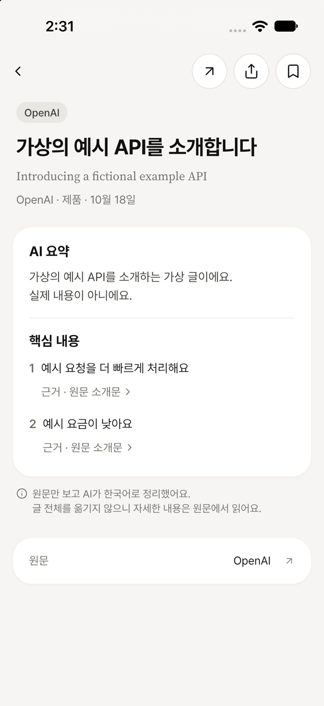

**목적.** 공식 발표(또는 공지·릴리스) 하나의 AI 요약과 핵심 내용, 그리고 원문으로 가는 길.

1. **상단 바** 52, 좌우 16, 간격 8: 「뒤로」 / 「원문 열기」(↗) · 공유 · 북마크(모두 원형 outline).
2. **제목 묶음** 여백 위 12, 좌우 20.
   - 출처 배지(바탕 위), 여백 12.
   - 제목 `titleDetail`(번역 제목, 없으면 원제).
   - 여백 8, 원제 `serifSubtitle textSecondary`(번역 제목이 있을 때).
   - 여백 8, 「OpenAI · 제품 · 10월 18일」(`meta textSecondary`).
3. **AI 카드**(여백 위 24), 안쪽 20/18.
   - 「AI 요약」 + 여백 8 + 요약 `bodySummary textBody`.
   - 구분선(위아래 16) + 「핵심 내용」 + 여백 10 + 핵심 내용.
   - 핵심 내용 항목(간격 10): 번호(`bodySummary` 600 `textSecondary`) + 간격 8 + 본문 `bodySummary`. 밑에 「근거 · 원문 N번째 문단 ›」(OpenAI 글은 「근거 · 원문 소개문 ›」, `meta textSecondary`, 높이 36).
   - 근거 링크를 누르면 원문을 브라우저로 열되, 근거 구절이 있으면 그 자리로 바로 간다(주소 끝에 `#:~:text=구절`).
   - 요약·핵심 내용이 둘 다 없으면 카드 대신 「이 글은 요약을 만들지 못했어요. 원문에서 읽어 주세요.」
4. **안내**(여백 위 12, ⓘ) 「원문만 보고 AI가 한국어로 정리했어요. 글 전체를 옮기지 않으니 자세한 내용은 원문에서 읽어요.」
5. **링크 카드**(여백 위 28) 「원문 · OpenAI ↗」.

**동작.** 화면을 열면 그 글의 새 글 점이 사라진다(첫 프레임 뒤에 읽음 처리). 상태바 밑 띠가 있다.

---

## S08 모델 상세

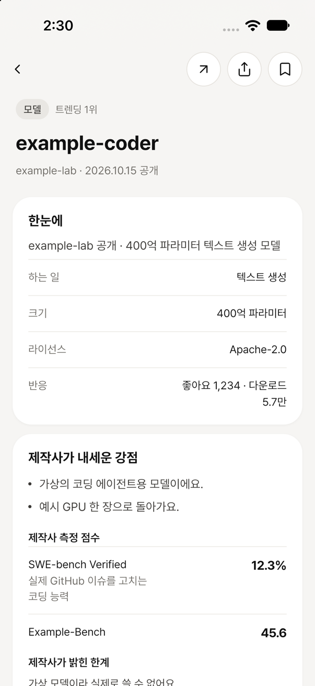 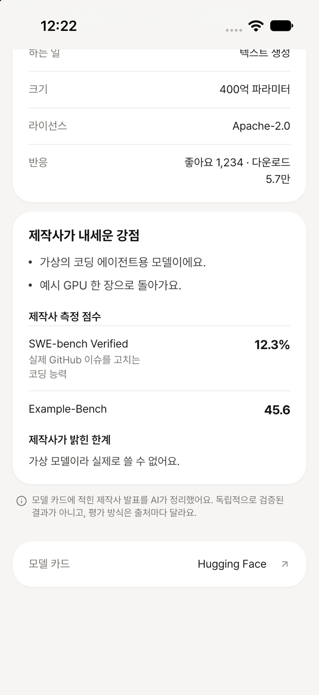

**목적.** 트렌딩 모델이 무엇이고 제작사가 무엇을 내세우는지, 독립 검증이 아니라는 점과 함께 보여 준다.

1. **상단 바**: S07과 같다(원문 열기 = HF 모델 카드).
2. **제목 묶음** 여백 위 12, 좌우 20.
   - 배지 「모델」 + 간격 8 + 「트렌딩 1위」(`caption textSecondary`), 여백 12.
   - 모델 이름 `titleDetail`.
   - 여백 8, 「example-lab · 2026.10.15 공개」(`meta textSecondary`).
3. **「한눈에」 카드**(여백 위 24), 안쪽 20/18.
   - 「한눈에」(`titleCard`), 여백 8, 한 줄 설명 `bodySummary textBody`, 여백 6.
   - 사실 행(DESIGN 5.15): 하는 일 / 크기(없으면 「공개된 정보 없음」 흐리게) / 라이선스(없으면 「정보 없음」) / 반응 「좋아요 1,234 · 다운로드 5.7만」.
   - **값은 모두 오른쪽 끝에 맞춘다.**
4. **「제작사가 내세운 강점」 카드**(여백 위 12).
   - 강점 최대 3개: 점 4pt + 간격 10 + `bodySummary textBody`, 간격 6.
   - 강점·점수가 하나도 없으면 「제작사가 모델 카드에 강점이나 평가 결과를 밝히지 않았어요.」(연결 논문이 있으면 「… 연결된 논문에서 확인해 보세요.」 덧붙임), `textSecondary`.
   - 점수가 있으면: 여백 12, 「제작사 측정 점수」(`bodySmall` 600) + 점수 사실 행(최대 4). 라벨 = 벤치마크 이름(`textPrimary`) + 밑에 한국어 풀이(`meta`, 아는 벤치마크만. 예: SWE-bench Verified → 「실제 GitHub 이슈를 고치는 코딩 능력」), 값 = 점수(`titleList` 700).
   - 한계가 있으면: 여백 16, 「제작사가 밝힌 한계」(`bodySmall` 600), 여백 6, 한 문장 `bodySmall textBody`.
5. **안내**(ⓘ) 「모델 카드에 적힌 제작사 발표를 AI가 정리했어요. 독립적으로 검증된 결과가 아니고, 평가 방식은 출처마다 달라요.」
6. **링크 카드**(여백 위 28): 「연결된 논문 · arXiv · 2601.00001 ↗」(있을 때) + 「모델 카드 · Hugging Face ↗」.

**데이터 규칙.** 점수는 모델 카드 원문에 그 숫자가 그대로 있을 때만 보인다(AI가 숫자를 지어내지 못하게, 수집 단계에서 거른다). 성인·검열 해제 계열 모델은 수집 단계에서 뺀다.

---

## S05 보관함

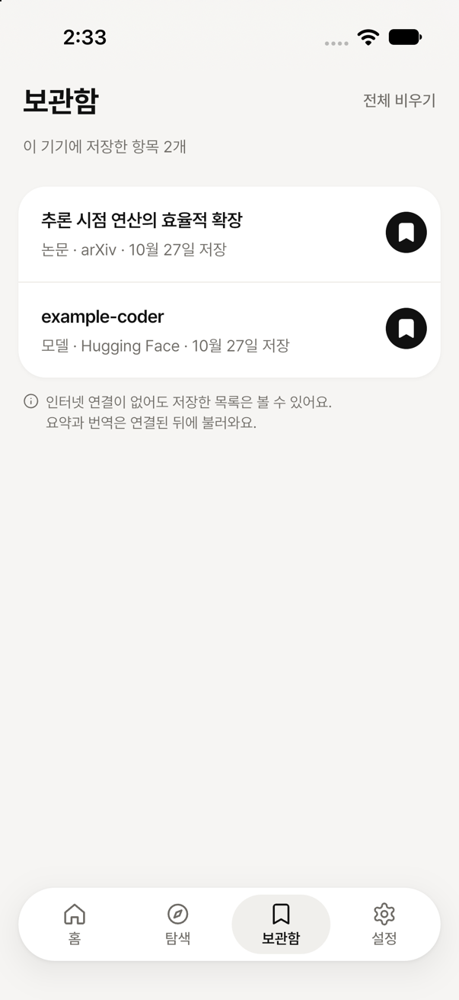

**목적.** 이 기기에 저장한 논문·공식 소식·모델. 서버 없이(오프라인에서도) 저장한 목록이 보인다.

1. **상단 바** 52: 「보관함」(`titleDetail`, 좌우 20) + 오른쪽 「전체 비우기」(`bodySmall` 500 `textSecondary`, 높이 44, 저장한 게 있을 때만).
2. 여백 위 4, 「이 기기에 저장한 항목 N개」(`bodySmall textSecondary`), 여백 아래 24.
3. **저장 목록 카드**: 최근에 저장한 순서. 행:
   - 제목 `titleList` → 여백 4 → 「논문 · arXiv · 10월 27일 저장」(종류 · 출처 · 저장일, `meta textSecondary`).
   - 오른쪽 북마크(plain, 채움).
   - 행을 누르면 그 항목 화면(S02/S07/S08)으로 간다.
4. 여백 12, ⓘ 「인터넷 연결이 없어도 저장한 목록은 볼 수 있어요. 요약과 번역은 연결된 뒤에 불러와요.」

**동작.**

- 북마크를 누르면 바로 빼고, 아래에 4초 동안 알림 「보관함에서 뺐어요 · 되돌리기」를 띄운다. 알림은 떠 있는 탭바 위에 뜬다. 「되돌리기」를 누르면 저장일 그대로 되살린다.
- 「전체 비우기」 → 확인 창 「저장한 항목 N개를 모두 뺄까요?」 [취소] [모두 빼기].

**빈 상태.** 카드 없이 좌우 20, 여백 위 24.

1. 「아직 저장한 게 없어요」(`titleCard`)
2. 여백 6, 「논문·소식·모델의 북마크를 누르면 여기에 모여요」(`bodySmall textSecondary`)
3. 여백 20, 외곽 알약 「오늘의 논문 보기」 → 홈

---

## S06 설정

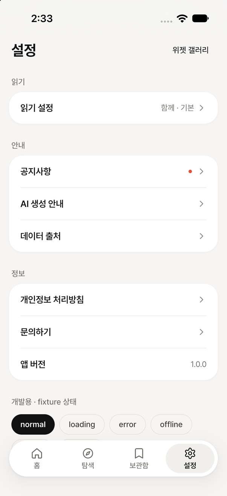

1. 상단 바 52: 「설정」(`titleDetail`, 좌우 20).
2. **묶음 이름**(`meta` 500 `textSecondary`, 좌우 20, 위 20(첫 묶음)·28, 아래 8) + 설정 카드(안쪽 좌우 20, 행 사이 구분선).
3. 설정 행: 최소 높이 56, 이름 `titleList`, 오른쪽 값(`bodySmall textSecondary`)과 셰브론 18(`textTertiary`), 간격 4. 새 글이 있으면 셰브론 앞에 새 글 점(오른쪽 여백 4).

| 묶음 | 행 | 동작 |
|---|---|---|
| 읽기 | 읽기 설정 · 「함께 · 기본」(현재 값) | S12 |
| 안내 | 공지사항(안 읽은 공지가 있으면 점) | S09 |
| 안내 | AI 생성 안내 | C03 |
| 안내 | 데이터 출처 | S10 |
| 정보 | 개인정보 처리방침 | S11 |
| 정보 | 문의하기 | 메일 앱(help.rootgist@gmail.com). 메일 앱을 열 수 없으면 주소를 복사하고 알림 「메일 앱을 열 수 없어 주소를 복사했어요 · 주소」 |
| 정보 | 앱 버전 · 1.0.0 | 누를 수 없음(셰브론 없음) |

디버그 빌드에만 보이는 것(출시 빌드에는 없음): 오른쪽 위 「위젯 갤러리」, 맨 아래 「개발용 · fixture 상태」 칩(normal · loading · error · offline · empty · delayed). 칩으로 아래 상태 X1~X5를 재현한다.

---

## S09 공지사항 · C05 공지 시트

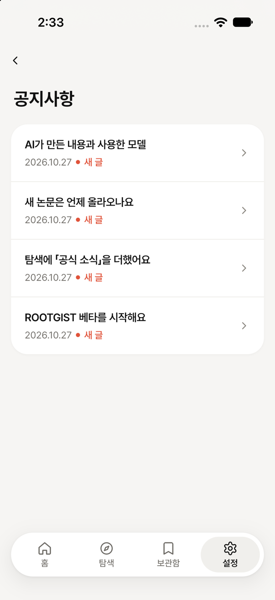 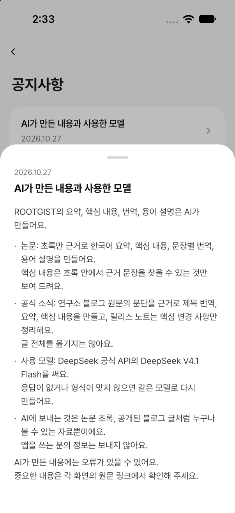

1. 상단 바 52: 「뒤로」(원형 outline, 좌우 16).
2. 여백 위 12, 「공지사항」(`titleDetail`, 좌우 20), 여백 아래 20.
3. **공지 목록 카드**: 행(가운데 정렬): 제목 `titleList` → 여백 4 → 날짜 「2026.10.27」(`meta textSecondary`). 안 읽은 공지면 날짜 옆에 새 글 점 + 「새 글」(`meta` 600 `newDot`, 간격 6). 오른쪽 셰브론. 위가 최신.
4. 행을 누르면 **공지 시트(C05)**가 열리고 그 공지를 읽음 처리한다.
   - 날짜(`caption textSecondary`), 여백 6, 제목(`titleSection`), 여백 16.
   - 본문: 문단 `bodySummary textBody`, 목록은 「·」 + 간격 8, 항목 아래 6.

**데이터.** 앱에 포함된 `docs/notices.md`. `## 제목`마다 공지 하나, 바로 다음 줄이 날짜(YYYY.MM.DD), 그 아래가 본문.

---

## S12 읽기 설정

설정 › 읽기 설정. 「뒤로」 → 여백 12 → 「읽기 설정」(`titleDetail`) → 여백 20 → 카드 두 개(간격 12, 안쪽 20/18).

1. **초록 기본 보기**(`titleList`) + 「초록 리더를 열 때 처음 보이는 방식이에요」(`bodySmall textSecondary`, 여백 4) + 여백 14 + 세그먼트 「함께 · 번역 · 원문」. 리더의 처음 모드. 바로 저장.
2. **글자 크기** + 「AI 요약·핵심 내용과 초록 리더 본문에 적용돼요」 + 여백 14 + `TextSizePicker`: 세그먼트 4단계, 여백 12, **미리 보기 상자**(`bgReading`, 모서리 16, 안쪽 18/16). 상자 안은 리더 「함께」 모양으로, 「AI 요약과 초록 번역이 이 크기로 보여요.」(`bodySummary`) + 세로선 원문 「The original abstract looks like this.」(`serifTogether`). 고르는 즉시 상자 글자 크기가 바뀐다.

C04 글자 크기 시트도 같은 `TextSizePicker`(세그먼트 + 미리 보기)를 쓴다.

## S10 데이터 출처

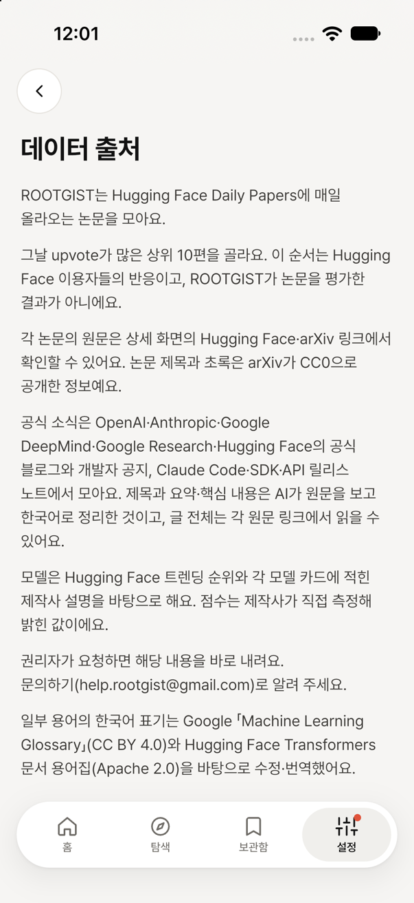

「뒤로」 → 여백 12 → 「데이터 출처」(`titleDetail`) → 여백 16 → 문단(`bodySummary textBody`, 간격 12). 문단은 `DataSourceScreen.paragraphs`이고 순서는 이렇다.

1. Daily Papers 수집
2. 상위 10편과 순서의 뜻
3. 원문 링크, arXiv CC0
4. 공식 소식의 출처와 AI 정리
5. 모델의 출처와 제작사 측정 점수
6. 권리자 삭제 요청 창구
7. 용어집 출처 표시(CC BY 4.0, Apache 2.0)

문구 원문은 코드에 있고, 권리 판단은 `docs/RIGHTS.md`를 따른다.

## S11 개인정보 처리방침

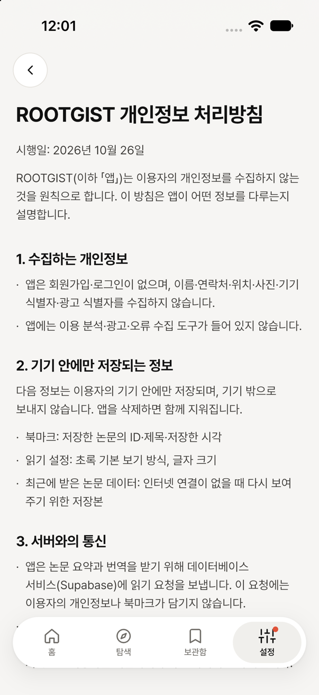

앱에 포함된 `docs/privacy.md`를 그대로 그린다. 같은 파일이 GitHub Pages(`/privacy/`) 페이지다.

- 「뒤로」 → 문서 제목(`titleDetail`, 아래 16).
- 소제목 `titleSection`(위 20 · 아래 8).
- 목록은 「·」, 문단은 `bodySummary textBody`.
- 맨 아래 여백 20, 「웹에서 보기 · 주소」(`meta textSecondary`, 누르면 브라우저).

---

## 공통 예외 상태 (X1~X5)

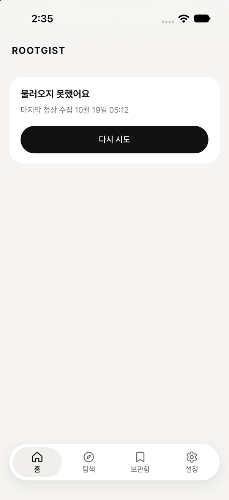 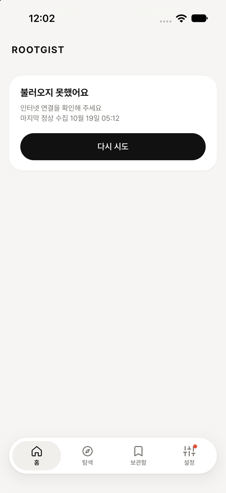 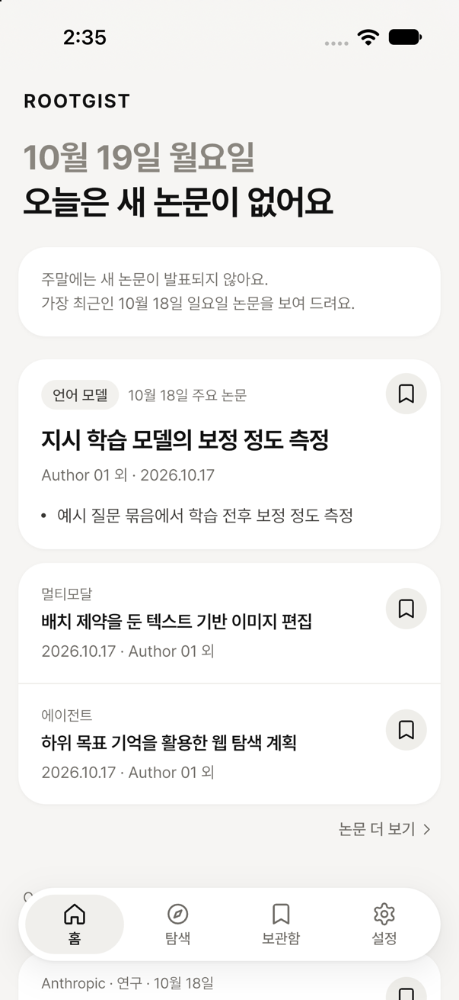 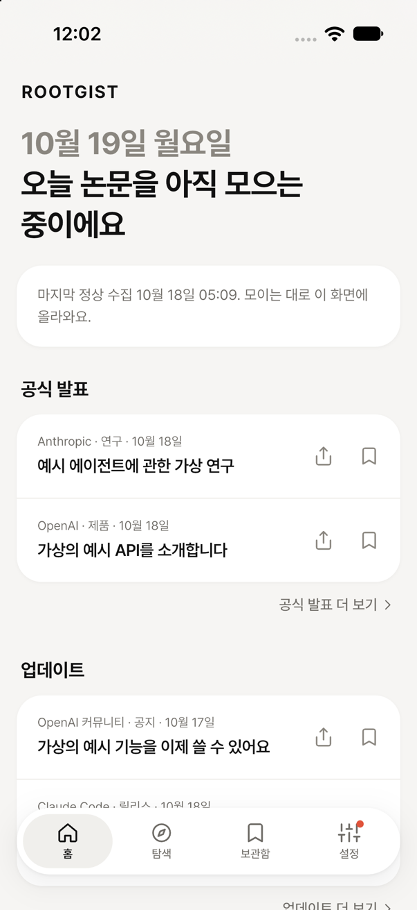

| | 언제 | 보이는 것 |
|---|---|---|
| **X1 로딩** 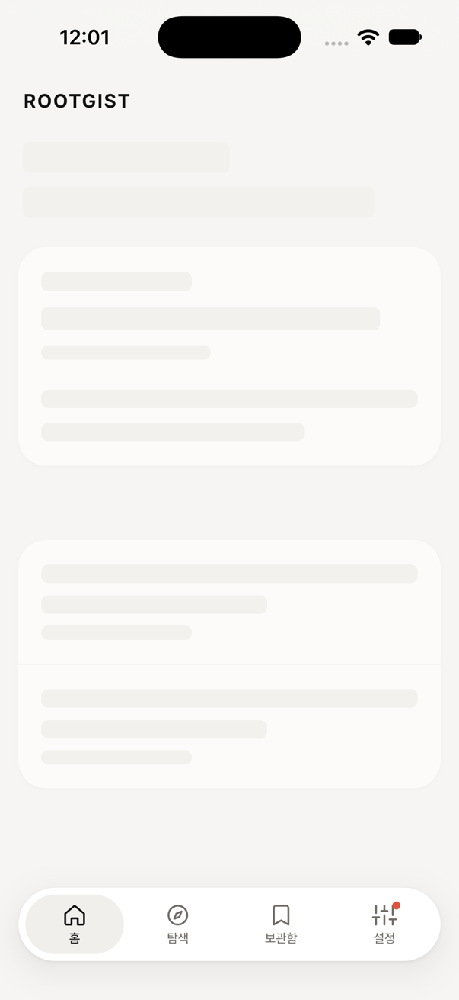 | 처음 불러오는 동안 | 실제 화면 모양의 스켈레톤. 홈: 헤드라인 2줄, 추천 카드, 행 2개 |
| **X2 오류** | 서버가 실패, 저장본도 없음 | 오류 카드 「불러오지 못했어요」 + 「마지막 정상 수집 10월 19일 05:12」 + 「다시 시도」 |
| **X3 오프라인** | 연결 끊김, 저장본도 없음 | X2 + 「인터넷 연결을 확인해 주세요」. 저장본이 있으면 오류 없이 저장본을 보여 준다 |
| **X4 오늘 0편** | 그날 노출 편수 0(주로 일·월요일) | 헤드라인 「오늘은 새 논문이 없어요」 + 안내 카드 「주말에는 새 논문이 발표되지 않아요. 가장 최근인 10월 18일 일요일 논문을 보여 드려요.」(일·월요일만 앞 문장) + 그날 논문(라벨 「10월 18일 주요 논문」) |
| **X5 수집 지연** | 배치가 아직 안 끝남 | 헤드라인 「오늘 논문을 아직 모으는 중이에요」 + 카드 「마지막 정상 수집 10월 18일 05:09. 모이는 대로 이 화면에 올라와요.」. 공식 소식·모델 묶음은 그대로 |

- 응답은 받을 때마다 기기에 저장한다. 다음에 요청이 실패하면 저장본을 보여 준다.
- 「마지막 정상 수집」은 저장본 중 가장 최근 값이다.
- 「다시 시도」는 같은 요청을 다시 보낸다.
