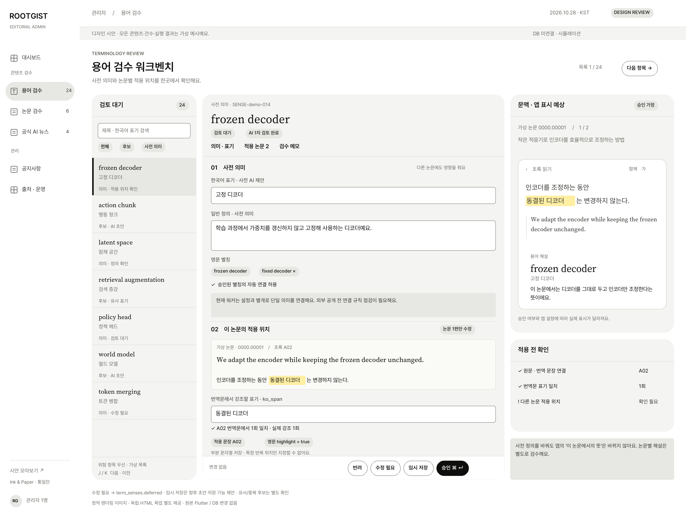
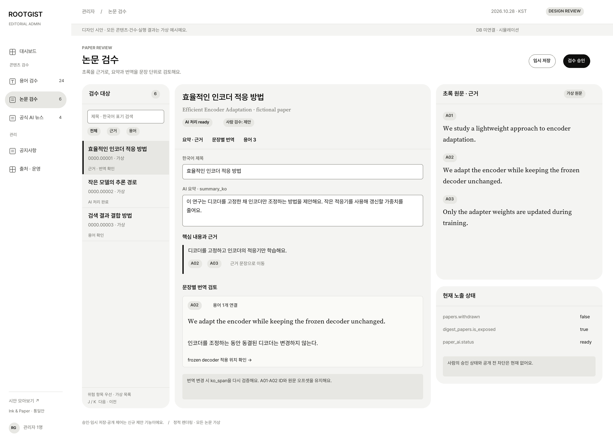
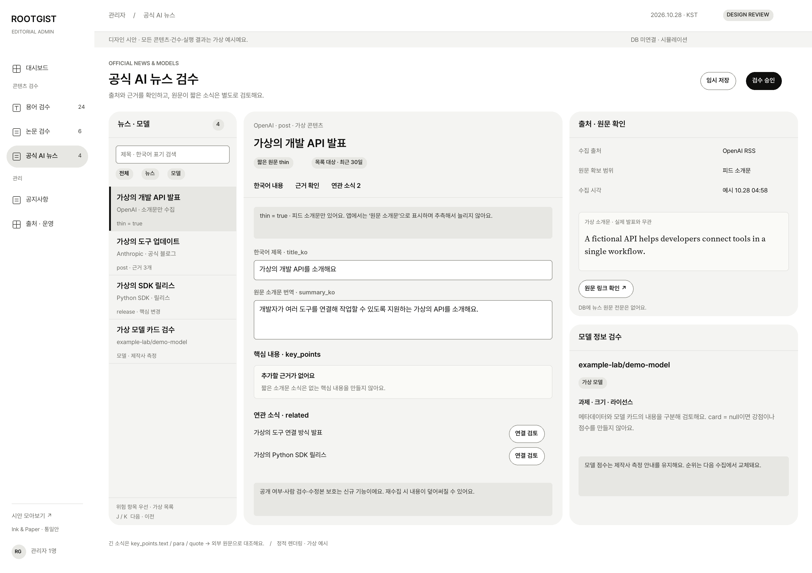
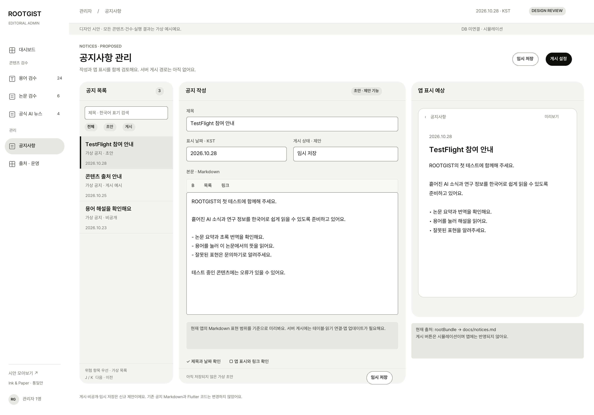
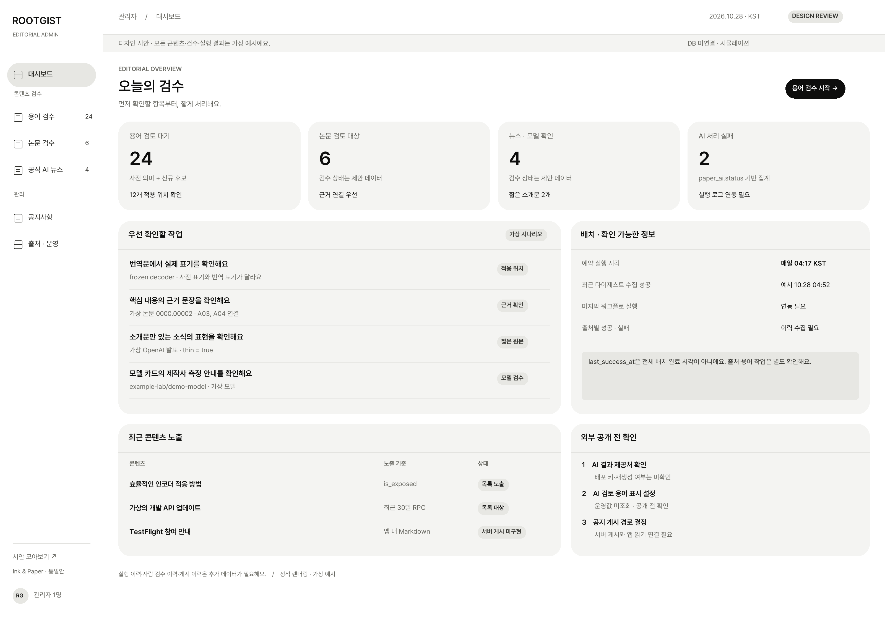
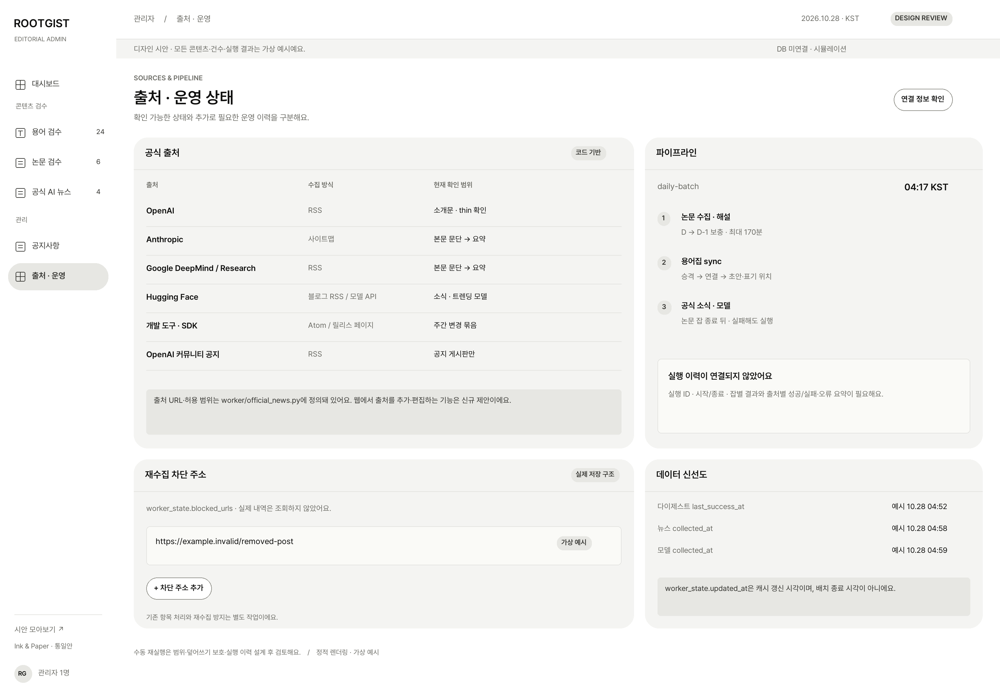

# ROOTGIST 관리자 웹 구현 명세서

버전 1.0 | 2026년 10월 28일 | 기준 디자인 Ink & Paper 앱 통일안

이 문서는 ROOTGIST 관리자 웹을 구현할 개발자를 위한 화면·동작·데이터 계약이다. 사용자가 확인한 앱 통일 시안을 기준으로 하며, 실제 서비스 코드는 구현하지 않았다. 이 문서에 새 테이블·API·워커 변경이 나와도 현재 존재하는 기능을 뜻하지 않는다.

핵심 작업은 **용어가 실제 한국어 번역문 어디에 적용되는지 확인하고 수정하는 것**이다. 신규 후보 표기 승인은 그다음이다. 관리자 1명을 전제로 하며 조직·결제·매출 KPI·협업 기능은 범위에 넣지 않는다.

## 1 문서의 지위와 구현 범위

### 1.1 확정한 디자인과 제안한 구현

| 구분 | 내용 | 구현 시 취급 |
|---|---|---|
| 사용자 확인 디자인 | 앱과 같은 밝은 무채색, 둥근 카드, 검정 버튼, 기존 글꼴, 노란 용어 강조 | 기본 디자인으로 사용 |
| 요구사항 | 6개 화면, 용어 적용 위치 우선, 한국어, 데스크톱 1280px 이상 | 기능·검수 완료 기준 |
| 코드에서 확인한 사실 | 기존 테이블·RPC·워커·앱 공지와 강조 규칙 | 재사용하며 임의 변경하지 않음 |
| 본 문서의 구현 기준 제안 | 관리자 인증, 초안·이력 테이블, 원자적 저장, 수정본 보호, 화면 경로 | 구현 계획의 기본값. 실제 변경 전에 검토할 설계 |
| 외부 설정값 | 관리자 사용자 UUID, 실제 도메인, 배포 환경, 비밀값 | 배포 담당자가 제공. 문서에 실값을 넣지 않음 |

기준 저장소는 `/Users/macrent/code/ROOTGIST/`, 기준 커밋은 `39774dfbbbd1aea22dd29d27d9576c75b292cfaa`이다. 라이브 DB의 마이그레이션 적용 여부와 실제 저장값은 조회하지 않았다. 구현 착수 시 동일 커밋인지와 운영 스키마를 읽기 전용으로 재확인해야 한다. 충돌 시 데이터 사실은 최신 코드·스키마, 디자인은 이 앱 통일안, 신규 동작은 본 명세를 기준으로 검토한다.

### 1.2 이번 작업과 향후 제품 구현의 구분

이번 작업은 문서·시안 작성뿐이다. 기존 Flutter 앱, Python 워커, DB·마이그레이션, 기존 문서·디자인 파일을 변경하지 않는다. 구현 단계에서는 관리자 전용 코드부터 별도 경로에 만들고 기존 영역 변경은 이 문서의 통합 의존성을 확인한 뒤 진행해야 한다. 기존 테이블을 전면 교체하지 않는다.

기술 기본 제안은 Next.js App Router + 기존 Supabase + Vercel이다. FastAPI 상시 서버는 전제하지 않는다. Python 배치 실행은 GitHub Actions에 유지한다. 프레임워크와 SDK 버전은 구현 시 공식 지원 버전을 확인하고 lockfile로 고정한다.

### 1.3 단계별 출고 조건

| 단계 | 제공 범위 | 출고 조건 |
|---|---|---|
| R0 읽기 검토 | 로그인, 목록·상세, 비교·미리보기, 조회 가능한 운영 정보 | 관리자 권한 검증, 기존 앱 읽기 회귀 없음 |
| R1 용어 수정 | 용어·별칭·논문별 span, 서버 초안, 승인·보류·반려, 변경 이력 | 공통 트랜잭션·충돌 감지·워커 수정본 보호가 모두 연결됨 |
| R2 콘텐츠 검수 | 논문 요약·번역, 뉴스·모델의 편집·검수 | 콘텐츠별 보호 규칙과 근거 검증 통과 |
| R3 공지·운영 | 서버 공지 게시, 출처 관리 메모·차단 URL, 실행 이력 | 공지 RPC·앱 연결과 운영 계측 완료 |

R1 출고는 term_writes와 occurrence_writes가 모두 true여야 한다. 사전 의미 편집만 가능해도 핵심 적용 위치 저장이 비활성이라면 R1 완료로 보지 않는다. R1 이상에서 보호 기능이 없으면 해당 쓰기 버튼을 비활성화하고 이유를 표시한다. 기능 플래그가 꺼져 있을 때 조작 성공 메시지를 먼저 띄우지 않는다. R0를 최종 제품 완성으로 표시하지 않는다.

## 2 현재 시스템과 반드시 유지할 제약

### 2.1 실제 데이터 흐름

GitHub Actions가 Python 워커를 실행하고, 워커가 Supabase에 저장한다. Flutter 앱은 공개 읽기 RPC와 로컬 캐시를 사용한다. 관리자 웹은 기존 공개 RPC를 쓰기 경로로 사용하지 않고 인증된 서버 경로를 추가한다.

| 영역 | 현재 구조 | 관리자에 없는 부분 |
|---|---|---|
| 논문 | papers, paper_ai, paper_sentences, paper_translations, paper_key_points, paper_glossary, digests, digest_papers | 사람 검수 상태·초안·편집 보호 |
| 용어 | terms, term_senses, term_aliases, term_candidates | 관리자 쓰기 API·초안 저장·문맥 검수 이력 |
| 뉴스 | official_news, thin, related, key_points | 사람 승인·비공개·수동 편집 보호 |
| 모델 | trending_models, 메타데이터, nullable card | 사람 승인·편집 보호·과거 순위 이력 |
| 공지 | 앱 번들 docs/notices.md와 파서 | 서버 게시·비공개·초안·원격 읽기 |
| 운영 | GitHub Actions, digests.last_success_at, paper_ai.status, collected_at, worker_state | 실행별 시작·종료·오류·출처별 결과 |

실제 예약값은 `17 19 * * *`, KST 04:17이다. 문서의 과거 05:00을 현재 예약값으로 표시하지 않는다. 예약 시각·실제 시작·성공 시각을 별도 라벨로 보여준다.

### 2.2 혼동하면 안 되는 상태

- `paper_ai.status=ready`는 AI 처리 완료이며 사람 승인과 다르다.
- `digest_papers.is_exposed`는 날짜별 목록 노출이다. 논문 상세 접근 차단과 같지 않다. `papers.withdrawn`은 철회 정보이므로 일반 ‘비공개’ 토글로 재사용하지 않는다.
- 후보 approved는 다음 glossary sync의 사전 승격 대상이다. `sense_id`가 채워지기 전에는 ‘승인됨 · 사전 반영 대기’로 표시한다.
- `term_candidates.seen_count`는 고유 논문 수가 아니다. 연결되지 않은 용어 행의 묶음 관측 수이며 UI 명칭은 ‘관측 수’다.
- `worker_state.updated_at`은 상태·캐시 갱신 시각이다. 전체 배치 성공으로 표시하지 않는다.
- 뉴스·모델 수집 시각은 전체 배치 종료 시각과 다르다. 수집 데이터가 없으면 ‘미수집’, 계측이 없으면 ‘연동 필요’, 요청 실패면 ‘조회 실패’다.

## 3 디자인 토큰과 화면 배치

### 3.1 공통 토큰

| 토큰 | 값 | 용도 |
|---|---|---|
| bg.app | #FFFFFF | 전체 기본 바탕 |
| surface.card | #F4F4F2 | 목록·편집·검수 카드 |
| surface.raised | #FFFFFF | 입력·선택 면·다이얼로그 |
| text.primary / action.primary | #0E0E0D | 제목·주 버튼·선택 강조 |
| text.body | #33332F | 본문·필드 값 |
| text.secondary | #6B6B65 | 메타·도움말 |
| fill.neutral | #E7E7E3 | 배지·선택 메뉴·보조 버튼 |
| border / divider | #E6E6E3 / #E3E3E0 | 구조 구분 |
| border.input | #8F8F88 | 입력 경계용 관리자 추가 토큰 |
| highlight.term | #FFEFA3 | 한국어 적용 용어만 강조 |
| highlight.active | #FFE27A | 현재 선택한 용어 |
| focus.ring | #0E0E0D 3px | 키보드 포커스, offset 3px |
| radius | card 22 / box 16 / field 10 / badge 10 / pill 999 | 앱과 형태 통일 |
| shadow | 기본 없음 | 선택 세그먼트만 필요시 약한 그림자 |

상태는 무채색 배지의 **기호 + 문구**로 구분한다. 예: ‘! 검토 대기’, ‘✓ 의미 승인’, ‘× 반려’, ‘수정 필요’, ‘앱 연동 전’. 초록·파랑·주황을 상태 팔레트로 다시 도입하지 않는다. 빨간 새 글 점은 앱에서 사용하는 정보가 실제 존재할 때만 허용한다. 일반 관리자 배지에 장식으로 넣지 않는다.

### 3.2 글자와 간격

UI와 한글은 Pretendard 400/600/700, 영문 초록·용어는 Source Serif 4를 사용한다. 글꼴은 로컬 파일로 제공하고 라이선스를 포함한다. 문서 제목30/40px, 패널 제목18/25px, 주요 목록16/24px, 편집 본문15~16/25~27px, 원문16~18/26~30px, 메타13/20px를 기본으로 한다. 12px는 보조 배지·ID에만 제한적으로 사용한다.

간격은 4/8/12/16/20/24/28/32px다. 주요 버튼 높이40px, 목록 필터32px, 클릭 가능한 작은 컨트롤은 최소24×24px다. 한국어는 어절 단위, 영어는 단어 단위로 줄바꿈한다. 긴 URL·ID는 `overflow-wrap:anywhere`를 허용한다. 필드 라벨을 placeholder로 대체하지 않는다.

### 3.3 데스크톱 그리드

| 화면 폭 | 탐색 폭 | 콘텐츠 좌우 여백 합 | 용어 목록 | 중앙 편집 | 우측 문맥 | 열 간격 합 |
|---|---:|---:|---:|---:|---:|---:|
| 1600 | 184 | 56 | 244 | 700 | 388 | 28 |
| 1440 | 184 | 48 | 220 | 632 | 332 | 24 |
| 1280 | 160 | 40 | 200 | 556 | 300 | 24 |

표의 값은 각 행에서 전체 화면 폭과 합계가 같아야 한다. 1600px 이상에서는 작업 영역 최대폭을 제한하고 남는 여백을 양쪽에 둔다. 1280px 미만에서는 축소된 글꼴로 강제로 맞추지 않는다. ‘데스크톱 권장’ 안내와 문맥 패널 접기 버튼을 제공한다. 이 최소 폭 아래 사용성은 1차 출고 대상이 아니다.

상단 앱 바56px, 디자인·환경 배너28px를 기준으로 한다. 제품에서는 가상 데이터 배너를 환경 배지로 대체한다. 목록과 중앙·우측 내용은 각각 스크롤하며, 중앙 하단 작업 바는 해당 편집 패널 안에 고정한다. 작업 바 높이보다24px 큰 하단 스크롤 여유를 두고 포커스를 가리지 않는다.

시안 PNG는 내용 전체를 보여주는 긴 정적 이미지다. 모든 영역이 900px 높이에 동시에 보인다는 뜻이 아니다. 실제 구현은 1280×800, 1440×900, 1600×1000에서 검증한다.

## 4 정보 구조와 공통 컴포넌트

### 4.1 경로와 선택 상태

| ID | 경로 | 주 작업 |
|---|---|---|
| ADM01 | /admin | 우선 검수·신선도·운영 연결 상태 |
| ADM02 | /admin/terms | 후보·사전 의미와 논문별 용어 적용 |
| ADM03 | /admin/papers | 논문 요약·근거·번역·용어 |
| ADM04 | /admin/news | 공식 뉴스와 모델 검수 |
| ADM05 | /admin/notices | 공지 작성·게시·비공개 |
| ADM06 | /admin/operations | 출처 정보·차단 주소·실행 결과 |

용어 예시 URL은 `/admin/terms?type=sense&id=SENSE-demo-014&paper=0000.00001&idx=0&sentence=A02&filter=pending`다. 이름 문자열 대신 식별자를 사용하고 URI 인코딩한다. 비밀값과 초안 본문은 URL에 넣지 않는다. 선택 항목·필터·정렬·스크롤 위치는 뒤로가기로 복구한다. 목록 첫 페이지는50개, cursor 방식으로 추가 로드한다. 검색은300ms debounce, 서버 결과 우선이며 로딩·0건·오류를 각각 표시한다.

### 4.2 재사용 부품

| 컴포넌트 | 입력 | 동작 계약 |
|---|---|---|
| AdminShell | activeRoute, environment, adminUser | 여섯 탐색 메뉴, 현재 위치, 로그아웃 |
| ReviewQueue | rows, cursor, selectedId, filters | 키 기반 선택, 검색·필터·다음, 위치 보존 |
| StatusBadge | status, label | 텍스트·기호, 색만으로 의미 전달 금지 |
| ScopeLabel | entityType, entityKey, affectedCount | 전역 의미 / 이 논문만 / 앱 연동 전 범위 명시 |
| LabeledField | value, error, dirty, sourceValue | 라벨·오류·원값 비교·되돌리기 |
| SentencePair | A문장 ID, EN, KO, highlights | 같은 문장에 원문·번역·용어 연결 |
| EvidenceLink | sentenceId 또는 url+para+quote | 근거 위치 이동·외부 링크 명시 |
| AppPreview | liveProjection, draftProjection, config | 현재 앱 정책 / 승인 가정 모드를 명확히 구분 |
| ReviewActionBar | dirtyScopes, saving, canApprove | 저장 범위 요약·초안·승인·보류·반려 |
| ConflictDialog | base, current, edited | 차이 확인·재적용·취소, 강제 덮어쓰기 없음 |
| AsyncPanel | loading/error/empty/unconnected | 재시도·복구·연결 필요를 혼동하지 않음 |

### 4.3 작업 공통 상태

편집 상태는 clean → dirty → savingDraft → draftSaved 또는 saveFailed다. 초안 저장은 앱 데이터를 바꾸지 않는다. 반영 상태는 validating → committing → committed 또는 conflict/validationFailed다. 저장 중 중복 요청을 막고 성공은 서버 응답 이후 표시한다. 오류면 편집값을 보존한다.

권한 만료 시 편집값을 메모리에 유지하고 재로그인 후 복구한다. 인증 토큰·실제 콘텐츠를 localStorage에 무조건 저장하지 않는다. 자동 초안 저장은 유휴2초 후 서버에 저장하되 명시적 ‘임시 저장’도 둔다. 최초 배포에서 자동 저장을 미룬다면 이를 숨기고 사용자가 직접 저장하게 한다.

단축키는 ⌘/Ctrl+S=초안 저장, ⌘/Ctrl+Enter=승인 확인, J/K=다음·이전, Esc=다이얼로그 닫기다. J/K는 입력·선택·contenteditable·모달 안에서 동작하지 않는다. 모달 중 승인 단축키가 배경 화면을 승인하지 않게 한다. 단축키 안내는 ‘?’ 버튼에서도 확인할 수 있게 한다.

다른 항목·메뉴로 이동하거나 창을 닫을 때 미저장 변경이 있으면 저장·버리기·취소를 제공한다. 브라우저 beforeunload는 보조 보호이며 앱 안 이동도 별도로 처리한다. 모달은 포커스 진입·가두기·복귀를 지원한다. 클릭·키보드·텍스트 입력 대안으로 드래그 의존성을 없앤다.

## 5 ADM02 용어 검수 워크벤치



### 5.1 행 유형과 목록

목록은 후보(candidate), 사전 의미(sense), 적용 위험(occurrence)의 세 작업 유형을 다룬다. ‘후보 / 사전 의미’는 원본 엔티티 필터이고 ‘적용 위치 확인’은 연결 glossary에서 계산한 작업 큐다. 같은 엔티티를 여러 개처럼 세지 않는다. 첫 진입은 **적용 위험 우선**, 그다음 수정 필요, 오래된 pending 순이다. 동점은 안정적인 ID 오름차순이다.

목록 행에는 영문명, 현재 한국어 표기 또는 후보 AI 초안, 유형, 검수 상태, 적용 위험 건수를 표시한다. 관측 수와 고유 연결 논문 수를 구분한다. 중복 후보 점수·정확도 퍼센트는 실제 계산 근거 없이 표시하지 않는다.

### 5.2 필드 매핑과 저장 단위

| UI 필드 | 기존 데이터 | 편집 규칙 |
|---|---|---|
| 영문 대표 표기 | terms.canonical_en / candidate.surface_form | 표시용. 정규화 PK 변경은 일반 편집에서 금지 |
| 의미 ID | term_senses.sense_id | 다의어 선택 키. 승인 대상은 sense |
| 사전 한국어 표기 | term_senses.canonical_ko | 현재 값·편집값 비교. terms.canonical_ko에 무조건 복사하지 않음 |
| 사전 일반 정의 | term_senses.definition_ko | 논문별 정의와 분리 |
| 분야·범위 | term_senses.domain / scope | 추가 정보 접기 영역 |
| 정의 출처·검토 | definition_kind, ai_review_status, source_media_review_required | 읽기 중심. 금지 원문을 승인으로 공개하지 않음 |
| 후보 AI 표기 | canonical_ko_draft / draft_model | 원제안 읽기 전용. 검토자 값은 candidate.canonical_ko |
| 약어 풀어쓰기 | full_form_en / full_form_en_draft | AI 초안과 확정값 분리 |
| 검수 메모 | term_senses.review_note_ko | 사전 의미 저장에 포함 |
| 영문 별칭 | term_aliases.* | sense_id·surface_form·relation_type·상태·자동 연결 허용 |
| 논문별 적용 | paper_glossary.(paper_id,idx) | 이 행만 수정. sense_id·ko_span·sentence_ids·highlight |
| 논문별 해설 | paper_glossary.definition_ko / context_ko | ‘이 논문에서의 뜻’ 별도 편집 구역 |

표기 길이는 trim 후1~120자, 정의는1~2000자, 메모는2000자 이내로 제안한다. 후보 한국어 표기의 운영 초안 제한60자는 기존 워커 검증과 일치시키며 후보 확정값도60자 이내로 한다. ‘자’ 제한은 서버·클라이언트에서 같은 Unicode 코드 포인트 기준으로 계산한다. 길이 제한은 기존 SQL 제약을 주장하는 것이 아니라 새 관리자 입력 규칙이다.

### 5.3 의미 편집과 별칭

중앙 상단은 사전 의미다. 현재 값, AI 제안, 편집값을 라벨로 구분한다. 변경된 필드에만 표시를 붙이고 ‘원래 값으로’는 해당 필드만 되돌린다. 의미가 여러 개면 scope/domain과 함께 선택하며, 다른 의미로 옮기는 것은 ‘의미 재연결’로 별도 확인한다.

별칭 추가 시 원표기와 정규화 결과를 동시에 보여준다. 정규화는 worker.glossary.normalize/variants와 동일한 규칙을 사용한다. relation_type은 실제 기존 값 목록을 서버가 제공하며 신규 임의 문자열을 클라이언트가 만들어 넣지 않는다. 동일 의미의 동일 정규화 별칭은 중복 오류다. 다른 의미에 같은 별칭이 있으면 ‘다의어 · 자동 연결 불가’ 경고를 표시하고 자동 연결을 허용하지 않는다.

별칭 제거는 사전 의미나 논문 glossary를 삭제하지 않는다. 제거 전 영향 논문 수를 계산해 확인창에 표시한다. 현재 워커가 auto_match_allowed를 검사하지 않는 문제를 해결하기 전에는 자동 연결 허용 스위치를 실제 운영 제어처럼 활성화하지 않는다. R1 구현에는 승인된 별칭만 자동 연결하도록 워커 조회·연결 규칙을 맞추는 작업이 포함된다.

### 5.4 실제 적용 위치 검수

연결 논문 선택 → A문장 선택 → 영문·번역 대조 → 실제 한국어 부분 문자열 선택 → 미리보기 → ‘적용 위치 저장’ 순서다. text 문장만 선택할 수 있다. sentence_ids는 선택한 paper_id 안의 기존 문장 ID로 제한하고 새 문장 ID를 만들지 않는다.

ko_span은 문자열로 저장한다. 드래그 결과는 앞뒤 공백을 제거한 문자열 후보로만 사용한다. 입력으로 동일한 작업을 할 수 있어야 한다. 현재 번역문에서의 일치 수와 앱에서 실제 강조되는 횟수를 별도로 표시한다. 문자열의 특정 두 번째 등장만 지정하는 UI는 제공하지 않는다.

‘위치 미확인’은 null, ‘검토했으나 표기 없음’은 빈 문자열이다. 후자는 이유를 기록하고 별도 확인 후 저장한다. RPC가 빈 문자열을 null로 내보내 표제어로 폴백할 수 있으므로 ‘표기 없음’이 곧 ‘앱 강조 안 함’이라는 설명을 붙이지 않는다. 미리보기에 실제 폴백 판정을 표시한다.

다른 의미로 연결하면 예상 한국어 표기·정의 출처·연결 논문 영향을 먼저 보여준다. sense_id 변경은 선택한 glossary 행만 반영한다. 전체 논문 자동 치환이나 번역문 자체 변경은 이 동작에 포함하지 않는다.

### 5.5 실제 앱 강조 알고리즘

웹 미리보기는 lib/features/reader/reader_screen.dart의 firstHighlights와 lib/data/models.dart의 latexDisplay를 포팅하여 같은 가상 입력에 같은 결과를 내야 한다.

1. glossary는 idx 순, 문장은 원문 start_offset 순이다. text이고 sentence_ids에 속한 문장만 대상으로 한다.
2. 영문은 highlight=true이고 논문별 definition_ko가 비어 있지 않을 때 term을 latexDisplay 변환 문자열에서 찾는다.
3. 한국어는 표시 가능한 term_ko가 있고 논문별 definition_ko가 비어 있지 않을 때만 찾는다. 한국어 경로에서는 highlight를 검사하지 않는다.
4. 한국어 검색 문자열은 term_ko_span 우선, 없으면 term_ko이며 끝의 괄호 표기를 기존 정규식대로 제거한다. 표시 가능 여부는 display_term_ko 함수의 의미 승인·AI 검토·앱 설정·definition_kind 조건을 그대로 따른다.
5. 각 용어마다 첫 일치 문장의 첫 indexOf만 사용한다. 기존 강조 구간과 겹치면 추가하지 않으며 그 문장에서 탐색을 중단한다. 이후 문장에서 다시 찾지 않는다. 용어마다 최대1회다.
6. Dart 문자열과 JavaScript의 위치 계산은 UTF-16 기준을 맞춘다. DB 원문 문장 offset은 SQL substr에서 쓰는 기준을 유지하며 브라우저 selection offset으로 덮어쓰지 않는다. 저장하는 ko_span에는 새 offset을 추가하지 않는다.
7. 현재 앱 정책 미리보기와 ‘승인 후 예상’은 별도 모드다. 기본은 현재 정책이며 승인 가정 모드에는 지속 배지를 붙인다.

앱 미리보기의 뜻은 사전 definition_ko가 아니라 해당 paper_glossary.definition_ko다. 사전 의미를 고쳐도 논문별 정의는 자동 변경하지 않는다.

### 5.6 승인과 보류

| 행 유형 | 승인 | 수정 필요 | 반려 | 저장 |
|---|---|---|---|---|
| 사전 의미 | term_senses.review_status=approved | deferred + 메모 | rejected + 메모 | 초안은 관리자 초안 테이블 |
| 후보 | candidate.review_status=approved, 다음 sync 승격 대기 | 후보 DB 상태는 pending 유지, 관리자 작업 상태 needs_changes | rejected + 사유는 관리자 이력 | 초안은 관리자 초안 테이블 |
| 적용 위치 | 의미 승인이 아님 | occurrence 작업 메모 | 의미를 반려하지 않음 | 해당 glossary 행 저장 + 적용 검수 기록 |

needs_changes/reject는 trim 후1~2000자의 reason이 필수이며 approve의 메모는 선택이다. 의미·후보 승인은 한국어 표기 또는 채택할 초안과 비어 있지 않은 정의가 있어야 한다. 논문 승인은 모든 text 번역과 근거 참조가 유효해야 하고, 뉴스·모델은 해당 유형 필수 필드가 충족되어야 한다.

의미 승인과 전체 연결 문맥의 검수 완료는 독립이다. 다른 논문에 미확인 적용 위치가 있어도 의미 승인을 강제로 막지 않는다. 확인창에 미확인 수를 표시하고, 승인 후에도 적용 위치 작업을 남긴다. 현재 선택한 문장의 잘못된 ko_span은 해당 위치 저장을 막되 초안은 저장할 수 있다. 적용 위치 저장은 변경한 glossary 행만 문맥 검수 완료로 기록한다. 값 변경 없이 확인만 마치는 경우 apply_patch의 parameters.mark_occurrences_reviewed에 idx와 expected_term을 보내며 서버가 현재 강조 입력 해시를 계산해 같은 완료 기록을 남긴다. 다른 행을 자동 완료 처리하지 않는다.

편집 범위가 의미와 적용 위치 두 개이면 확인창에 ‘사전 의미 변경’과 ‘논문 1편의 적용 위치 변경’을 각각 표시한다. 사용자가 두 범위를 선택한 경우 같은 트랜잭션으로 반영한다. 일부만 성공시키지 않는다. ‘승인 후 다음’은 서버 성공 후 다음 항목으로 이동하고 이전 필터를 유지한다.

후보 sense_id가 채워지면 후보 편집은 읽기 전용으로 전환하고 ‘사전 의미로 이동’을 제공한다. 이미 연결된 후보를 다시 독립 승격시키지 않는다. 신규 후보를 기존 의미에 연결하는 동작은 신규 관리자 동작이며 확인 후 후보의 sense_id와 그 후보로 식별한 glossary 연결만 갱신한다. 여러 의미 중 자동 선택하지 않는다.

## 6 ADM03 논문 검수



좌측 논문 목록, 중앙 편집·근거·문장별 번역, 우측 초록 원문·현재 노출 상태를 배치한다. paper_id와 A01~는 관리자에 표시한다. 원문 초록과 offsets는 읽기 전용이다.

| 영역 | 읽기·쓰기 필드 | 검증 |
|---|---|---|
| 제목·요약 | paper_ai.title_ko / summary_ko | 제목1~300자, 요약1~4000자 |
| 핵심 내용 | paper_key_points.idx / claim_ko / evidence_sentence_ids | 0~3개, 각 claim1~2000자, 근거1~4개 |
| 문장 번역 | paper_translations.(paper_id,sentence_id).translation_ko | text 문장과1:1, 빈 번역은 승인 불가 |
| 용어 | paper_glossary | ADM02의 적용 검증 재사용 |
| 생성 정보 | model_id, prompt_version, schema_version, generated_at | 읽기 전용, 사람 승인과 별도 |
| 노출 정보 | withdrawn / is_exposed / AI status | 원래 의미로 읽기 표시 |

근거 ID 클릭1회로 우측 해당 문장을 강조하고 중앙 번역도 같은 위치로 이동한다. 근거 ID가 없거나 다른 논문의 ID이면 저장 오류다. 번역 수정은 해당 문장에 연결된 모든 glossary의 ko_span을 재검증한다. 원문에 없는 성능·기관 정보를 임의로 늘리지 않는다.

‘검수 승인’은 새 관리자 review_state를 갱신한다. paper_ai.status를 approved로 쓰지 않는다. ‘공개’ 토글은 1차에 제공하지 않는다. 현재 노출값과 사람 검수 상태를 나란히 보여준다. 향후 사람 승인 게이트 도입은 앱 공개 RPC 정책 변경을 별도 승인받아야 한다.

논문별 편집을 한 번이라도 반영하면 이 논문의 생성 단위를 보호한다. 승인되지 않은 초안 저장만으로는 기존 앱 내용을 바꾸거나 생성 단위를 잠그지 않는다. 워커 재생성 제안이 있으면 기존 검수본과 비교하는 화면으로 연결한다.

## 7 ADM04 공식 뉴스와 모델 검수



뉴스/모델 탭과 source/kind/검수 상태 필터를 제공한다. 뉴스 상세는 중앙 한국어 편집, 우측 출처·발행·수집·근거 확인이다. 모델 탭을 고르면 모델 전용 폼으로 전환하며 뉴스 폼에 모델 card를 억지로 끼워 넣지 않는다.

### 7.1 뉴스 필드와 유형

| 필드 | 관리자 표현 | 검증·저장 규칙 |
|---|---|---|
| source/source_label/kind/category | 출처·분류 | 1차 읽기 전용, 원수집 값 유지 |
| title_en/url/published_at/collected_at | 원제·원문·발행·수집 | 읽기 전용. KST 표시, 원시값 UTC 보관 |
| title_ko | 한국어 제목 | 1~300자 |
| summary_ko | AI 요약 또는 원문 소개문 번역 | 최대4000자, release는 null 허용 |
| key_points | text/para/quote 배열 | 최대3개, text필수, 근거 위치는 원래 구조 유지 |
| thin | 소개문만 있음 | 읽기 기본, 수집 근거 없는 false 변경 금지 |
| related | 같은 실행의 연관 ID | 최대3개, 자신·중복·존재하지 않는 ID 제외 |

thin=true면 ‘원문 소개문’ 라벨을 사용하고 상세 해설을 추측해서 추가하지 않는다. key_points가0개여도 오류가 아니다. 기존 데이터에 포인트가 있으면 근거를 확인하여 유지·제거할 수 있으나 thin라는 이유만으로 일괄 삭제하지 않는다. release는 요약이 없어도 핵심 변경을 보여줄 수 있다.

현재 DB에 원문 전문이 없으므로 원문 패널은 수집된 근거 참조와 외부 링크를 기본으로 한다. 원문 본문을 이미 저장한 것처럼 그리지 않는다. 외부 원문은 새 탭에서 열고 원문으로 떠나는 표시를 한다. 서버가 임의 URL 전체를 프록시해 수집하는 기능은 1차에 넣지 않는다.

뉴스 편집 반영과 사람 승인은 분리한다. 현재 공개 RPC에 비공개 상태가 없으므로 1차 공개 토글은 비활성 안내다. 삭제 요청 처리에서는 재수집 차단과 기존 항목 제거가 별도임을 확인창에 표시하며 자동 삭제는 범위 밖으로 둔다.

### 7.2 모델 폼

상단에는 id/author/name/rank/task/params/license/likes/downloads/arxiv/url/collected_at을 읽기 표시한다. 순위·다운로드를 사람이 고쳐 저장하는 기능은 제공하지 않는다. card의 strengths, benchmarks, limitation만 편집 대상으로 한다. 배열·객체의 구체 키는 `strengths: string[0..3]`, `benchmarks: {name:string, score:string}[0..4]`, `limitation: string|null`이다. 점수는 원문 형식의 문자열로 보관하고 백분율·단위·지표명을 임의 변환하지 않는다. strengths·limitation은 해요체로 검수한다. 알 수 없는 키는 허용하지 않는다.

card=null이면 ‘제작사 카드 정보가 없어요’로 표시한다. 값을 채울 때 실제 모델 카드 근거를 검토하도록 요구한다. 벤치마크에는 제작사 측정 안내를 유지하며 서로 다른 지표를 같은 막대로 비교하지 않는다. 모델이 다음 트렌딩 목록에서 빠지는 것은 검수 반려가 아니다. 과거 검수 이력과 보호된 카드 값은 보존하고 다시 등장하면 재사용 가능 여부를 확인한다.

## 8 ADM05 공지사항 관리



### 8.1 편집과 게시

좌측 목록에 초안·게시·비공개 필터를 두고 중앙 제목·표시 날짜·Markdown·게시 설정, 우측 앱 미리보기를 둔다. 기존 공지 수정 시 앱 공개 중인 버전과 새 초안을 분리한다. ‘임시 저장’은 공개 중인 본문을 덮어쓰지 않는다.

제목은1~120자, 본문은1~20000자, 게시 시각은 유효한 timestamptz로 제한한다. HTML·script·이미지·임의 iframe은 허용하지 않는다. Markdown 지원 범위는 현재 notices.dart와 settings 화면 파서를 기준으로 문단·헤딩·목록·링크 중 실제 지원 항목을 확인하여 제한한다. 지원되지 않는 문법은 경고하고 일반 텍스트로 표시한다. 웹 렌더링은 XSS를 방지하도록 sanitize한다.

상태 전이는 draft → published → hidden이며 hidden → published 재게시를 지원한다. 이미 게시된 공지 편집은 draft 개정본을 만들고 재게시에서만 공개 버전을 교체한다. 별도 예약 작업 없이 미래 시각을 예약 게시했다고 표시하지 않는다. 1차 게시 시각은 now 이하만 허용한다.

### 8.2 앱 연결과 호환

기존 앱은 rootBundle의 docs/notices.md를 읽는다. 웹 게시가 앱에 보이려면 새 notices 읽기 RPC와 Repository 경로가 필요하다. 이 연결이 배포되지 않은 환경에서는 ‘앱 연동 전’ 배지를 유지하고 ‘앱 게시 완료’ 메시지를 띄우지 않는다.

새 공지는 불변 UUID를 읽음 기록 키로 쓴다. 기존 제목·날짜 기반 키는 legacy_key로 저장하고 앱에서 첫 원격 공지 로드 시 과거 읽음 기록을 이 UUID에 대응시킨다. 공지 ID가 같으면 제목 수정만으로 새 공지 점을 다시 만들지 않는다. 재공지하려면 새 ID를 만든다. 구버전 앱이 번들 공지를 계속 읽는 제약도 게시 확인에 표시한다.

서버 RPC는 published이고 published_at<=현재 시각인 공개 버전만 반환한다. 관리자 초안·비공개 내용은 응답에서 제외한다. 기존 번들 문서를 즉시 지우지 않고 앱 업데이트 전환 정책을 별도 회귀 검증한다.

## 9 ADM01 대시보드와 ADM06 출처 및 운영



### 9.1 대시보드 집계

| 표시 | 계산 기준 | 없는 데이터 처리 |
|---|---|---|
| 용어 검토 대기 | pending 후보 수 + pending 의미 수, 승격된 후보 중복 제외 | 쿼리 실패와0건 분리 |
| 적용 위치 확인 | 연결 glossary의 불일치·미연결·미확인 작업 | 계산한 위험 종류 명시 |
| 논문 검토 대상 | 원본 논문과 control LEFT JOIN, 없는 control은 pending으로 계산 | 없으면 신규 검수 데이터 연동 필요 |
| 뉴스·모델 검토 대상 | 원본과 control LEFT JOIN, 검수 상태 없는 항목은 pending | AI 생성 상태로 대신 계산하지 않음 |
| AI 처리 실패 | paper_ai.status=failed | 상세 원인 로그 없으면 원인 미연동 |
| 최근 콘텐츠 노출 | 실제 기존 노출 조건 기준 | 사람이 게시한 이력이라고 부르지 않음 |
| 마지막 실행 | admin_job_runs 결과 | digests 성공시각으로 대체 금지 |

첫 화면은 위치 위험→근거 검토→thin 소식→실행 오류 순으로 우선 작업을 제공한다. 카드의 건수를 누르면 동일 조건의 목록으로 이동한다. 날짜·기간을 명시하며 숨겨진 전체 기간 누계로 오해하게 하지 않는다. 매출·이용자 성장·팀 생산성 차트는 넣지 않는다.



### 9.2 출처 관리

수집 URL과 수집 방식은 현재 Python의 RSS_SOURCES/RELEASE_SOURCES/사이트맵·API 상수를 읽기 기준으로 유지한다. 웹에서 임의 새 출처 URL을 추가하여 즉시 수집하는 기능은 1차 범위가 아니다. 출처별 내부 메모, 권리 검토 상태, 담당 확인일, 문의 링크를 편집할 수 있게 한다. 이 메타데이터는 앱 출처 표기를 자동 변경하지 않는다.

차단 URL 관리는 기존 worker_state의 key=blocked_urls, value.urls를 사용한다. URL을 HTTPS/HTTP 절대주소로 검증하고 앞뒤 공백을 제거한다. 쿼리 문자열·경로는 멋대로 정규화하지 않으며 실제 워커의 비교 규칙을 따른다. 같은 주소 추가는 중복 없이 성공으로 처리한다. 추가·제거 모두 현재 배열의 버전을 확인하고 트랜잭션에서 한 주소만 변경하여 다른 주소를 덮어쓰지 않는다.

차단 추가는 이미 저장된 뉴스를 자동 삭제하지 않는다. 확인창에는 ‘앞으로 재수집 차단’과 ‘기존 항목 처리 별도’를 표시한다. 주소 목록이 비어 있을 때와 조회 실패를 구분한다.

### 9.3 실행 이력

실행은 workflow_run_id + run_attempt로 식별한다. 논문·보충·용어·소식 잡의 시작·종료·상태와 출처별 성공·실패·건수·안전한 오류 요약을 저장한다. 상태는 queued/running/succeeded/partial/failed/cancelled다. 주 논문 수집·저장의 실패는 failed, 주 논문 성공 후 보충/용어/뉴스/모델 중 일부 실패는 partial, 모든 실행 대상 단계 성공은 succeeded다. 실행하지 않은 선택 단계는 skipped로 jobs에 기록하고 성공률 분모에서 제외한다. workflow 자체 실패와 이 운영 요약 상태는 구분하여 함께 보관한다. 하나의 출처가 실패했다고 전체를 succeeded로 표시하지 않으며 필수/선택 단계 기준을 설정으로 남긴다. 원시 LLM 응답·비밀키·실제 초록 전문을 공개 로그·문서에 저장하지 않는다.

최근 실행 기본20개, 출처별 상세는 해당 실행을 선택한 뒤 제공한다. GitHub Actions 원문 로그 링크를 제공하고 권한이 없으면 안내한다. 수동 재실행·재생성 버튼은 1차에 제공하지 않는다. 오류 확인에서 해당 대상의 재검토 큐로 이동하는 링크만 제공한다.

## 10 추가 관리자 데이터와 수정본 보호

### 10.1 신규 테이블 제안

아래는 구현을 위한 추가 구조다. 기존 콘텐츠 테이블을 바꾸어 새 스키마로 대체하지 않는다. 새 테이블명은 충돌 검사를 거쳐 마이그레이션으로 추가한다. 현재 DB에 존재한다고 주장하지 않는다.

| 테이블 | 키와 주요 필드 | 용도 |
|---|---|---|
| admin_entity_control | PK(entity_type,entity_key), revision bigint, review_state, protected boolean, managed_fields text[], protected_snapshot jsonb, reviewed_revision bigint, reviewed_sha256, occurrence_reviews jsonb, reviewed_at, reviewed_by uuid, note, updated_at | 단위별 버전·검수·보호된 값·승인 근거 |
| admin_drafts | PK(id uuid), actor_id uuid nullable, actor_key text, generation_id text nullable, draft_revision bigint, base_revision, base_sha256, payload jsonb, origin human/worker, purpose edit/regenerate, state active/superseded/accepted/discarded, updated_at | 사람 초안과 배치 재생성 제안 보존 |
| admin_audit | PK(operation_id uuid), request_sha256, actor_id, changes jsonb[], result jsonb, created_at | 한 트랜잭션의 전후 값과 멱등 응답 |
| admin_notices | PK(id uuid), published_version jsonb nullable, visibility draft/published/hidden, revision, legacy_key unique nullable, created_at, updated_at | 공지 개정 초안과 공개 버전 분리 |
| admin_sources | PK(source_id text), internal_note, rights_review_state unreviewed/reviewed/needs_followup, reviewed_at, reference_url, revision, updated_at | 코드 출처에 연결한 내부 관리 정보 |
| admin_job_runs | PK(workflow_run_id,run_attempt), status, started_at, finished_at, jobs jsonb, error_summary, log_url | 배치 실행별 이력 |
| admin_source_runs | PK(workflow_run_id,run_attempt,source_id,stage), status, collected_count, failed_count, started_at, finished_at, error_summary | 출처별 실행 관측 |

admin_entity_control의 entity_type은 candidate/sense/paper/news/model/blocked_urls 중 허용 목록이다. alias의 버전은 sense에, occurrence의 버전은 paper에 귀속시킨다. API의 논리 target 종류에는 alias/occurrence/notice/source도 있지만 서버는 각 종류를 해당 충돌 단위로 변환한다. notice와 source의 revision은 각각 admin_notices/admin_sources에서 관리하며 control 행을 중복 생성하지 않는다. occurrence의 entity_key는 paper_id와 idx를 구조화한 canonical JSON 문자열로 만들며, 서버가 파싱한다. 임의 구분자 결합과 SQL 경로 문자열을 받아 실행하지 않는다. 내부 테이블은 RLS를 켜고 공개 브라우저 역할에는 읽기·쓰기를 허용하지 않는 기본값을 쓴다.

공지 초안도 admin_drafts의 entity_type=notice, entity_key=공지 UUID에 저장한다. admin_notices에는 공개 버전만 두어 두 개의 초안 원본이 생기지 않게 한다. 게시 트랜잭션은 선택한 draft_revision과 공지 revision을 모두 검사하여 초안을 published_version으로 복사하고 draft 기반 버전을 갱신한다. 보호 snapshot은 사람 반영값의 보존 사본이며 검수 승인 상태를 뜻하지 않는다. 일반 apply_patch로 검수 대상 필드가 달라지면 기존 approved는 pending으로 되돌리고 reviewed_revision/sha256을 무효화한다. 메모만 수정하면 의미 승인 상태는 유지한다. approve 명령에 유효한 patch가 함께 오면 반영·승인·reviewed_revision/hash 기록을 한 트랜잭션으로 수행한다. 같은 patch를 별도 apply_patch와 approve 두 요청으로 보내야 한다고 강제하지 않는다.

paper control의 occurrence_reviews는 각 항목에 idx,term,sense_id,sentence_ids,content_sha256,state,reviewed_at,reviewed_by,note를 가진다. content_sha256은 현재 paper의 문장·번역·정렬된 전체 glossary·표시 가능한 의미 표기·앱 표기 설정을 포함한 예상 강조 입력에서 계산한다. 이 해시가 바뀌면 과거 기록을 삭제하지 않고 stale로 파생 표시하며 검수 완료 건수에서 제외한다. paper revision만 메모 때문에 바뀐 경우라도 hash가 같으면 유효하다. 재생성 채택 시 모든 occurrence 기록은 미확인으로 시작한다. 의미 승인은 occurrence 완료 기록을 자동 생성하지 않는다.

사람 초안은 actor_id=검증된 Auth UUID, actor_key=`user:<UUID>`이며 (actor_id,entity_type,entity_key)에 origin=human AND state=active 조건부 유일 인덱스를 둔다. 워커는 actor_id=null, actor_key=`worker:<run_id>:<attempt>`, generation_id=`<run_id>:<attempt>:<paper_id>:<payload_sha>`로 식별하고 generation_id에 origin=worker 조건부 유일 인덱스를 둔다. 사람·워커의 origin/purpose/actor는 서버가 결정하며 클라이언트 입력을 신뢰하지 않는다. 다른 실행의 재생성 제안은 기존 active 제안을 superseded로 표시하고 새 행으로 보존한다. superseded는 비교 가능하지만 직접 채택은 불가하며 최신 원문으로 다시 검토해야 한다.

관리자 논문 review_state는 pending/approved/needs_changes/rejected다. 기존 sense의 deferred는 관리자 needs_changes로 표시하되 실제 저장은 deferred다. candidate의 needs_changes는 기존 후보 상태를 pending으로 유지한다. review_state를 기존 모든 테이블에 동일하게 추가하지 않는다.

### 10.2 동시성 단위

논문·번역·키 포인트·glossary는 **paper 하나를 트랜잭션 충돌 단위**로 한다. occurrence의 편집 UI 키는 paper_id+idx이지만 revision은 해당 paper의 revision을 함께 검증한다. 의미와 별칭은 sense 단위로 묶는다. 후보는 normalized_form, 뉴스는 id, 모델은 id, 차단 목록은 blocked_urls, 공지는 UUID 단위다.

초안 저장도 expected_draft_revision을 검사한다. 최초 저장은0, 성공 시1씩 증가하며 다른 탭의 최신 초안을 덮어쓰려 하면409 DRAFT_CONFLICT다. 이때 사용자에게 서버 초안과 현재 편집값을 비교하게 한다. 초안 삭제는 해당 actor의 활성 human 초안을 discarded로 전환하여 보존하며 원본 콘텐츠·worker 재생성 제안을 삭제하지 않는다.

GET 상세는 원본 전체 중 편집에 영향을 주는 필드의 canonical JSON을 SHA-256으로 계산하여 base_sha256을 반환한다. 관리자 control 행이 없는 기존 항목에도 hash를 반환한다. 관리자는 expected_revision과 base_sha256을 저장 요청에 보내며 서버는 트랜잭션 안에서 다시 검증한다. expected revision만 믿고 기존 직접 DB 변경을 놓치지 않는다.

공통 DB 저장 함수는 관련 control 행을 만들고 안정적인 entity_type/entity_key 순으로 FOR UPDATE 잠금을 획득한다. 같은 순서로 여러 단위를 잠가 교착을 줄인다. 일반 REST 요청 여러 개를 이어 붙여 원자적 저장처럼 취급하지 않는다. 신규 함수는 서버 전용이고 호출 권한을 최소화한다.

### 10.3 워커와 관리자 저장의 공통 계약

현재 save_paper_ai는 하위 행을 삭제 후 재삽입하고, glossary.sync는 후보 정의를 갱신하며, 뉴스는 upsert, 모델은 수집 순위를 교체한다. 따라서 관리자만 버전검사를 해서는 보호가 완성되지 않는다. **모든 관련 워커 쓰기도 같은 DB 잠금·버전·보호 규칙을 거쳐야 한다.** 기존 DB 서비스키를 가진 다른 쓰기 경로가 이 규칙을 우회하면 R1 쓰기를 출고하지 않는다.

| 단위 | 수동 반영 후 보호 규칙 | 새 배치 결과 처리 |
|---|---|---|
| 논문 생성 단위 | abstract_en/sha, 문장 ID·offset, paper_ai 편집값, 번역·키 포인트·glossary를 한 세트로 보호 | 생성 결과는 worker origin regenerate 초안에 저장. 기존 검수본은 유지 |
| 후보 | 사람이 편집한 표기·정의·확정 full_form 보존. 초안 존재·보호 항목은 stale 정리에서 삭제 금지 | 관측 수·last_seen만 갱신, 새 AI 초안은 분리 |
| 사전 의미·별칭 | 관리자가 반영한 의미·상태·별칭을 일반 sync가 덮어쓰지 않음 | 새 연결·위험 작업만 추가 |
| 뉴스 | title_ko/summary_ko/key_points/related 등 managed_fields 보호 | 수집 시각·원출처 메타는 갱신 가능, 변경 요약은 제안 초안 |
| 모델 | 관리자가 반영한 card는 control snapshot에 보존 | rank·관측 메타는 새 수집으로 갱신. 목록에서 빠져도 검수 이력은 남음 |

논문의 source 초록이 달라졌을 때 새 abstract와 기존 번역·offset을 섞지 않는다. 보호된 논문은 기존 일관된 세트를 유지하고 새 원문+문장+생성물을 재검토 제안으로 저장한다. 논문 철회 같은 원출처 상태는 보호와 별개로 반영하고 앱의 철회 필터를 유지한다.

보호된 paper에는 glossary sync의 sense_id 새 연결·ko_span 채우기·full_form 채움도 바로 적용하지 않는다. 이러한 제안 역시 worker 초안으로만 남긴다. 보호를 거치지 않는 하위 행 쓰기가 없어야 한다.

재생성 제안을 관리자가 채택할 때는 새 문장·번역·근거·용어를 전체 비교한다. idx만 보고 과거 glossary 수정값을 새 행에 덮어씌우지 않는다. term+sentence_ids+원문/번역 fingerprint가 일치할 때만 재사용 후보로 제시하고, 일치하지 않으면 수동 재연결한다. 적용은 한 paper 트랜잭션으로 수행한다. accept_regeneration의 parameters는 draft_id,expected_draft_revision,confirm_discard_stale_human_draft:boolean을 받는다. 현재 paper revision/hash와 active worker 제안 revision을 모두 검사한다. 다른 활성 human 초안이 있으면 기본409 HUMAN_DRAFT_EXISTS이며 사용자 비교·확인 후 true를 보낸 경우만 그 초안을 discarded로 보존한다. 새 제안 전체를 한 번에 반영하고 paper는 protected=true, review_state=pending으로 둔다. 새 결과를 채택했다는 이유만으로 승인하지 않는다. 선택 worker 제안은 accepted로 바꾸며 원시 배치 초안 전체를 감사 로그에 복제하지 않고 참조 ID·digest·영향 필드를 남긴다.

후보 approved→사전 승격도 공통 함수로 실행한다. terms/term_senses/term_aliases 생성과 candidate.sense_id 갱신을 같은 트랜잭션에 넣는다. 현재 워커의 해시 기반 ID 규칙을 유지하며 동일 후보 재시도는 중복을 만들지 않는다. 후보→기존 의미 연결은 새로운 의미 생성 없이 명시한 sense에 연결한다. link_candidate의 parameters는 target_sense_id,expected_affected_glossary_keys,preview_sha256이다. 미리보기는 워커의 동일한 정규화·variants 규칙으로 아직 연결 안 된 대상만 구하고, 저장 시 후보·대상 의미·영향 paper를 잠근 뒤 대상을 다시 계산한다. 목록이 달라졌거나 다른 의미가 섞이면409 LINK_PREVIEW_CHANGED로 비교를 다시 요구한다.

### 10.4 이력과 되돌리기

이력은 작업자·시각·대상·변경 필드·전후 값·검수 메모·operation_id를 남긴다. raw_response나 비밀값 전체를 기록하지 않는다. UI 기본은 최근20건이다. ‘되돌리기’는 과거 행을 지우는 동작이 아니라 현재 버전을 기준으로 inverse patch를 검증하여 새 작업을 기록한다. 이후 배치·편집이 있으면 자동 되돌림을 막고 충돌 비교를 연다. 1차에서는 이력 조회를 필수, 원클릭 되돌림은 별도 기능 플래그로 둔다.

## 11 관리자 API 계약

### 11.1 인증과 권한

로그인은 기존 Supabase Auth에 사전 등록한 관리자 1명의 이메일·비밀번호를 사용한다는 제안이다. 공개 회원가입·조직 가입은 제공하지 않는다. 서버 환경의 ADMIN_USER_ID와 검증된 사용자 UUID를 비교한다. 이메일 문자열·브라우저의 role·user_metadata를 권한 근거로 사용하지 않는다.

관리자 페이지·Route Handler·Server Action 각각 서버에서 인증과 ADMIN_USER_ID를 확인한다. getUser 등 서버가 검증한 신원으로 권한을 판단하며 getSession의 쿠키 내 사용자 객체만 신뢰하지 않는다. 권한 실패는401 또는403으로 종료하고 DB 호출을 시작하지 않는다. 서버용 Supabase secret/service key는 브라우저·NEXT_PUBLIC_*·HTML·로그에 넣지 않는다.

DB 관리 함수는 명시적 테이블/필드 허용 목록으로만 동작한다. 신규 함수의 PUBLIC 기본 EXECUTE 권한을 제거하고 필요한 서버 역할만 허용한다. 공개 앱 RPC의 반환값을 확대해 초안·내부 원자료·관리자 이력을 노출하지 않는다. 관리자 캐시는 private/no-store이며 사용자별 세션 응답을 공용 CDN 캐시에 넣지 않는다. 쓰기는 동일 출처 확인과 서버 세션 검증을 적용한다.

### 11.2 엔드포인트

모든 경로는 신규 제안이며 `/api/admin/v1` 아래에 둔다. JSON 키는 snake_case다. commands의 공통 top-level 필드는 operation_id,action,targets,reason,parameters이며 parameters는 해당 action의 명세에 정의된 키만 허용한다. source 메모와 notice의 base_sha256도 각 최신 데이터에서 계산한다. GET에서 원시 비밀값·전체 raw_response는 반환하지 않는다.

| 메서드와 경로 | 요청·응답 |
|---|---|
| GET /dashboard | 기간·상태별 counts, priority_tasks, freshness, capabilities |
| GET /terms | type/filter/risk/query/cursor/limit → rows,next_cursor |
| GET /terms/{type}/{id} | 원값·초안·meaning·aliases·occurrences·revision·base_sha256 |
| GET /papers | query/status/cursor/limit → 논문 목록,next_cursor |
| GET /papers/{paper_id} | 원문·번역·근거·용어·노출·검수·revision·hash |
| GET /news | tab=news/model, source/kind/status/query/cursor |
| GET /news/{id} 또는 /models/{id} | 상세·초안·근거·검수·revision·hash |
| PUT /drafts/{entity_type}/{encoded_key} | payload,base_revision,base_sha256,expected_draft_revision → draft_id,draft_revision,saved_at |
| POST /commands | operation_id,action,targets,reason → 변경·revision·후속 작업 |
| GET /history | entity_type/entity_key/cursor → audit summaries |
| GET /notices, GET /notices/{id} | 목록·개정 초안·공개 버전·revision |
| POST /notices | 빈 신규 draft 생성. operation_id로 멱등 처리 |
| GET /sources, GET /operations/runs | 코드 출처+관리 메모, 실행 목록 |
| GET /operations/runs/{run_id}/{attempt} | 잡별 상태·출처별 결과·계측 누락·로그 링크 |
| GET /generation-proposals?paper_id=... | 해당 paper의 worker 제안 목록, 원본 revision/hash |
| GET /generation-proposals/{draft_id} | 제안 전체·현재 보호본·차이·draft_revision |

capabilities는 서버에서 아래 조건을 계산해 모든 상세 응답과 dashboard에 반환한다. UI는 capability=false의 reason을 버튼 근처에 표시하며, 버튼 숨김만으로 서버 검증을 대체하지 않는다.

| capability | true 조건 |
|---|---|
| term_writes | 관리자 스키마·공통 잠금·후보 승격·별칭 규칙·glossary 보호 통합 완료 |
| occurrence_writes | term_writes + paper 생성 단위의 모든 워커 쓰기·잠금·재생성 staging 보호 완료 |
| paper_writes | occurrence_writes + 논문 전체 편집·근거·번역 검증과 권한 처리 완료 |
| news_writes | 뉴스 및 모델 저장 모두 버전검증·managed_fields 보존 경로 사용 |
| notice_publish | 공지 초안·공개버전·RPC·권한 테스트 완료. 앱 연결 전에도 서버 공개는 가능하되 앱 미연결 안내 유지 |
| notice_app_integration | 원격 공지 읽기·읽음 키 호환을 포함한 앱 버전 검증 완료 |
| source_metadata_writes | 출처 메모 테이블·차단목록 원자적 변경·워커 차단 비교 호환 완료 |
| operations_history | 실행·출처별 계측 배포 및 최신 실행 이력 실제 수신 확인 |

glossary만 수정하는 paper target은 occurrence_writes를 검사하고, 제목·요약·번역·키 포인트를 포함하면 paper_writes도 검사한다. 여러 target을 묶은 명령은 필요한 모든 capability가 true여야 한다. 기존 save_paper_ai가 공통 보호 경로를 우회하는 동안에는 occurrence_writes를 true로 설정할 수 없다.

POST /commands의 action은 apply_patch/approve/needs_changes/reject/link_candidate/publish_notice/hide_notice/add_blocked_url/remove_blocked_url/accept_regeneration 중 하나다. 서버는 action×entity_type 허용 행렬을 검사한다. apply_patch는 candidate/sense/paper/news/model/source에 허용하며 alias/occurrence는 각각 sense/paper 패치 안에서만 처리한다. approve/needs_changes/reject는 candidate/sense/paper/news/model에 허용한다. accept_regeneration은 paper만 허용하고 link_candidate는 candidate, publish_notice/hide_notice는 notice, add_blocked_url/remove_blocked_url은 blocked_urls 전용이다. 공지 편집은 draft API만 사용한다. source apply_patch는 관리 메모·검토 상태·확인일·문의 링크만 허용하고 수집 URL 변경은 거절한다. 예를 들어 publish_notice는 notice만, reject는 occurrence에 적용하지 않는다. 알 수 없는 action·필드·키는422 오류다.

### 11.3 용어 적용 저장 예시

```json
{
  "operation_id": "11111111-1111-4111-8111-111111111111",
  "action": "apply_patch",
  "targets": [{
    "entity_type": "paper",
    "entity_key": "0000.00001",
    "expected_revision": 3,
    "base_sha256": "<GET에서 받은 전체 SHA-256>",
    "patch": {"glossary": [{
      "idx": 0,
      "expected_term": "frozen decoder",
      "sense_id": "SENSE-demo-014",
      "sentence_ids": ["A02"],
      "ko_span": "동결된 디코더"
    }]}
  }],
  "reason": "가상 예시: 번역문에 실제 사용된 표기로 수정"
}
```

예시 UUID와 논문은 가상이다. idx만으로 대상을 확정하지 않는다. paper revision/hash와 expected_term을 함께 확인하고 glossary가 재생성됐다면409로 거절한다. 주어지지 않은 glossary 행·필드는 보존한다. patch에 null이 있으면 명시적 null 변경이며 키가 없으면 유지다. 전체 glossary 배열을 부분 패치로 오해하여 교체하지 않는다.

성공 응답은 `{operation_id, committed_at, targets:[{entity_type,entity_key,revision,base_sha256}], followups:[...]}`다. 후보 승인에는 followups의 `dictionary_sync_pending=true`를 반환하고 앱 반영 완료라고 쓰지 않는다. 공지는 capabilities의 앱 연결 여부를 함께 표시한다.

### 11.4 처리 순서와 오류

쓰기 순서는 인증 → 허용 action/필드 검증 → operation_id 기반 트랜잭션 advisory lock → operation_id 조회 → 관련 행 잠금 → 최신 hash/revision 재검증 → 필드·참조 검증 → 콘텐츠·보호·검수 갱신 → audit 성공 응답 기록 → commit이다. 중간 실패는 모두 rollback한다.

operation_id는 클라이언트가 한 번 만들고 네트워크 재시도에서 그대로 쓴다. 동시에 도착한 같은 ID 요청도 operation_id의 안정적인64bit 해시 기반 DB 트랜잭션 advisory lock으로 직렬화한다. 해시 충돌은 추가 직렬화만 유발하며 다른 ID의 응답을 재사용하지 않는다. 이미 성공한 operation_id와 동일 request_sha256이면 저장된 결과를 반환한다. 같은 ID에 다른 요청이면409다. 타임아웃 후 결과를 모르면 같은 ID로 재시도하며 새 ID로 중복 승인하지 않는다.

| HTTP와 code | 화면 반응 |
|---|---|
| 401 AUTH_REQUIRED | 편집값 보존, 재로그인 |
| 403 ADMIN_ONLY | 권한 안내, 쓰기 차단 |
| 404 ENTITY_NOT_FOUND | 삭제·승격·재생성 여부 안내, 목록 갱신 |
| 409 VERSION_CONFLICT | base/current/edited 비교, 새 버전에 재적용 |
| 409 OPERATION_MISMATCH | 같은 작업 ID 재사용 오류, 자동 재시도 금지 |
| 422 SPAN_NOT_FOUND / INVALID_SENTENCE / DUPLICATE_ALIAS 등 | field_errors를 해당 필드 아래 표시 |
| 423 WRITES_NOT_READY | 수정본 보호·필수 통합 미완료 이유 표시 |
| 429 RATE_LIMITED | Retry-After 뒤 같은 operation_id로 재시도 |
| 500 INTERNAL_ERROR / 503 DEPENDENCY_UNAVAILABLE | 편집 보존, request_id와 재시도. 비밀 스택 노출 금지 |

오류 응답 공통은 `{error:{code,message,field_errors,retryable,request_id}}`다. 버전 충돌의 최신 값은 권한 범위의 편집 필드만 반환한다. 낙관적으로 ‘승인됨’을 표시한 뒤 조용히 되돌리는 패턴은 사용하지 않는다.

## 12 완료 기준과 검수 시나리오

### 12.1 공통 완료 조건

- 1280/1440/1600px에서 가로 페이지 넘침이 없고 원문·번역과 작업 버튼이 읽힌다. 200% 확대에서도 입력·포커스가 사라지지 않는다.
- 본문 대비4.5:1 이상, 의미 있는 입력 경계·포커스3:1 이상을 확인한다. 상태는 색 없이도 식별된다.
- Tab·Shift+Tab·Esc·단축키로 검수 가능하고 모달 포커스가 배경으로 빠지지 않는다.
- 실제 비관리자 JWT로 모든 GET/쓰기 경로가 차단된다. 브라우저 번들·로그에 서버 비밀키가 없다.
- 로딩/0건/검색0건/조회실패/미연동/저장중/충돌 상태를 각 화면에서 확인한다.
- 공개 Flutter RPC의 기존 응답 계약을 깨지 않고 초안·이력이 유출되지 않는다.

### 12.2 용어 핵심 시나리오

| 번호 | 입력·행동 | 기대 결과 |
|---|---|---|
| T01 | 사전 고정 디코더, 번역 동결된 디코더 | ko_span 수정 후 올바른 부분만 노란 강조 |
| T02 | 번역에 없는 문자열 | 적용 저장422, 초안 저장은 허용 |
| T03 | 같은 문자열이 두 번 등장 | 첫 일치만 강조, 두 번째 선택 위치 저장 기능 없음 |
| T04 | 서로 겹치는 두 용어 | 앱과 같은 순서로 겹침 제외, 다른 문장 재탐색 안 함 |
| T05 | highlight=false지만 term_ko는 표시 가능 | 영문 강조 없음, 한국어는 기존 규칙대로 평가 |
| T06 | ko_span 빈 문자열과 null | DB 값 구분, RPC 폴백 예상 표시 |
| T07 | source_machine_translation_verbatim 의미 | 승인 가정에서도 금지 원문을 표시하지 않음 |
| T08 | 후보 수정 필요 | candidate 상태에 deferred를 쓰지 않고 관리자 needs_changes 기록 |
| T09 | 후보 승인·sync 재시도 | 한 번만 사전 생성, 승격 전 대기와 승격 후 링크 표시 |
| T10 | 관리자 상세 열기 후 배치가 glossary 재생성 | old idx 대상 저장409, 자동 덮어쓰기 없음 |
| T11 | 의미 승인·다른 논문 미확인 | 의미 승인만 완료, 문맥 확인 작업은 남음 |
| T12 | 별칭이 두 의미에 연결 | 다의어 경고, 자동 연결 허용 불가 |
| T13 | 한국어 조사·이모지·LaTeX 혼합 | 저장 문자열·미리보기 위치가 앱 기준과 일치 |

### 12.3 콘텐츠와 운영 시나리오

P01 키 포인트의 잘못된 근거 ID는422다. P02 번역 변경으로 ko_span이 깨지면 관련 오류를 모아서 표시한다. P03 보호된 논문 재생성은 기존 일관된 세트를 유지하고 새 결과를 제안 초안으로 남긴다.

N01 thin 소개문은 요약 확장 없이 보여주고0개 포인트를 허용한다. N02 release의 null 요약을 오류로 보지 않는다. N03 related에 자신·중복·없는 ID는 저장하지 않는다. M01 card=null과 제작사 점수 안내를 확인한다. M02 모델이 트렌딩에서 빠져도 검수 이력이 남는다.

A01 게시 중 공지의 초안 편집만으로 공개 본문이 바뀌지 않는다. A02 비공개와 미래 날짜는 공개 RPC에서 제외된다. A03 같은 UUID의 제목 수정은 새 공지 읽음 키를 만들지 않는다. A04 앱 미연결 상태를 게시 성공으로 표시하지 않는다.

O01 출처 이력이 없으면 ‘연동 필요’다. O02 일부 수집 실패는 partial로 구분한다. O03 차단 URL 두 건을 동시에 추가해도 둘 다 보존된다. S01 비관리자·만료 세션의 요청은 콘텐츠 변경 없이 끝난다. S02 같은 operation_id를 재전송해도 한 번만 반영된다. S03 보호 잠금 직전·직후 워커 쓰기 경합에서 수정본을 잃지 않는다.

## 13 구현 순서와 인수인계

1. 최신 코드·스키마 읽기 확인, 새 관리자 작업 경로와 환경 구분, Auth 관리자 UUID 설정, 읽기 전용 ADM01~06 골격을 만든다.
2. 앱 토큰과 글꼴을 관리자 디자인 토큰으로 정의하고 Shell·Queue·SentencePair·Preview·ActionBar를 완성한다.
3. 기존 강조 함수와 같은 순수 함수 및 T01~T07·T13 가상 데이터 검증을 먼저 만든다. 실제 콘텐츠를 공개 fixture에 넣지 않는다.
4. 관리자 추가 테이블·트랜잭션·멱등 처리·권한·revision/hash를 구현하고 관리자와 워커의 공통 저장 경로를 연결한다.
5. 용어 적용 위치 저장 → 사전 의미·별칭 → 후보 승인·승격 순서로 R1을 마친다. 보호·충돌 시나리오가 통과하기 전 쓰기를 켜지 않는다.
6. 논문·뉴스·모델 편집과 각 보호 규칙을 연결하여 R2를 마친다. 공개 게이트를 임의로 추가하지 않는다.
7. 공지 서버화와 앱 읽기·읽음 호환, 출처 내부 메모·차단 URL·실행 계측을 연결하여 R3를 마친다.
8. 브라우저→서버→DB→공개 읽기 응답→앱 표시까지 검증한 뒤 배포 승인을 받는다. 이 문서 작성은 배포 승인이나 운영 DB 변경 허가가 아니다.

완료 인수인계에는 구현한 기능 목록, 아직 꺼진 capability, 적용 마이그레이션 목록, 앱 업데이트 필요 여부, 실제 검증 결과, rollback 경로를 포함한다. 시안과 달라진 배치는 이유와 새 이미지를 기록한다. 설명되지 않은 원본 데이터 구조 교체는 하지 않는다.

## 14 근거와 부록

현재 디자인 토큰은 lib/design/tokens.dart와 typography.dart, 공지 파서는 lib/features/settings/notices.dart, 강조 함수는 reader_screen.dart:firstHighlights, 표시 변환은 lib/data/models.dart:latexDisplay를 기준으로 확인했다. 데이터 구조는 supabase/migrations/의 초기 스키마·glossary_dictionary·candidate_ko_draft·acronym_full_form·glossary_ko_span·official_news·official_news_thin_related 파일이다.

배치 보호 의존성은 worker/db.py:save_paper_ai, worker/glossary.py:promote_candidates/plan_links/sync/align_spans, worker/official_news.py:save_db, .github/workflows/daily-batch.yml에서 확인했다. README·HANDOFF·DESIGN·SCREENS·PROPOSALS·RIGHTS는 기존 결정과 제약의 배경이다. 문서 속 과거 명령은 이번 작업의 실행 지시로 취급하지 않았다.

공식 인증 참고는 [Supabase 서버 측 인증](https://supabase.com/docs/guides/auth/server-side/nextjs), [API 키](https://supabase.com/docs/guides/getting-started/migrating-to-new-api-keys), [RBAC](https://supabase.com/docs/guides/api/custom-claims-and-role-based-access-control-rbac)이다. 문서 작성 시 Supabase 문서 검색과 변경 내역을 읽었으나 특정 SDK 버전·함수 구현을 이 문서에서 고정하지 않았다. 실제 통합 시 다시 확인한다.

첨부 화면의 모든 논문·소식·공지·건수·실행 결과는 가상이다. PNG는 정적 디자인 렌더링이며 HTML 브라우저 캡처가 아니다. 픽셀 일치·반응형·키보드·실제 저장은 향후 구현 검수 대상이다. 현재 문서는 이를 이미 검증 완료한 제품이라고 주장하지 않는다.
